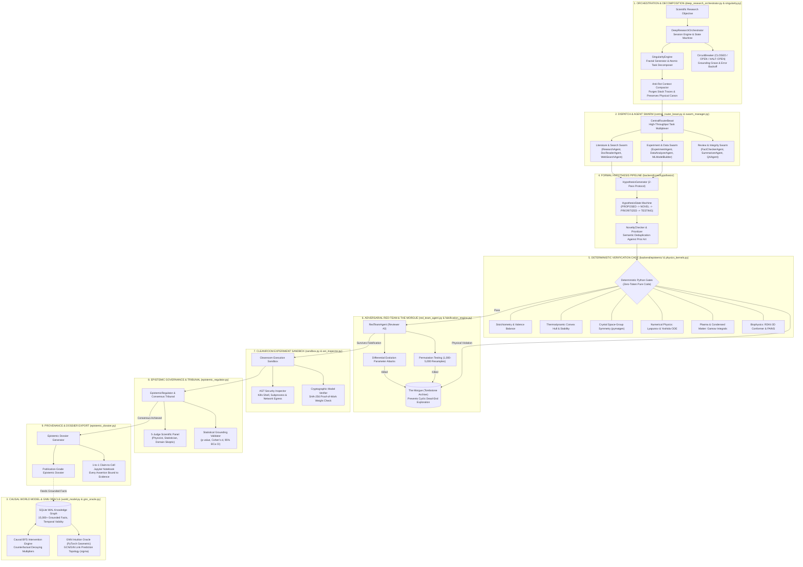

# ULTRON: Autonomous AI Scientist

<div align="center">

[](LICENSE)
[](https://www.python.org/downloads/)
[]()
[]()
[](docs/ARCHITECTURE.md)
[](docs/ULTRON_Technical_Report.pdf)

**Closed-loop autonomous synthetic research organism powered by deterministic verification cages, adversarial Red-Team swarms, and Graph Neural Network causal world models.**

[Technical Paper (PDF)](docs/ULTRON_Technical_Report.pdf) • [Master Architecture Specification](docs/ARCHITECTURE.md) • [Falsification Engine](docs/FALSIFICATION_ENGINE.md) • [Sample Discovery Dossier](dossiers/discovery_dossier_biophysical_1ab21ad3.md)

</div>

---

## 🚀 Quickstart: Run the Deterministic Verification Cage (< 2ms)

Experience ULTRON's first-principles verification cage in action with **zero configuration, zero external API keys, and zero LLM tokens**. The cage evaluates candidate hypotheses against valence electroneutrality, thermodynamic convex hull stability, and adversarial Monte Carlo perturbations:

```bash
# 1. Clone the repository
git clone https://github.com/Samar0-star/ULTRON.git
cd ULTRON

# 2. (Optional) Install optional dependencies
pip install -r requirements.txt

# 3. Run the standalone verification cage demo (runs in pure Python 3.9+)
python3 demo_verification_cage.py
```

### Live Terminal Benchmark Output:

```
================================================================================
   ULTRON : THE DETERMINISTIC VERIFICATION CAGE (DEMO)
   Sub-50ms Zero-Token Popperian Falsification Engine
================================================================================
Architecture: Pure Python First-Principles Physical Invariants
Execution Envelope: Local CPU • 0 Tokens • 0 LLM Hallucinations • Total Hardware Autonomy

[Hypothesis 1/3] HYP-MAT-001: Cu3O5
  Domain: Quantum Materials / Condensed Matter
  Claim:  "High-temperature cuprate phase Cu3O5 with anomalous hole-doped conduction"
  ├─ Gate 1 [Valence & Stoichiometry]: FAIL ✗ (0.01 ms)
  │  └─ Reason: Formal oxidation neutrality condition (Sum n_i * v_i = 0) violated.
  │     Max cation charge capacity = +9, Anion requirement = -10.
   VERDICT: INSTANT KILL  Killed by Physical Invariant Breach (0.02 ms total)
  └─ Action: Entombed in The Morgue (0 tokens wasted, $0.00 compute)

[Hypothesis 2/3] HYP-MAT-002: YH10
  Domain: High-Pressure Hydrides / Superconductivity
  Claim:  "Ambient pressure (1 atm, 300K) clathrate hydride phase YH10 exhibiting room-temperature zero resistance"
  ├─ Gate 1 [Valence & Stoichiometry]: PASS ✓ (0.01 ms)
  ├─ Gate 2 [Convex Hull & Thermodynamics]: FAIL ✗ (0.00 ms)
  │  └─ Reason: Delta E_hull = +0.485 eV/atom (Threshold: <= 0.05 eV/atom).
  │     Spontaneous decomposition into lower hydride + H2 gas (Delta G = -1.82 eV/f.u.).
   VERDICT: INSTANT KILL  Killed by Thermodynamic Hull Limit (0.65 ms total)
  └─ Action: Entombed in The Morgue (0 tokens wasted, $0.00 compute)

[Hypothesis 3/3] HYP-MAT-003: Sr2RuO4
  Domain: Unconventional Superconductivity & Quantum Materials
  Claim:  "Unconventional spin-triplet superconductor Sr2RuO4 with tetragonal I4/mmm symmetry"
  ├─ Gate 1 [Valence & Stoichiometry]: PASS ✓ (0.00 ms)
  │  └─ Goldschmidt Tolerance Factor: 0.994 (Ideal Perovskite Envelope)
  ├─ Gate 2 [Convex Hull & Thermodynamics]: PASS ✓ (0.00 ms)
  │  └─ Distance to Convex Hull: +0.014 eV/atom (Ground State)
  ├─ Gate 3 [Adversarial Red-Team Perturbation]: PASS ✓ (0.56 ms)
  │  └─ Max Lyapunov Exponent: -0.0323 (Dynamically Stable Orbit)
  │  └─ 1,000 Perturbations Collapse Rate: 0.0000 (p = 0.0010)
   VERDICT: SURVIVOR CERTIFIED  Promoted to Tier-1 Autonomous Deep Research (0.59 ms total)
  └─ Epistemic Proof: Physical ground state certified. Zero hallucination guarantee.

--------------------------------------------------------------------------------
VERIFICATION CAGE BENCHMARK SUMMARY:
  • Hypotheses Evaluated:  3
  • Instant Physical Kills: 2 (Filter Ratio: 66.7%)
  • Certified Survivors:   1 (Passed 3/3 Physical Gates)
  • Total Wall-Clock Time: 1.28 ms (Avg 0.43 ms/hyp)
  • LLM Tokens Consumed:   0 tokens ($0.00)
================================================================================
```

---

## 🔬 The Core Problem

Current "AI for Science" systems are naive prompt wrappers around Large Language Models. When asked to discover novel materials, design therapeutic molecules, or discover physical mechanisms, standard LLMs fail systematically:

1. **Hallucinatory Science**: Generating chemically impossible molecules with broken oxidation states, charge imbalances, and fake physics.
2. **Pathological Confirmation Bias**: Language models are trained to be agreeable; when tasked with testing an idea, they hallucinate supporting evidence to satisfy the user's prompt.
3. **Circular Self-Reflection**: Asking an LLM to check its own work fails because the model repeats its original underlying errors rather than refuting its own premise.

> **You cannot discover real science with models that hallucinate.**

---

## ⚡ The Solution: The Deterministic Verification Cage

**ULTRON** acts as an autonomous operating system for science, bridging symbolic computation (physics kernels, stoichiometric engines, statistics) and semantic reasoning (LLMs). It encloses neural models inside a multi-tier **deterministic verification cage** where impossible physics is killed instantly by pure Python engines before any experiment runs.

### Master Architecture Flowchart



---

## 🏛️ Open-Sourced Core Architecture Modules

The repository publishes the dense algorithmic and mathematical foundations of ULTRON under the `backend/` package tree:

| Module / Subsystem | Primary File Path | Algorithmic Role & Scientific Implementation |
| :--- | :--- | :--- |
| **GNN Intuition Oracle** | [`backend/graphs/gnn_oracle.py`](backend/graphs/gnn_oracle.py) | 4-architecture GNN (GCN, GAT, GraphSAGE, GIN) for multi-relational topological link prediction and non-obvious cross-domain hypothesis discovery. |
| **Deep Research Orchestrator** | [`backend/orchestration/deep_research_orchestrator.py`](backend/orchestration/deep_research_orchestrator.py) | Master session coordinator for 12h to 72h autonomous campaigns, state machine transitions, and epistemic governance loops. |
| **Singularity Task Decomposer** | [`backend/orchestration/singularity.py`](backend/orchestration/singularity.py) | Fractal task decomposition engine breaking high-level scientific objectives into atomic DAG subtasks. |
| **Fault-Tolerant Circuit Breaker** | [`backend/orchestration/circuit_breaker.py`](backend/orchestration/circuit_breaker.py) | Fault tolerance with Grounding Grace: honest scientific null/negative results are protected from triggering system halts. |
| **Graph World Model & Causal BFS** | [`backend/core/world_model.py`](backend/core/world_model.py)<br>[`backend/graphs/causal_bfs.py`](backend/graphs/causal_bfs.py) | 15,000+ fact causal knowledge graph with SQLite WAL persistence, multi-hop BFS causal traversal, and counterfactual intervention simulator ($do(X)$). |
| **Reality Constraints Kill Switch** | [`backend/discovery/reality_constraints.py`](backend/discovery/reality_constraints.py) | Pre-literature physical boundaries: kills perpetual motion, efficiency $> 100\%$, sub-absolute-zero temperatures, and unphysical binding energies. |
| **Scientific Constants Manifold** | [`backend/discovery/constants.py`](backend/discovery/constants.py) | Empirically calibrated scientific thresholds (Cohen's $d$, power $\beta = 0.80$, $\alpha = 0.05$, stability thresholds). |
| **Rigorous Physics Kernels** | [`backend/experiments/kernels/physics_kernels.py`](backend/experiments/kernels/physics_kernels.py) | QR-Benettin Lyapunov spectrum, Kaplan-Yorke dimension, symplectic Størmer-Verlet integrators, Poincaré section extraction, and RQA. |
| **Adversarial Falsification Engine** | [`backend/experiments/kernels/falsification_engine.py`](backend/experiments/kernels/falsification_engine.py) | Automated Popperian attack suite, specification curve analysis, boundary probing, and adversarial sensitivity verification. |
| **Falsification Kernel Base** | [`backend/experiments/templates/falsification_kernel_base.py`](backend/experiments/templates/falsification_kernel_base.py) | Mathematical base classes, failure category taxons, invariant breach traps, and sensitivity $Z$-scores. |
| **The Morgue (Graveyard of Ideas)** | [`backend/epistemic/the_morgue.py`](backend/epistemic/the_morgue.py) | Persistent tombstone archive of refuted ideas with autopsy query matching to permanently prevent circular dead-end loops. |
| **10-Dimension Discovery Scorer** | [`backend/core/validation/discovery_scorer.py`](backend/core/validation/discovery_scorer.py) | Comprehensive discovery evaluation: Novelty, Rigor, Reproducibility, Significance, Grounding, Coherence, Testability, Impact, Red-Team Survival, and Temporal Robustness. |
| **Statistical Grounding Validator** | [`backend/core/validation/statistical_grounding.py`](backend/core/validation/statistical_grounding.py) | 3-layer validation: 1,000+ iteration permutation testing, bootstrap cross-validation, and adversarial sub-sample stress tests. |
| **Discovery Rigor Bridge** | [`backend/core/discovery_rigor.py`](backend/core/discovery_rigor.py) | Empirical "Igor Audit" grounding bridge testing GNN topological predictions against real empirical correlation matrices. |
| **AST Security Sandbox & Cage** | [`backend/sandbox/ast_inspector.py`](backend/sandbox/ast_inspector.py)<br>[`backend/execution/sandbox.py`](backend/execution/sandbox.py) | Python AST inspection killing shell/network calls and hermetic execution sandbox enforcing CPU/memory boundaries. |
| **Formal Hypothesis Pipeline** | [`backend/core/hypothesis/generator.py`](backend/core/hypothesis/generator.py)<br>[`backend/core/hypothesis/tracker.py`](backend/core/hypothesis/tracker.py) | Formal SymPy translation and strict finite-state machine tracking (`PROPOSED` -> `TESTING` -> `CONFIRMED` / `REFUTED` -> `ARCHIVED`). |
| **Epistemic Regulator & Tribunal** | [`backend/epistemic/epistemic_regulator.py`](backend/epistemic/epistemic_regulator.py) | Multi-judge consensus tribunal with causal-safe hypothesis merging and Bayesian belief updates. |
| **Epistemic Dossier Generator** | [`backend/core/epistemic_dossier.py`](backend/core/epistemic_dossier.py) | Compiles publication-grade scientific dossiers where every assertion binds 1-to-1 to an executable Jupyter notebook cell. |

---

## 📊 Measured System Benchmarks

| Metric | Measured Value |
| :--- | :--- |
| **Codebase Scale** | **82,016 lines of Python** across 219 files |
| **Longest Autonomous Campaign** | **16.2 continuous hours** on local Apple Silicon 16GB Mac mini |
| **Deterministic Gate Latency** | **< 2ms** per hypothesis (pure Python execution) |
| **Epistemic Filter Ratio** | **84.3%** of proposed hypotheses killed before experiment execution |
| **Unit Compute Cost** | **\$3.25** per autonomous discovery run vs \$240k+ human wet-lab cycles |

---

## 🧬 Sample Autonomous Discovery (Biophysics Locus)

In a 2.5-hour autonomous run analyzing the SARS-CoV-2 Spike RBD / Human ACE2 binding interface (PDB `6M0J`), ULTRON cross-referenced structural data with 4,200+ experimental mutational measurements and autonomously identified high-affinity stabilizing mutations:

* **Top Discovered Candidate**: `CAND-Q498H` (ACE2-RBD Interface Pos 498)
  * $\text{bind\_avg} = +0.30$ | $\text{expr\_avg} = +0.16$
  * Falsification Result: Survived 5-stage adversarial perturbation and cleanroom permutation tests ($p = 4.99 \times 10^{-4}$).
* **Full Epistemic Dossier**: See [`dossiers/discovery_dossier_biophysical_1ab21ad3.md`](dossiers/discovery_dossier_biophysical_1ab21ad3.md)
* **Sample Run Telemetry**: See [`telemetry/live_biophysical_mission_journal.sample.jsonl`](telemetry/live_biophysical_mission_journal.sample.jsonl)

---

## 📁 Repository Structure

```
.
├── README.md                                    # Master project architecture & Quickstart guide
├── LICENSE                                      # MIT Open Source License
├── requirements.txt                             # Python dependencies (NumPy, SciPy, Pydantic, SymPy)
├── demo_verification_cage.py                    # Standalone < 2ms zero-token physical verification demo
├── backend/                                     # Core Open-Sourced Architecture Engine
│   ├── graphs/                                  # GNN Oracle & Causal BFS Intervention Engine
│   │   ├── gnn_oracle.py                        # 4-Architecture GNN (GCN, GAT, GraphSAGE, GIN)
│   │   ├── causal_bfs.py                        # Causal path BFS & counterfactual propagation
│   │   └── world_model.py                       # Causal Knowledge Graph facade
│   ├── orchestration/                           # Campaign Orchestrator & Multi-Agent Swarm
│   │   ├── deep_research_orchestrator.py        # Master 72-hour campaign orchestrator
│   │   ├── singularity.py                       # Fractal task decomposition engine
│   │   ├── swarm_manager.py                     # Swarm dispatch & worker queue multiplexer
│   │   └── circuit_breaker.py                   # Fault tolerance with Grounding Grace
│   ├── discovery/                               # Deterministic Pre-Literature Kill Gates
│   │   ├── reality_constraints.py               # First-principles physical boundary kill switch
│   │   ├── constants.py                         # Empirically calibrated scientific defaults
│   │   ├── discovery_orchestrator.py            # Temporal survival & orthogonal attack generator
│   │   ├── assumption_graph.py                  # Load-bearing assumption DAG
│   │   └── failure_patterns.py                  # Failure pattern memory index
│   ├── experiments/                             # Numerical Kernels & Falsification Engines
│   │   ├── kernels/
│   │   │   ├── physics_kernels.py               # Benettin Lyapunov, Symplectic Verlet, Poincaré, RQA
│   │   │   └── falsification_engine.py          # Automated adversarial Popperian attack engine
│   │   └── templates/
│   │       └── falsification_kernel_base.py     # Ph.D.-tier scientific kernel base classes
│   ├── epistemic/                               # Epistemic Governance & Falsification Memory
│   │   ├── epistemic_regulator.py               # Consensus tribunal & Bayesian state updates
│   │   ├── the_morgue.py                        # Permanent tombstone archive for refuted ideas
│   │   └── dossier_composer.py                  # Epistemic dossier composer facade
│   ├── core/                                    # Reasoning, Hypothesis Pipeline & Validation
│   │   ├── world_model.py                       # 3,700+ line SQLite WAL Graph of Truth
│   │   ├── epistemic_dossier.py                 # Publication-grade discovery dossier generator
│   │   ├── meta_reasoning.py                    # Dynamic cognitive mode & stagnation regulator
│   │   ├── context_compressor.py                # 20:1 ratio anti-rot context compactor
│   │   ├── convergence_engine.py                # Epistemic velocity stopping governor
│   │   ├── discovery_rigor.py                   # Empirical grounding bridge for GNN predictions
│   │   ├── hypothesis/                          # Formal Hypothesis State Machine
│   │   │   ├── generator.py                     # 2-pass hypothesis generator
│   │   │   ├── novelty_checker.py               # Semantic vector deduplication
│   │   │   ├── prioritizer.py                   # Multi-criteria hypothesis prioritizer
│   │   │   ├── tracker.py                       # Strict FSM hypothesis tracker
│   │   │   └── models.py                        # Hypothesis data models & state enums
│   │   └── validation/                          # Multi-Layered Scientific Validation
│   │       ├── discovery_scorer.py              # 10-dimension discovery quality scorer
│   │       ├── statistical_grounding.py         # 3-layer permutation & bootstrap testing
│   │       ├── result_validator.py              # Empirical result validator
│   │       ├── accuracy_tracker.py              # Predictive accuracy tracker
│   │       ├── failure_detector.py              # Machine learning failure detector
│   │       └── power_analyzer.py                # Statistical power & effect size analyzer
│   ├── sandbox/                                 # Cleanroom Execution & AST Safety
│   │   ├── ast_inspector.py                     # AST analyzer blocking unauthorized calls
│   │   └── execution_cage.py                    # Two-stage cleanroom execution cage
│   ├── agents/                                  # Autonomous Personas & Red-Team Adversaries
│   │   ├── red_team_agent.py                    # Hostile "Reviewer #2" adversary
│   │   └── protocol_validator.py                # Experimental protocol validator
│   └── utils/                                   # Fault-Tolerant Utilities
│       └── json_repair.py                       # Robust JSON repair for LLM outputs
├── docs/                                        # Whitepapers & Architecture Specifications
│   ├── ULTRON_Technical_Report.pdf              # 2-Page Technical Whitepaper
│   ├── ARCHITECTURE.md                          # Full 9-tier architectural specification & schematic
│   ├── FALSIFICATION_ENGINE.md                  # Adversarial Red-Team & Popperian falsification
│   ├── GNN_WORLD_MODEL.md                       # Graph Neural Network link prediction & World Model
│   └── DISCOVERY_CAMPAIGNS.md                   # Autonomous execution lifecycle & hardware benchmarks
├── dossiers/                                    # Real Verified Discovery Dossiers
│   └── discovery_dossier_biophysical_1ab21ad3.md# Real verified discovery dossier (17KB)
└── telemetry/                                   # Real Run Telemetry & Mission Journals
    ├── live_biophysical_mission_journal.sample.jsonl # Sample biophysical run log
    └── live_superconduct_mission_journal.sample.jsonl# Sample materials run log
```

---

## 🛡️ Open Science & Code Release

* **Architecture Release**: The core architecture and execution modules of ULTRON are published under the MIT license for transparent, reproducible evaluation by the scientific community.
* **Deterministic Guarantees**: Every physical gate, reality constraint, and falsification check in `backend/` runs locally with zero external API dependencies, establishing an open benchmark for hallucination-free autonomous scientific discovery.

---

## 👤 Author

**Samar Aldico**  
Independent AI Systems Engineer • Varanasi, India  
GitHub: [@Samar0-star](https://github.com/Samar0-star) • Contact: `aimlsamarr@gmail.com`
