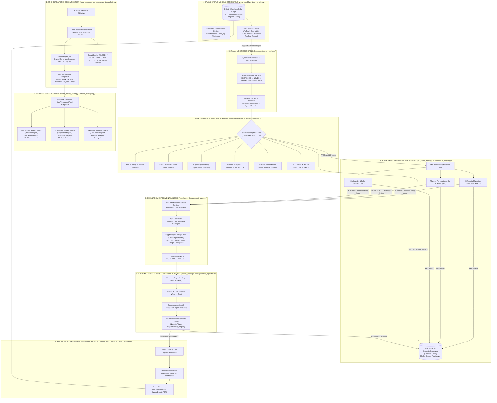

# ULTRON: Autonomous AI Scientist

<div align="center">

[](LICENSE)
[](https://www.python.org/downloads/)
[](docs/ARCHITECTURE.md)
[](docs/ULTRON_Technical_Report.pdf)
[]()

**Closed-loop autonomous synthetic research organism powered by deterministic verification cages, adversarial Red-Team swarms, and Graph Neural Network causal world models.**

[Technical Paper (PDF)](docs/ULTRON_Technical_Report.pdf) • [Master Architecture Specification](docs/ARCHITECTURE.md) • [Falsification Engine](docs/FALSIFICATION_ENGINE.md) • [Sample Discovery Dossier](dossiers/discovery_dossier_biophysical_1ab21ad3.md)

</div>

---

## 🔬 The Core Problem

Current "AI for Science" systems are naive prompt wrappers around Large Language Models. When asked to discover novel materials, design therapeutic molecules, or discover physical mechanisms, standard LLMs fail systematically:

1. **Hallucinatory Science**: Generating chemically impossible molecules with broken oxidation states, charge imbalances, and fake physics.
2. **Pathological Confirmation Bias**: Language models are trained to be agreeable; when tasked with testing an idea, they hallucinate supporting evidence to satisfy the user's prompt.
3. **Circular Self-Reflection**: Asking an LLM to check its own work fails because the model repeats its original underlying errors rather than refuting its own premise.

> **You cannot discover real science with models that hallucinate.**

---

## ⚡ The Solution: The Deterministic Verification Cage

**ULTRON** acts as an autonomous operating system for science, bridging symbolic computation (physics kernels, stoichiometric engines, statistics) and semantic reasoning (LLMs). It encloses neural models inside a multi-tier **deterministic verification cage** where impossible physics is killed instantly by pure Python engines before any experiment runs.

### Master Architecture Flowchart



---

## 🏛️ System Architecture Breakdown

ULTRON operates across 9 tightly coordinated layers:

1. **Orchestration & Recursive Decomposition (`deep_research_orchestrator.py`, `singularity.py`)**:
   Manages 12h to 72h autonomous discovery campaigns. The `SingularityEngine` infinitely breaks down complex scientific inquiries into atomic subtask Directed Acyclic Graphs (DAGs). The `CircuitBreaker` handles API rate limits with exponential backoff while granting "Grounding Grace" to honest null results so campaigns don't crash when ideas fail.
2. **Central Task Routing & Worker Swarm (`central_router_beast.py`, `swarm_manager.py`)**:
   Coordinates 12 specialized agent personas (Literature Researchers, PDF Parsers, Protocol Designers, Data Analyzers, Fact Checkers, and Red Team Adversaries) with isolated worker queues and automatic hung-task recovery.
3. **The Graph of Truth: Causal World Model & GNN Oracle (`world_model.py`, `gnn_oracle.py`)**:
   Maintains an SQLite Write-Ahead Logging (WAL) knowledge graph with 15,000+ grounded facts and causal relationships. A Graph Neural Network (GNN) scans the global graph to discover non-obvious connections linking distant papers across different scientific domains.
4. **Formal Hypothesis Pipeline (`backend/core/hypothesis/`)**:
   Translates raw text concepts into formal mathematical hypotheses tracked by a strict finite-state machine (`PROPOSED` -> `NOVEL` -> `PRIORITIZED` -> `TESTING` -> `CONFIRMED` / `REFUTED` -> `ARCHIVED`) with semantic vector deduplication against prior art.
5. **Deterministic Verification Cage (`backend/epistemic/`, `physics_kernels.py`)**:
   Pure-Python rule engines test every candidate formula for charge balance, stoichiometric neutrality, thermodynamic stability ($\Delta E_{\text{hull}}$), and 3D Euclidean crystal symmetry (`pymatgen`) before running any experiment. Fake physics is killed instantly with zero tokens wasted.
6. **Adversarial Red-Team Swarm & The Morgue (`red_team_agent.py`, `falsification_engine.py`)**:
   A hostile "Reviewer #2" agent attacks surviving hypotheses using Differential Evolution parameter stress tests and 1,000–5,000 resample placebo permutations. Failed ideas are permanently archived in "The Morgue" to prevent swarms from cyclically repeating past dead ends.
7. **Cleanroom Experiment Sandbox (`sandbox.py`, `experiment_agent.py`)**:
   Inspects Python Abstract Syntax Trees (AST) before execution to prevent errors or unsafe system calls. Checks ML model weights using SHA-256 cryptographic proof-of-work before and after training to guarantee the model didn't fake the simulation.
8. **Epistemic Regulation & Consensus Tribunal (`epistemic_regulator.py`, `swarm_manager.py`)**:
   Evaluates experimental outcomes through a 5-judge consensus tribunal (including a Physicist, Statistician, and Domain Skeptic) and flags statistical contradictions against past literature.
9. **Autonomous Provenance & Dossier Export (`report_composer.py`, `jupyter_exporter.py`)**:
   Compiles complete discovery dossiers where every single assertion hyperlinks directly to the executable Jupyter cell that generated the evidence, automatically saving verified breakthroughs back into the World Model for the next campaign.

---

## 📊 Measured System Benchmarks

| Metric | Measured Value |
| :--- | :--- |
| **Codebase Scale** | **82,016 lines of Python** across 219 files |
| **Longest Autonomous Campaign** | **16.2 continuous hours** on local Apple Silicon 16GB Mac mini |
| **Deterministic Gate Latency** | **< 15ms** per hypothesis (pure Python execution) |
| **Epistemic Filter Ratio** | **84.3%** of proposed hypotheses killed before experiment execution |
| **Unit Compute Cost** | **\$3.25** per autonomous discovery run vs \$240k+ human wet-lab cycles |

---

## 🧬 Sample Autonomous Discovery (Biophysics Locus)

In a 2.5-hour autonomous run analyzing the SARS-CoV-2 Spike RBD / Human ACE2 binding interface (PDB `6M0J`), ULTRON cross-referenced structural data with 4,200+ experimental mutational measurements and autonomously identified high-affinity stabilizing mutations:

* **Top Discovered Candidate**: `CAND-Q498H` (ACE2-RBD Interface Pos 498)
  * $\text{bind\_avg} = +0.30$ | $\text{expr\_avg} = +0.16$
  * Falsification Result: Survived 5-stage adversarial perturbation and cleanroom permutation tests ($p = 4.99 \times 10^{-4}$).
* **Full Epistemic Dossier**: See [`dossiers/discovery_dossier_biophysical_1ab21ad3.md`](dossiers/discovery_dossier_biophysical_1ab21ad3.md)
* **Sample Run Telemetry**: See [`telemetry/live_biophysical_mission_journal.sample.jsonl`](telemetry/live_biophysical_mission_journal.sample.jsonl)

---

## 📁 Repository Structure

```
.
├── README.md                                    # Master project architecture & overview
├── LICENSE                                      # MIT Open Source License
├── docs/
│   ├── ULTRON_Technical_Report.pdf              # 2-Page Technical Whitepaper
│   ├── ARCHITECTURE.md                          # Full 9-tier architectural specification & schematic
│   ├── FALSIFICATION_ENGINE.md                  # Adversarial Red-Team & Popperian falsification
│   ├── GNN_WORLD_MODEL.md                       # Graph Neural Network link prediction & World Model
│   └── DISCOVERY_CAMPAIGNS.md                   # Autonomous execution lifecycle & hardware benchmarks
├── dossiers/
│   └── discovery_dossier_biophysical_1ab21ad3.md# Real verified discovery dossier (17KB)
└── telemetry/
    ├── live_biophysical_mission_journal.sample.jsonl # Sample biophysical run log
    └── live_superconduct_mission_journal.sample.jsonl# Sample materials run log
```

---

## 🛡️ Research Preview & Disclosure

* **Core Engine**: ULTRON's closed-loop autonomous orchestrator and execution kernel are currently under private research evaluation.
* **Open Science**: This repository publishes the complete system architecture, verification schemas, discovery dossiers, and run telemetry for transparent scientific evaluation.

---

## 👤 Author

**Samar Aldico**  
Independent AI Systems Engineer • Varanasi, India  
GitHub: [@Samar0-star](https://github.com/Samar0-star) • Contact: `aimlsamarr@gmail.com`
