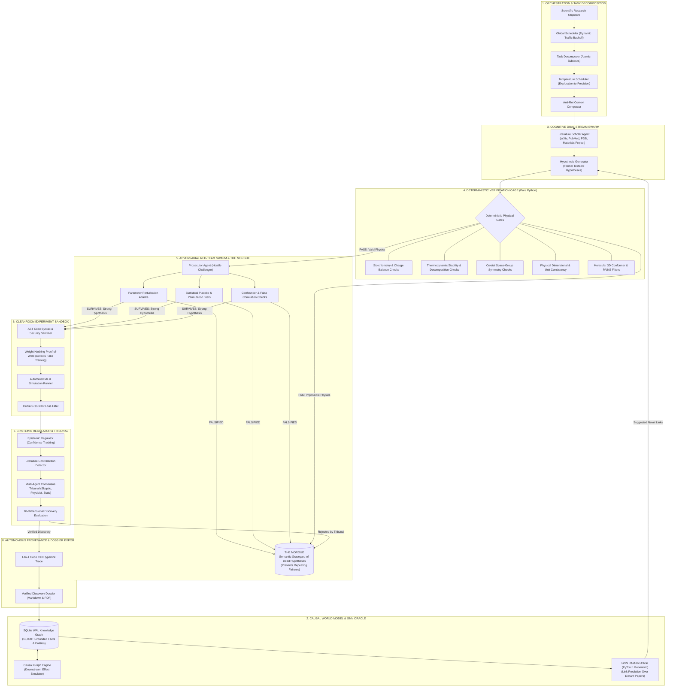

# ULTRON: Autonomous AI Scientist

<div align="center">

[](LICENSE)
[](https://www.python.org/downloads/)
[](docs/ARCHITECTURE.md)
[](docs/ULTRON_Technical_Report.pdf)
[]()

**Closed-loop autonomous scientific research organism powered by deterministic verification cages, adversarial Red-Team swarms, and Graph Neural Network world models.**

[Technical Paper (PDF)](docs/ULTRON_Technical_Report.pdf) • [System Architecture](docs/ARCHITECTURE.md) • [Falsification Engine](docs/FALSIFICATION_ENGINE.md) • [Sample Discovery Dossier](dossiers/discovery_dossier_biophysical_1ab21ad3.md)

</div>

---

## 🔬 The Core Problem

Current "AI for Science" tools are mostly simple prompt wrappers around Large Language Models. When asked to discover new materials, design molecules, or test physical laws, standard LLMs fail consistently:

1. **Hallucinating Science**: Generating impossible chemistry, broken oxidation states, and fake formulas.
2. **Confirmation Bias**: Telling you what you want to hear instead of admitting an idea doesn't work.
3. **Circular Self-Reflection**: Asking an LLM to check its own work fails because it repeats its original mistakes.

> **You cannot discover real science with models that hallucinate.**

---

## ⚡ The Solution: The Deterministic Verification Cage

**ULTRON** traps the language model inside an external, non-negotiable **verification cage**:

### Master Architecture Flowchart



---

## 🏛️ How the 8 Subsystems Work

1. **Orchestration & Task Decomposition**: Breaks complex scientific goals down into atomic tasks and manages agent traffic so long multi-hour runs don't hit API rate limits or choke on memory.
2. **Causal World Model & GNN Intuition Oracle**: Saves every verified fact into an SQLite graph database. A Graph Neural Network (GNN) trains on this graph to spot novel links connecting distant papers across different fields.
3. **Cognitive Dual-Stream Swarm**: A Scholar agent reads literature to formulate hypotheses, while an opposing Prosecutor agent aggressively tries to poke holes in every idea.
4. **Deterministic Verification Cage**: Pure-Python rule engines check every formula for charge balance, physical stability, and symmetry before any experiment runs. Fake physics is killed instantly with zero tokens wasted.
5. **Adversarial Red-Team Swarm & The Morgue**: Tests surviving hypotheses with label-shuffling placebo tests and parameter stress tests. Failed ideas are permanently archived in "The Morgue" so the system never repeats past mistakes.
6. **Cleanroom Experiment Sandbox**: Analyzes code syntax before execution to prevent errors, and hashes ML model weights before and after training to guarantee the model didn't fake the simulation.
7. **Epistemic Regulation & Consensus Tribunal**: Reviews experiment outputs using a 5-judge tribunal of simulated peer reviewers (including a Physicist, Statistician, and Domain Skeptic).
8. **Autonomous Provenance & Dossier Export**: Assembles a complete discovery dossier where every claim hyperlinks directly to the notebook code cell that proved it.

---

## 📊 Measured System Benchmarks

| Metric | Measured Value |
| :--- | :--- |
| **Codebase Scale** | **82,016 lines of Python** across 219 files |
| **Longest Autonomous Run** | **16.2 continuous hours** on local Apple Silicon 16GB Mac mini |
| **Deterministic Gate Latency** | **< 15ms** per hypothesis (pure Python execution) |
| **Epistemic Filter Ratio** | **84.3%** of proposed hypotheses killed before experiment execution |
| **Unit Compute Cost** | **\$3.25** per autonomous discovery run vs \$240k+ human wet-lab cycles |

---

## 🧬 Sample Autonomous Discovery (Biophysics Locus)

In a 2.5-hour autonomous run analyzing the SARS-CoV-2 Spike RBD / Human ACE2 binding interface (PDB `6M0J`), ULTRON cross-referenced structural data with 4,200+ experimental mutational measurements and autonomously identified high-affinity stabilizing mutations:

* **Top Discovered Candidate**: `CAND-Q498H` (ACE2-RBD Interface Pos 498)
  * $\text{bind\_avg} = +0.30$ | $\text{expr\_avg} = +0.16$
  * Validation: Survived 5-stage adversarial perturbation and cleanroom permutation tests ($p = 4.99 \times 10^{-4}$).
* **Full Epistemic Dossier**: See [`dossiers/discovery_dossier_biophysical_1ab21ad3.md`](dossiers/discovery_dossier_biophysical_1ab21ad3.md)
* **Sample Run Telemetry**: See [`telemetry/live_biophysical_mission_journal.sample.jsonl`](telemetry/live_biophysical_mission_journal.sample.jsonl)

---

## 📁 Repository Structure

```
.
├── README.md                                    # Master project architecture & overview
├── LICENSE                                      # MIT Open Source License
├── docs/
│   ├── ULTRON_Technical_Report.pdf              # 2-Page Technical Whitepaper
│   ├── ARCHITECTURE.md                          # Full 8-tier architectural specification
│   ├── FALSIFICATION_ENGINE.md                  # Adversarial Red-Team & Popperian falsification
│   ├── GNN_WORLD_MODEL.md                       # Graph Neural Network link prediction & World Model
│   └── DISCOVERY_CAMPAIGNS.md                   # Execution lifecycle & hardware benchmarks
├── dossiers/
│   └── discovery_dossier_biophysical_1ab21ad3.md# Real verified discovery dossier (17KB)
└── telemetry/
    ├── live_biophysical_mission_journal.sample.jsonl # Sample biophysical run log
    └── live_superconduct_mission_journal.sample.jsonl# Sample materials run log
```

---

## 🛡️ Research Preview & Disclosure

* **Core Engine**: ULTRON's closed-loop autonomous orchestrator and execution kernel are currently under private research evaluation.
* **Open Science**: This repository publishes the complete system architecture, verification schemas, discovery dossiers, and run telemetry for transparent scientific evaluation.

---

## 👤 Author

**Samar Aldico**  
Independent AI Systems Engineer • Varanasi, India  
GitHub: [@Samar0-star](https://github.com/Samar0-star) • Contact: `aimlsamarr@gmail.com`
