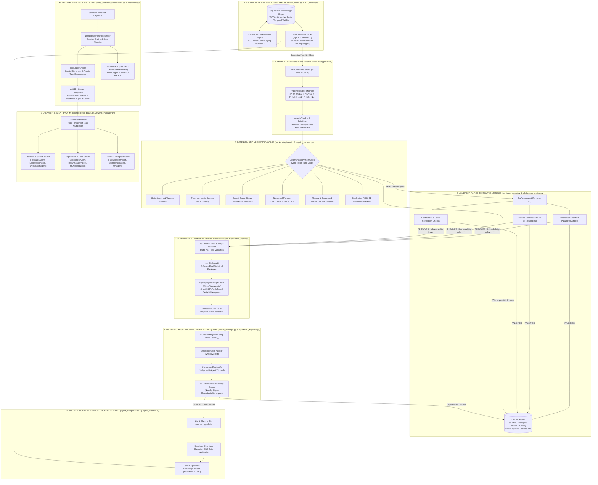

# ULTRON Master System Architecture: 9-Tier Autonomous AI Scientist

ULTRON is an 82,016-line autonomous synthetic research organism built across 219 Python files, engineered to conduct continuous 12 to 72-hour closed-loop discovery campaigns without human intervention.

Rather than acting as a standard conversational wrapper around Large Language Models, ULTRON acts as an autonomous operating system for science. It connects symbolic computation (physics kernels, stoichiometric engines, statistics) with semantic reasoning (LLMs) inside a multi-tier **deterministic verification cage**.

---

## 1. Master System Flowchart



---

## 2. Master System Schematic

```
=======================================================================================================================
                                          ULTRON COMPLETE SYSTEM SCHEMATIC
=======================================================================================================================

 [ SCIENTIFIC RESEARCH OBJECTIVE / EXPERIMENTAL BENCHMARK ]
                 │
                 ▼
 ┌───────────────────────────────────────────────────────────────────────────────────────────────────────────────────┐
 │ 1. ORCHESTRATION & RECURSIVE DECOMPOSITION (`deep_research_orchestrator.py`, `singularity.py`)                    │
 │  ├── DeepResearchOrchestrator: Manages 12h, 24h, 48h, and 72h continuous discovery sessions                      │
 │  ├── SingularityEngine: "The Fractal Generator" - infinitely decomposes macro tasks into atomic subtask DAGs      │
 │  ├── CircuitBreaker: CLOSED -> OPEN -> HALF-OPEN state machine with Grounding Grace for honest null findings       │
 │  ├── GlobalScheduler: Multiplicative decrease (70%) on rate limits, additive increase (+1) on successes          │
 │  ├── Sigmoidal Temperature Scheduler: Transitions from high creative exploration to deterministic verification    │
 │  └── Anti-Rot Context Compactor: Purges terminal noise & hydration blobs, preserving core physical canon          │
 └───────────────────────────────────┬───────────────────────────────────────────────────────────────────────────────┘
                                     │
                                     ▼
 ┌───────────────────────────────────────────────────────────────────────────────────────────────────────────────────┐
 │ 2. CENTRAL TASK ROUTING & WORKER SWARM (`central_router_beast.py`, `swarm_manager.py`)                            │
 │  ├── CentralRouterBeast: High-throughput task multiplexer managing isolated agent pools                          │
 │  ├── Literature & Discovery: ResearchAgent, DocReaderAgent (PDF extraction), WebSearchAgent (arXiv/PubMed/S2)     │
 │  ├── Execution & Analysis: ExperimentAgent (Code synth), DataAnalyzerAgent (Stats), MLModelBuilder (AutoML)       │
 │  ├── Verification & Integrity: FactCheckerAgent (Truth verification), SummarizerAgent, QAAgent, WriterAgent        │
 │  └── SwarmManager: Isolated task checkout, concurrency tracking, and automatic hung-worker scavenging            │
 └───────────────────┬───────────────────────────────────────────────────────────────────────────▲───────────────────┘
                     │ Dispatches Subtasks                                                       │ Verified Discoveries
                     ▼                                                                           │
 ┌───────────────────────────────────────────────────────────────────────────────────────┐       │
 │ 3. THE GRAPH OF TRUTH: CAUSAL WORLD MODEL & GNN ORACLE (`world_model.py`, `gnn_oracle.py`)    │       │
 │  ├── SQLite WAL Knowledge Graph: 15,000+ grounded entities, hypergraph edges, temporal facts  │       │
 │  ├── Causal BFS Intervention Engine: Propagates decaying multipliers to model systemic effects│       │
 │  ├── Graph Analytics: PageRank centrality & Label Propagation community detection             │       │
 │  └── GNN Intuition Oracle (PyTorch Geometric): GCN/GIN link prediction over distant literature│       │
 └───────────────────┬───────────────────────────────────────────────────────────────────┘       │
                     │ High-Novelty Candidate Links                                              │
                     ▼                                                                           │
 ┌───────────────────────────────────────────────────────────────────────────────────────┐       │
 │ 4. FORMAL HYPOTHESIS ENGINE (`backend/core/hypothesis/`)                              │       │
 │  ├── HypothesisGenerator: 2-Pass protocol generating mathematical functional forms    │       │
 │  ├── HypothesisState Finite State Machine: PROPOSED -> NOVEL -> PRIORITIZED -> TESTING│       │
 │  ├── NoveltyChecker: Semantic vector deduplication against prior art & literature     │       │
 │  └── Evidence Tracker: Strictly typed evidence binding with agent attribution         │       │
 └───────────────────┬───────────────────────────────────────────────────────────────────┘       │
                     │ Formal Candidate Hypotheses                                               │
                     ▼                                                                           │
 ┌───────────────────────────────────────────────────────────────────────────────────────┐       │
 │ 5. DETERMINISTIC VERIFICATION CAGE (`backend/epistemic/`, `physics_kernels.py`)       │       │
 │  ├── Stoichiometry & Valence Balance: Pure-Python checks for oxidation states         │       │
 │  ├── Thermodynamic Convex Hull: Checks decomposition energies and phase stability     │       │
 │  ├── Crystal Space-Group Symmetry (pymatgen): Ensures 3D Euclidean invariance        │       │
 │  ├── Numerical Physics: Lyapunov QR-Benettin spectrums & Yoshida 4th-order ODE solver │       │
 │  ├── Plasma Kinetics: Relativistic Bremsstrahlung & numerical Gamow peak integrals   │       │
 │  └── Biophysics & Chemistry: RDKit 3D ETKDGv3 conformers & PAINS false-positive filter│       │
 └─────────┬───────────────────────────────────────────────────────────────────┬─────────┘       │
           │ PASS (Valid Physics)                                              │ FAIL (Impossible Physics)
           ▼                                                                   ▼                 │
 ┌─────────────────────────────────────────────────────────────────┐   ┌───────────────────────┐ │
 │ 6. ADVERSARIAL RED-TEAM SWARM & THE MORGUE (`red_team_agent.py`)│   │ THE MORGUE            │ │
 │  ├── RedTeamAgent ("Reviewer #2"): Aggressive counter-theses    │   │ (Semantic Graveyard)  │ │
 │  ├── Differential Evolution: Parameter attacks to break claims  │   │ ├── ChromaDB Vectors  │ │
 │  ├── Placebo Permutation Tests: 1,000 - 5,000 label shuffles    ├──►│ ├── Graph Invariants  │ │
 │  ├── Confounder Collinearity & False Correlation Detector       │   │ └── Blocks Cyclical   │ │
 │  └── Unbreakability Index: Measures resistance to adversarial attacks│     Rediscovery       │ │
 └─────────┬───────────────────────────────────────────────────────┘   └───────────────▲───────┘ │
           │ SURVIVES (Passed Adversarial Attacks)                                     │         │
           ▼                                                                           │         │
 ┌─────────────────────────────────────────────────────────────────────────────────┐   │         │
 │ 7. CLEANROOM EXPERIMENT SANDBOX (`sandbox.py`, `experiment_agent.py`)           │   │         │
 │  ├── AST NameVisitor: Static syntax tree parsing, scope checking & call security│   │         │
 │  ├── Igor Code Audit: Enforces PhD-level statistical packages and cross-val     │   │         │
 │  ├── Cryptographic Weight PoW (UltronRigorMonitor): SHA-256 model weight hash   │   │         │
 │  ├── CorrelationChecker: Empirical validation against physical dataset matrices │   │         │
 │  └── Automated ML Builder Forge: 6-Modality CrossAttention GSTM fusion          │   │         │
 └─────────┬───────────────────────────────────────────────────────────────────────┘   │         │
           │ Experiment Results & Execution Telemetry                                  │         │
           ▼                                                                           │         │
 ┌─────────────────────────────────────────────────────────────────────────────────┐   │         │
 │ 8. EPISTEMIC REGULATION & CONSENSUS TRIBUNAL (`epistemic_regulator.py`)          │   │         │
 │  ├── Epistemic Regulator: Log-Odds belief tracking (avoids boundary distortion) │   │         │
 │  ├── Statistical Clash Auditor: Welch-Z test detecting literature contradictions├───┘ (Reject)│
 │  ├── ConsensusEngine: 5-Judge Tribunal (Statistician, Physicist, Domain Skeptic)│             │
 │  └── 10-Dimensional Discovery Scorer: Novelty, Rigor, Reproducibility, Impact   │             │
 └─────────┬───────────────────────────────────────────────────────────────────────┘             │
           │ VERIFIED DISCOVERY (p < 0.01, Cohen's d >= 0.5, Z >= 2.576)                         │
           ▼                                                                                     │
 ┌───────────────────────────────────────────────────────────────────────────────────────────────┴───┐
 │ 9. AUTONOMOUS PROVENANCE & DOSSIER EXPORT (`report_composer.py`, `jupyter_exporter.py`)           │
 │  ├── Claim-to-Cell Traceability: Every sentence hyperlinks to the verified Jupyter notebook cell  │
 │  ├── Headless Chromium Rendering: Async Playwright DOM polling guarantees full SVG/canvas painting│
 │  ├── Publication-Grade Dossier: Compiles structured Markdown, executable Notebook, and PDF reports│
 │  └── Knowledge Graph Integration: Automatically commits verified findings into the World Model    │
 └───────────────────────────────────────────────────────────────────────────────────────────────────┘
=======================================================================================================
```

---

## 3. The 9 Core Subsystems (In Plain English)

### 1. Orchestration & Recursive Decomposition
* **Module**: `backend/orchestration/deep_research_orchestrator.py`, `backend/orchestration/singularity.py`
* **How it works**: Acts as the central nervous system for campaigns running from 12 up to 72 continuous hours. The `SingularityEngine` recursively deconstructs massive, ambiguous research goals into clean, atomic subtask Directed Acyclic Graphs (DAGs). It includes a `CircuitBreaker` that manages API faults with exponential backoff while granting "Grounding Grace" to honest null findings, preventing the system from crashing when experiments refute a hypothesis.

### 2. Central Task Routing & Worker Swarm
* **Module**: `backend/central_router_beast.py`, `backend/orchestration/swarm_manager.py`
* **How it works**: Dispatches atomic tasks across 12 specialized autonomous agent personas:
  * **Literature**: `ResearchAgent`, `DocReaderAgent` (extracting tables and deep PDF text), `WebSearchAgent` (arXiv, PubMed, Semantic Scholar).
  * **Execution**: `ExperimentAgent` (synthesizing simulation protocols), `DataAnalyzerAgent` (inferential statistics), `MLModelBuilderAgent` (multimodal PyTorch pipelines).
  * **Integrity**: `FactCheckerAgent` (cross-checking data against source files), `SummarizerAgent`, `QAAgent`, `WriterAgent`.
  * **Management**: `SwarmManager` handles concurrent task checkouts, heartbeats, and worker timeouts.

### 3. The Graph of Truth: Causal World Model & GNN Oracle
* **Module**: `backend/core/world_model.py`, `backend/graphs/gnn_oracle.py`
* **How it works**: Operates as a persistent SQLite Write-Ahead Logging (WAL) knowledge graph holding 15,000+ grounded empirical facts. It performs PageRank centrality and Label Propagation community detection. A Causal BFS Intervention Engine simulates downstream counterfactual effects across variables. During the "Dream Phase", a PyTorch Geometric Graph Neural Network (GNN) scans the global graph to predict novel, hidden connections between papers in completely different scientific fields.

### 4. Formal Hypothesis Pipeline
* **Module**: `backend/core/hypothesis/` (`generator.py`, `tracker.py`, `models.py`)
* **How it works**: Replaces vague text ideas with formal mathematical functional forms. Manages a strict finite-state machine (`PROPOSED` -> `NOVEL_CHECK` -> `NOVEL` -> `PRIORITIZED` -> `TESTING` -> `CONFIRMED` / `REFUTED` -> `ARCHIVED`). A semantic `NoveltyChecker` screens candidate hypotheses against prior literature, ensuring compute is never spent on already-discovered concepts.

### 5. Deterministic Verification Cage
* **Module**: `backend/epistemic/`, `backend/tools/physics_kernels.py`, `backend/tools/fusion_plasma_kernel.py`
* **How it works**: Pure Python, zero-token mathematical verification engines that screen candidate hypotheses before any code execution:
  * **Stoichiometry & Valence**: Validates charge neutrality, oxidation states, and coordination geometries.
  * **Thermodynamics**: Checks convex hull decomposition energies ($\Delta E_{\text{hull}}$) to ensure materials don't decompose.
  * **Crystallography**: Enforces 3D Euclidean space-group symmetry via `pymatgen`.
  * **Numerical Physics**: Computes Lyapunov stability spectrums via QR-Benettin algorithms and integrates Hamiltonian systems with Yoshida 4th-order symplectic integrators.
  * **Plasma Kinetics**: Models relativistic Bremsstrahlung power loss and integrates Gamow peak $S$-factors.
  * **Biophysics & Chemistry**: Computes 3D conformers (ETKDGv3) and screens out assay-interfering PAINS molecules via RDKit.

### 6. Adversarial Red-Team Swarm & The Morgue
* **Module**: `backend/agents/red_team_agent.py`, `backend/epistemic/falsification_engine.py`
* **How it works**: Enforces Popperian falsification. A hostile `RedTeamAgent` ("Reviewer #2") attacks hypotheses using:
  * **Parameter Perturbation**: Uses Differential Evolution to find edge-case parameter values that destroy claimed effects.
  * **Placebo Tests**: Shuffles experimental labels and residuals 1,000–5,000 times; if the hypothesis matches placebo noise ($p > 0.01$), it is killed.
  * **Confounder Detection**: Tests for collinearity and spurious correlations.
  * **The Morgue**: A dual-tier vector and graph graveyard permanently storing refuted hypotheses, mathematical contradictions, and failure causes. Prevents agents from repeating dead ends.

### 7. Cleanroom Experiment Sandbox
* **Module**: `backend/execution/sandbox.py`, `backend/agents/experiment_agent.py`
* **How it works**: 
  * **AST NameVisitor**: Inspects raw Abstract Syntax Trees before execution to catch undefined variables, scope leaks, and dangerous system calls.
  * **Igor Code Audit**: Enforces PhD-grade statistical code (mandating `statsmodels`, bootstrap intervals, and cross-validation).
  * **UltronRigorMonitor**: Cryptographic Proof-of-Work that hashes PyTorch model weights ($\text{SHA-256}(\mathbf{W})$) before and after training. If weights don't diverge past a physical threshold, it proves the LLM faked the training loop and rejects the run.
  * **CorrelationChecker**: Grounds calculations in real physical data matrices.

### 8. Epistemic Regulation & Consensus Tribunal
* **Module**: `backend/core/epistemic_regulator.py`, `backend/orchestration/swarm_manager.py`
* **How it works**: 
  * **Epistemic Regulator**: Tracks belief velocity on a log-odds scale, demanding exponentially greater empirical proof as confidence approaches certainty.
  * **Statistical Clash Auditor**: Uses Welch-Z tests to catch statistical contradictions with past literature.
  * **Consensus Tribunal**: Dispatches a 5-judge panel (Statistician, Physicist, Domain Skeptic) requiring consensus approval before any finding is promoted.
  * **Discovery Scorer**: Evaluates output across 10 dimensions: Novelty, Rigor, Reproducibility, Significance, Grounding, Coherence, Testability, Impact, Adversarial Survival, and Temporal Robustness.

### 9. Autonomous Provenance & Dossier Export
* **Module**: `backend/agents/report_composer.py`, `backend/tools/jupyter_exporter.py`
* **How it works**: Assembles complete scientific deliverables without human editing:
  * **Claim-to-Cell Linking**: Every assertion in the text hyperlinks directly to the executable Jupyter notebook cell that generated the evidence.
  * **Headless Chromium Rendering**: Uses async Playwright to poll the DOM, guaranteeing all SVG canvas diagrams and charts paint cleanly before exporting publication-grade PDFs.
  * **Continuous Knowledge Ingestion**: Automatically writes verified discoveries back into the SQLite World Model, allowing subsequent discovery campaigns to build upon prior breakthroughs.
