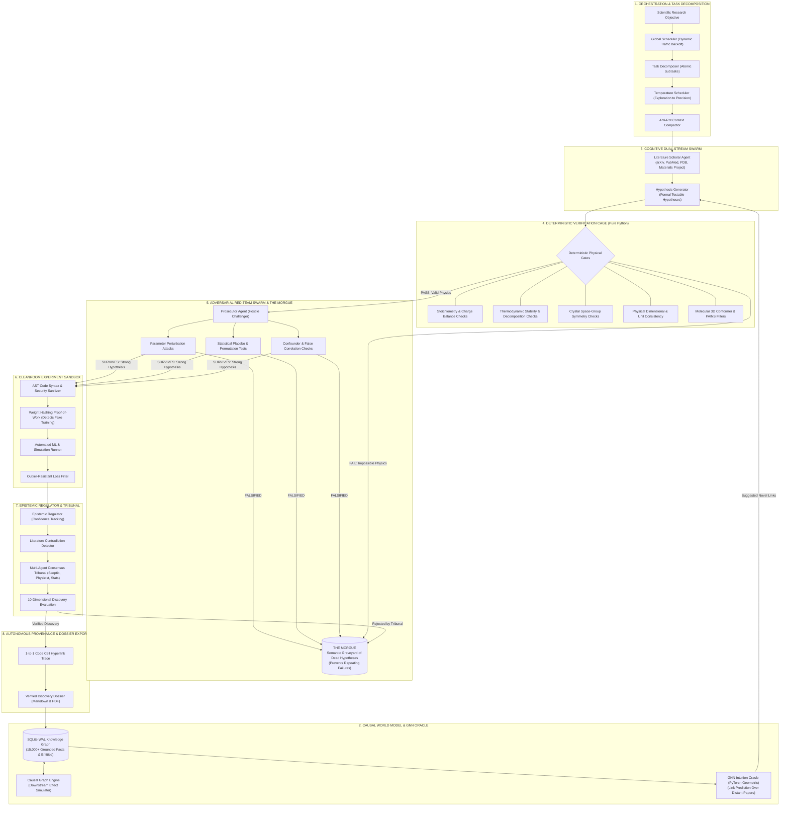

# ULTRON System Architecture: 8-Tier Autonomous AI Scientist

ULTRON is an 82,000-line autonomous AI scientist system built across 219 Python files, engineered to run continuous 12 to 24-hour closed-loop discovery campaigns without human intervention.

Rather than acting as a standard conversational wrapper around Large Language Models, ULTRON encloses neural models inside a multi-tier **deterministic verification cage** where hypotheses are proposed, checked against hard physics and math rules, attacked by adversarial red-team agents, and grounded in a persistent graph memory.

---

## 1. Master System Flowchart



---

## 2. System Architecture Schematic

```
========================================================================================================
                                      ULTRON ARCHITECTURAL SCHEMATIC
========================================================================================================

 [ SCIENTIFIC RESEARCH OBJECTIVE ]
                 │
                 ▼
 ┌────────────────────────────────────────────────────────────────────────────────────────────────────┐
 │ 1. ORCHESTRATION & TASK DECOMPOSITION                                                              │
 │  ├── Global Scheduler: Manages API limits with automatic traffic backoff to prevent timeouts       │
 │  ├── Task Decomposer: Splits big research questions into small atomic subtasks                     │
 │  ├── Temperature Scheduler: Starts with high creative exploration, cools to precise execution      │
 │  └── Anti-Rot Context Compactor: Purges terminal noise and error logs, keeping memory sharp       │
 └───────────────────────────────────┬────────────────────────────────────────────────────────────────┘
                                     │
                                     ▼
 ┌────────────────────────────────────────────────────────────────────────────────────────────────────┐
 │ 2. CAUSAL WORLD MODEL & GNN INTUITION ORACLE                                                       │
 │  ├── SQLite WAL Knowledge Graph: Stores 15,000+ grounded facts, paper citations, and molecules      │
 │  ├── Causal Engine: Tracks cause-and-effect relationships between variables                        │
 │  └── GNN Intuition Oracle: Neural network trained on the graph to link distant, disconnected papers│
 └───────────────────┬────────────────────────────────────────────────────────────▲───────────────────┘
                     │ High-Novelty Candidate Links                               │ Verified Discoveries
                     ▼                                                            │
 ┌────────────────────────────────────────────────────────────────────────┐       │
 │ 3. COGNITIVE DUAL-STREAM SWARM                                         │       │
 │  ├── Literature Scholar Agent: Reads papers from arXiv, PubMed, PDB    │       │
 │  └── Hypothesis Generator: Formulates testable, formal hypotheses      │       │
 └───────────────────┬────────────────────────────────────────────────────┘       │
                     │ Candidate Hypotheses                                       │
                     ▼                                                            │
 ┌────────────────────────────────────────────────────────────────────────┐       │
 │ 4. DETERMINISTIC VERIFICATION CAGE (Pure Python, Zero LLM)             │       │
 │  ├── Stoichiometry & Valence Balance: Kills impossible chemical bonds  │       │
 │  ├── Thermodynamic Stability: Checks if materials decompose into rust  │       │
 │  ├── Space-Group Symmetry: Ensures 3D crystals obey Euclidean geometry │       │
 │  ├── Physical Units Checker: Enforces dimensional consistency          │       │
 │  └── Molecular Structure Filters: Eliminates false-positive assay data │       │
 └─────────┬────────────────────────────────────────────────────┬─────────┘       │
           │ PASS (Valid Physics)                               │ FAIL (Fake Physics)
           ▼                                                    ▼                 │
 ┌──────────────────────────────────────────────────┐   ┌───────────────────────┐ │
 │ 5. ADVERSARIAL RED-TEAM SWARM & THE MORGUE       │   │ THE MORGUE            │ │
 │  ├── Prosecutor Agent: Actively attacks the claim│   │ (Semantic Graveyard)  │ │
 │  ├── Parameter Stress Tests: Finds edge-case bugs│   │ ├── Stored in vector  │ │
 │  ├── Placebo Permutations: Tests vs random data  ├──►│ │   and graph memory  │ │
 │  └── Confounder Checks: Catches fake correlations│   │ └── Stops system from │ │
 └─────────┬────────────────────────────────────────┘   │     repeating failures│ │
           │ SURVIVES (Passed All Attacks)              └───────────────▲───────┘ │
           ▼                                                            │         │
 ┌──────────────────────────────────────────────────────────────────┐   │         │
 │ 6. CLEANROOM EXPERIMENT SANDBOX                                  │   │         │
 │  ├── AST Code Sanitizer: Analyzes code structure before running  │   │         │
 │  ├── Weight Hashing Proof-of-Work: Catches faked training loops  │   │         │
 │  ├── Automated ML & Simulation: Runs real Python experiment code │   │         │
 │  └── Outlier-Resistant Loss: Drops bad data points automatically │   │         │
 └─────────┬────────────────────────────────────────────────────────┘   │         │
           │ Real Experiment Results & Telemetry                        │         │
           ▼                                                            │         │
 ┌──────────────────────────────────────────────────────────────────┐   │         │
 │ 7. EPISTEMIC REGULATION & CONSENSUS TRIBUNAL                     │   │         │
 │  ├── Confidence Tracker: Demands more evidence as certainty rises│   │         │
 │  ├── Contradiction Detector: Catches conflicts with past papers  ├───┘ (Reject)│
 │  ├── 5-Judge Tribunal: Consensus vote by specialized reviewers   │             │
 │  └── 10-Dimensional Scorer: Grades novelty, rigor, and impact    │             │
 └─────────┬────────────────────────────────────────────────────────┘             │
           │ VERIFIED DISCOVERY                                                   │
           ▼                                                                      │
 ┌────────────────────────────────────────────────────────────────────────────────┴───────────────────┐
 │ 8. AUTONOMOUS PROVENANCE & DISCOVERY DOSSIER EXPORT                                                │
 │  ├── Code-to-Claim Traceability: Every conclusion hyperlinks directly to the notebook code cell   │
 │  ├── Full Automated Dossier: Compiles clean Markdown, Jupyter notebook, and PDF reports           │
 │  └── Persistent Commit: Saves new verified facts back into the World Model for the next campaign   │
 └────────────────────────────────────────────────────────────────────────────────────────────────────┘
========================================================================================================
```

---

## 3. How the 8 Subsystems Work (In Plain English)

### 1. Orchestration & Task Decomposition
Takes a large, open-ended scientific problem (e.g., *"Find stabilizing mutations at the viral spike interface"*) and breaks it down into small, atomic subtasks. A global scheduler manages worker agents, automatically backing off traffic if API rate limits hit, and smoothly transitions from creative brainstorming at the start to strict precision during experiment runs.

### 2. Causal World Model & GNN Intuition Oracle
All facts, paper summaries, chemical formulas, and test results are stored in an SQLite graph database. A Graph Neural Network (GNN) continuously learns from this knowledge graph to spot non-obvious connections between papers in completely different fields. This allows ULTRON to propose hypotheses that humans wouldn't think to connect.

### 3. Cognitive Dual-Stream Swarm
Two opposing agent streams work in parallel:
* **The Scholar**: Gathers literature, extracts real experimental data, and writes formal hypotheses.
* **The Prosecutor (Red Team)**: A hostile adversarial agent whose sole job is to prove the Scholar's hypothesis wrong.

### 4. Deterministic Verification Cage
Before any experiment code is generated, the candidate hypothesis must pass through hardcoded Python math and physics checks. If a formula violates charge balance, proposes an unstable crystal structure, or breaks conservation laws, it is killed instantly. Zero tokens and zero compute are wasted on impossible science.

### 5. Adversarial Red-Team Swarm & The Morgue
Hypotheses that pass basic physics are aggressively stress-tested:
* **Perturbation attacks**: Tests whether small changes in parameters break the entire result.
* **Placebo tests**: Shuffles dataset labels 1,000+ times to make sure the result isn't just random luck.
* **The Morgue**: Any idea that fails is permanently logged into a semantic graveyard so the system never wastes time re-testing dead ends in future cycles.

### 6. Cleanroom Experiment Sandbox
When simulation or machine learning code is written:
* **AST Security Check**: Inspects the code syntax tree to prevent system errors or memory leaks before execution.
* **Weight Hashing Proof-of-Work**: Checks the internal weights of ML models before and after training. If the weights didn't change, the model faked the training loop, and the run is rejected.
* **Outlier Filtering**: Drops corrupt data points so noise doesn't ruin the experiment.

### 7. Epistemic Regulation & Consensus Tribunal
Evaluates the final experimental results through a 5-judge panel of simulated peer reviewers (including a Statistician, Physicist, and Domain Skeptic). Contradictions with established literature are flagged immediately, and the hypothesis must win a consensus vote to pass.

### 8. Provenance & Discovery Dossier Export
Once a hypothesis survives the entire gauntlet, ULTRON automatically compiles a complete Epistemic Discovery Dossier. Every claim is linked directly to the exact Jupyter notebook code cell that proved it, accompanied by full execution logs and verifiable data files.
