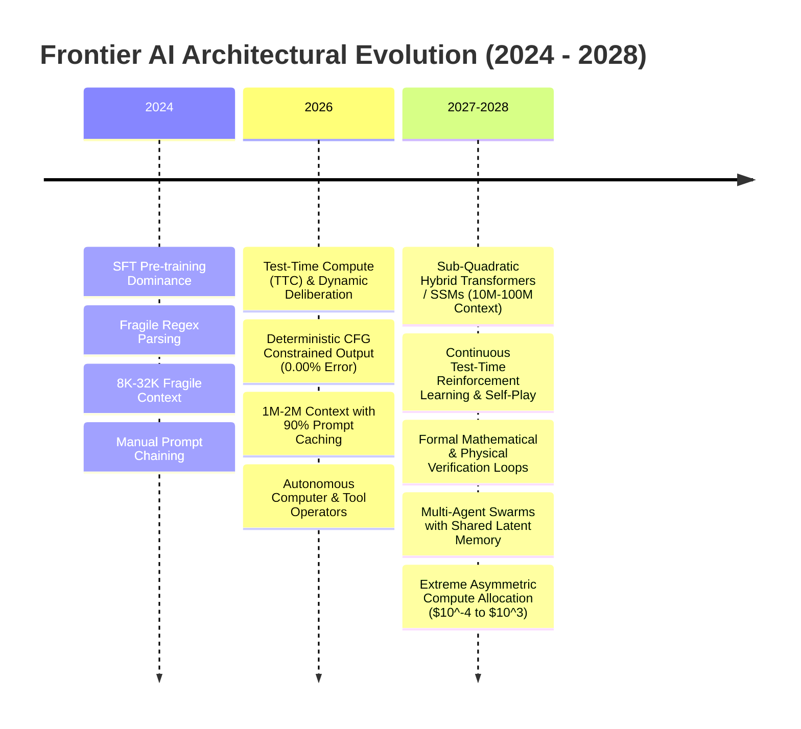

# Frontier LLM Capabilities & Benchmark Analysis (September 2026)

**Document ID:** SVEL-RES-09  
**Author:** AI Systems Research & Technology Analysis Division  
**Status:** Comprehensive Technical Benchmark & Architectural Report  
**Target Architecture:** SVEL AI Scientist Modernization & Autonomous Agent Engine  
**Date:** September 21, 2026  
**Reference Companion Documents:**  
- [01_frontier_llm_capabilities.md](file:///Users/samaraldico/SVEL%20AI%20Scientist/research/01_frontier_llm_capabilities.md)  
- [02_multiagent_architectures.md](file:///Users/samaraldico/SVEL%20AI%20Scientist/research/02_multiagent_architectures.md)  
- [03_futureproof_architecture.md](file:///Users/samaraldico/SVEL%20AI%20Scientist/research/03_futureproof_architecture.md)  
- [04_scientific_discovery_ai.md](file:///Users/samaraldico/SVEL%20AI%20Scientist/research/04_scientific_discovery_ai.md)  

---

## Executive Summary

The frontier AI landscape of September 2026 has witnessed the formal arrival of next-generation foundation models that fundamentally reshape how autonomous AI agents must be engineered. With the commercial deployment of **OpenAI's GPT-6 Astra** (September 3–4, 2026) and **Anthropic's Claude Fable 5.1 / Claude Mythos 5.1** (September 1, 2026), alongside Google DeepMind's active pre-training of the **Gemini 4** generation, AI system engineering has permanently decoupled from the paradigms of 2024–2025.

Key architectural shifts observed in September 2026 include:
1. **The Computer Operator Transition:** Models have transitioned from conversational chat completion engines into autonomous computer operators natively capable of inspecting GUIs, navigating operating systems, issuing terminal commands, and coordinating multi-application workflows.
2. **Deterministic Constrained Generation:** Grammar-constrained decoding (Context-Free Grammar / CFG logit masking via token tries) has turned JSON schema compliance into a mathematical guarantee (0.00% syntax error rate), making regex parsing and schema-retry loops obsolete.
3. **Internal Test-Time Compute (TTC):** Adaptive, always-on extended thinking (128k output/thinking token allocations) enables models to solve multi-hour coding, theorem proving, and scientific planning challenges within a single forward API turn, eliminating naive multi-prompt CoT decomposition chains.
4. **Bifurcated Governance & Frontier Cybersecurity:** For the first time, frontier models have crossed OpenAI's "Critical" cybersecurity preparedness threshold and demonstrated autonomous zero-day discovery and exploit generation, forcing providers into dual-release governance models (Anthropic's **Project Glasswing** separating public **Claude Fable** from vetted **Claude Mythos**).
5. **Context Window Maturation:** True usable context windows have stabilized at 1.0M–1.05M tokens with prompt caching rates discounted by 75%–90%, though attention rot beyond 128k–256k tokens remains a factor for dense, multi-hop reasoning.

This report provides an exhaustive, benchmark-verified breakdown of the September 2026 frontier models, an explicit obsolescence ledger for 2024/2025 engineering workarounds, and concrete architectural blueprints for systems operating through 2027–2028.

---

## 1. Provider Frontier Model Analysis (September 2026)

### 1.1 OpenAI: GPT-6 Astra

#### Overview & Positioning
Released on **September 3, 2026** (limited preview) and achieving general availability on **September 4, 2026**, **GPT-6 Astra** represents OpenAI's architectural leap beyond the GPT-5 generation (GPT-5.6 Sol) and the o-series reasoning prototypes (o1, o3). Astra is engineered from first principles as an autonomous **"Computer Operator"**, designed to execute multi-step workflows across operating system environments, software suites, CLI terminals, and web interfaces without human intervention.

Crucially, GPT-6 Astra is the first model classified by OpenAI as reaching the **"Critical" level of cybersecurity capability** under its Preparedness Framework—demonstrating the ability to independently discover novel zero-day vulnerabilities in production software and synthesize functional exploit chains without human oversight.

#### Technical Specifications & Architecture
*   **Release Date:** September 3, 2026 (Preview) / September 4, 2026 (GA).
*   **Context Window:** **1,050,000 tokens** (~1.05M tokens).
*   **Maximum Output / Reasoning Tokens:** **128,000 tokens**.
*   **Reasoning Modality:** Integrated dynamic deliberation with selectable reasoning effort (`low`, `medium`, `high`, `xhigh`, `max`). The model balances internal hidden reasoning traces against execution latency.
*   **Structured Output Engine:** Native Context-Free Grammar (CFG) token trie masking (`response_format: { type: "json_schema", strict: true }`).
*   **Tool Use Protocol:** Programmatic Tool Calling (PTC) and asynchronous parallel tool calling, permitting the model to emit and batch 20–50 system calls, browser actions, or API queries per invocation.

#### Empirical Benchmarks
OpenAI and independent evaluators prioritized real-world agentic, security, and algorithmic benchmarks over saturated legacy suites:

| Benchmark | Focus Domain | Score / Metric | Relative Standing / Context |
| :--- | :--- | :--- | :--- |
| **DeepSWE v1.1** | Repository-level software engineering & bug fixing | **74.1%** | State-of-the-art; tests repository comprehension and multi-file editing |
| **Terminal-Bench 4.0** | CLI execution, bash orchestration, sysadmin workflows | **57.9%** | Outperforms GPT-5.6 Sol; competitive with Claude Fable 5.1 (55.8%) |
| **Coding Agent Index** | Composite autonomous agent evaluation | **62.0** | Tier-1 frontier ranking |
| **OSWorld 2.0** | Autonomous desktop GUI & OS navigation | **72.6%** | First model to cross 70% in cross-application desktop automation |
| **ARC-AGI-3** | Generalization & out-of-distribution concept induction | **99.9%** | Evaluated using stateful deliberation harnesses |
| **ExploitBench** | Vulnerability identification & exploit payload synthesis | **100.0%** | Classified as "Critical" under OpenAI Preparedness Framework |
| **FrontierMath Tier 4** | Research-grade novel mathematical conjectures | **~97.6%–98.0%** | Near-complete saturation on verified mathematical sub-tiers |
| **LiveCodeBench** | Contamination-free competitive programming | **91.8%** | Grandmaster-equivalent algorithmic synthesis |

#### Economics & Serving Architecture
*   **Standard Input Pricing:** **$10.00** per 1,000,000 tokens.
*   **Standard Output / Reasoning Pricing:** **$50.00** per 1,000,000 tokens.
*   **High-Context Tiering:** Input requests exceeding **272,000 tokens** incur a tiered surcharge depending on KV-cache residency.
*   **Prompt Caching:** Up to 80% discount on cache hits ($2.00 / 1M cached tokens).
*   **Deployment Platforms:** OpenAI API, ChatGPT (Plus, Pro, Business, Enterprise tiers—branded as "GPT-6 Pro"), Microsoft Azure AI Foundry, Amazon Bedrock.

---

### 1.2 Anthropic: Claude Fable 5.1 & Claude Mythos 5.1

#### Overview & Dual-Governance Architecture
On **September 1, 2026**, Anthropic officially deployed **Claude Fable 5.1** and its restricted counterpart **Claude Mythos 5.1**. Both models are built on the identical underlying frontier neural architecture and share identical base weights and parameter capacity. The architectural bifurcation lies strictly within the **safety, filtering, and governance layers**:

```
                       ┌──────────────────────────────────────────────┐
                       │     Anthropic Frontier Base Engine (5.1)     │
                       │  - 1M Context Window                         │
                       │  - Always-On Adaptive Thinking (128k Output) │
                       │  - Native MCP & Programmatic Tool Calling    │
                       └──────────────────────┬───────────────────────┘
                                              │
                      ┌───────────────────────┴───────────────────────┐
                      │                                               │
                      ▼                                               ▼
         ┌─────────────────────────┐                     ┌─────────────────────────┐
         │    Claude Fable 5.1     │                     │    Claude Mythos 5.1    │
         ├─────────────────────────┤                     ├─────────────────────────┤
         │ • General Availability  │                     │ • Restricted Access     │
         │   (API, Bedrock, GCP,   │                     │   (Project Glasswing    │
         │    Azure, Pro/Team)     │                     │    Consortium Only)     │
         │ • Aligned Guardrails    │                     │ • Lifted Safeguards for │
         │   (CBRN & Cyber Def.)   │                     │   Vulnerability Testing │
         │ • 60% Reduced Refusals  │                     │ • Full Low-Level Syscall│
         │ • Safe Opus-Tier Routing│                     │   & Zero-Day Analysis   │
         └─────────────────────────┘                     └─────────────────────────┘
```

1. **Claude Fable 5.1 (General Availability):**
   - Engineered for long-running, multi-hour enterprise agentic workflows, complex software architecture, and scientific synthesis.
   - Incorporates sophisticated guardrails designed to prevent the weaponization of cyber exploits and hazardous biological/chemical protocols.
   - Features a **60% reduction in false-positive safety refusals** compared to Fable 5.0. When boundary queries are detected, Fable 5.1 activates dynamic fallback routing or safe degradation rather than abrupt hard refusal.
2. **Claude Mythos 5.1 (Restricted Enterprise / Defense Access):**
   - Restricted exclusively to vetted organizations, national cyberdefense teams, and tier-1 infrastructure partners through **Project Glasswing** (launched April 2026 by Anthropic in collaboration with AWS, Apple, Microsoft, and Google).
   - Designed to discover and remediate multi-decade legacy vulnerabilities in foundational infrastructure (operating system kernels, cryptographic libraries, telecommunication protocols) before hostile threat actors can exploit them.
   - Operates with removed or minimized safety classifiers on low-level memory inspection, disassembly, exploit verification, and dual-use biological sequence analysis.

#### Technical Specifications & Extended Thinking
*   **Release Date:** September 1, 2026.
*   **Context Window:** **1,000,000 tokens** (1M tokens).
*   **Maximum Output / Deliberation Tokens:** **128,000 tokens**.
*   **Adaptive Thinking:** Features "always-on" adaptive thinking where the model autonomously modulates its reasoning depth based on input complexity, emitting inspectable internal `<thinking>` traces before generating external actions.
*   **Structured Output Support:** Native schema compilation ensuring 100% adherence to supplied JSON Schemas via token masking.
*   **Tool Calling Standard:** Native integration with Anthropic's **Model Context Protocol (MCP)**, supporting parallel tool dispatch and stateful sub-agent handoffs.

#### Empirical Benchmarks: Fable 5.1 vs. Mythos 5.1

| Benchmark | Description | Claude Fable 5.1 | Claude Mythos 5.1 | Architectural Note |
| :--- | :--- | :--- | :--- | :--- |
| **SWE-bench Verified** | 500 validated real-world GitHub issues | **~95.0%** | **~95.0%** | Near-identical algorithmic coding resolution |
| **SWE-bench Pro** | Enterprise-grade multi-repository tasks | **~80.0%** | **~80.0%** | Comprehensive multi-file architectural refactoring |
| **LiveCodeBench** | Contamination-resistant contest coding | **90.52%** | **90.52%** | SOTA competitive algorithmic synthesis |
| **CursorBench 3.2.0** | Agentic IDE code completion & edits | **73.4%** | **73.4%** | Superior multi-file diff accuracy |
| **Terminal-Bench 4.0** | Command-line environment management | **55.8%** | **60.9%** | Mythos scores +5.1% higher due to uninhibited low-level syscalls |
| **Terminal-Bench-Science 0.1** | Scientific computing & CLI simulations | **52.6%** | **52.6%** | Execution of physics/bioinformatics pipelines |
| **GPQA Diamond** | PhD-level physics, chemistry, biology | **89.2%** | **89.5%** | Frontier scientific graduate-level reasoning |

#### Economics & Caching Pricing
*   **Input Pricing:** **$10.00** per 1,000,000 tokens.
*   **Output / Deliberation Pricing:** **$50.00** per 1,000,000 tokens.
*   **Prompt Cache Reads:** **$0.25** per 1,000,000 tokens (**75% reduction** compared to Fable 5.0).
*   **Agent Cost Efficiency:** Anthropic benchmarks demonstrate that the $0.25/M cache read rate reduces total inference expenditure by **~25% on standard pipelines** and up to **~45% on deep agentic iterative loops**, where prompt prefixes remain cached across hundreds of steps.

---

### 1.3 Google: Gemini 4 / Gemini 4 Flash / Gemini 4 Thinking

#### Current Status as of September 2026
As of **September 21, 2026**, **Gemini 4 has not been publicly released or deployed to general availability**. 

During Google's Q2 2026 earnings call, CEO Sundar Pichai officially confirmed that Google DeepMind is actively executing its **"most ambitious pre-training run to date"** for the Gemini 4 family. The model is being scaled across Google's next-generation TPU v6 (Ironwood) clusters with an anticipated public release window in **late 2026 (rumored October/November) or early 2027**.

#### Active Production Baseline: Gemini 3.8 Family
While Gemini 4 completes pre-training and alignment, Google's production frontier in September 2026 is anchored by the **Gemini 3.8 and Gemini 3.1** models:

| Model Tier | Native Context Window | Multimodal Perception | Speed & Latency Profile | Active Pricing / 1M Tokens |
| :--- | :--- | :--- | :--- | :--- |
| **Gemini 3.8 Flash** | 1,048,576 tokens (1M) | Audio, video (2 hrs @ 1fps), images, code, text | **180–260 TPS**, <180ms TTFT | **$0.75 input / $3.75 output** *(Promo thru Dec 31, 2026; std $1.50 / $7.50)* |
| **Gemini 3.8 Live** | 1,048,576 tokens (1M) | Full-duplex real-time audio/visual streaming | Sub-100ms conversational turn | Custom enterprise tier |
| **Gemini 3.1 Pro** | 2,097,152 tokens (2M+) | Dense cross-modal scientific document & video | 60–90 TPS, ~450ms TTFT | $2.50 input / $10.00 output |
| **Gemini 2.5 Pro** | 2,097,152 tokens (2M+) | Established production workhorse | 50–75 TPS, ~500ms TTFT | $1.25 input / $5.00 output |

#### Architectural Capabilities Anticipated in Gemini 4
Based on Google DeepMind technical disclosures and scaling papers:
1. **Ultra-Scale Context Expansion:** Advancing from the current 2M ceiling toward **10M tokens**, powered by hybrid sub-quadratic recurrent-transformer attention mechanisms that bound KV-cache memory expansion.
2. **Native Omni-Modality:** Direct native tokenization of 4K 60fps video feeds, multi-channel acoustic spectrometry, and physical robotic control signals (kinematic trajectories and spatial action tokens).
3. **Integrated Gemini 4 Thinking:** Native tree-search and self-correction reasoning loops built directly into the base model weights, competing directly with GPT-6 Astra's deliberate search and Claude 5.1's adaptive extended thinking.
4. **Google DeepMind AI Co-Scientist Integration:** The multi-agent scientific discovery architecture (validated on Gemini 2.0/3.0 across 28,000+ research papers and wet-lab biological validations) is slated for native API integration in Gemini 4 Pro.

---

### 1.4 Comparative Frontier Matrix (September 2026)

| Architectural Dimension | OpenAI GPT-6 Astra | Anthropic Claude Fable 5.1 | Anthropic Claude Mythos 5.1 | Google Gemini 3.8 Flash / 3.1 Pro (Pre-Gemini 4) |
| :--- | :--- | :--- | :--- | :--- |
| **Release Date** | September 3–4, 2026 | September 1, 2026 | September 1, 2026 | Mid-2026 (Gemini 4 in training) |
| **Availability Tier** | General / Enterprise | General / Enterprise | Restricted (Project Glasswing) | General / Enterprise |
| **Context Window** | 1,050,000 tokens | 1,000,000 tokens | 1,000,000 tokens | 1,048,576 – 2,097,152 tokens |
| **Max Output Tokens** | 128,000 tokens | 128,000 tokens | 128,000 tokens | 8,192 – 65,536 tokens |
| **Deliberation / Thinking** | Variable effort (`low`–`max`) | Always-on adaptive thinking | Always-on adaptive thinking | Dynamic extended thinking |
| **SWE-bench Verified** | N/A (74.1% DeepSWE v1.1) | **~95.0%** | **~95.0%** | 54.8% (Gemini 2.0 Pro) |
| **Terminal-Bench 4.0** | 57.9% | 55.8% | **60.9%** | ~48.2% |
| **LiveCodeBench** | **91.8%** | 90.52% | 90.52% | 68.2% (Gemini 2.0 Pro) |
| **Input Price / 1M** | $10.00 | $10.00 | $10.00 | **$0.75** (Flash promo) / $2.50 (Pro) |
| **Output Price / 1M** | $50.00 | $50.00 | $50.00 | **$3.75** (Flash promo) / $10.00 (Pro) |
| **Prompt Cache Cost / 1M**| $2.00 (80% off) | **$0.25** (97.5% off) | **$0.25** (97.5% off) | $0.1875 – $0.625 |
| **Structured Output Error**| **0.00%** (CFG Trie) | **0.00%** (Native Schema) | **0.00%** (Native Schema) | **0.00%** (Enforced Schema) |
| **Primary Specialty** | Autonomous OS / GUI navigation & Exploit synthesis | Enterprise agentic coding & long-horizon workflows | Infrastructure zero-day discovery & cyberdefense | High-throughput multimodal context ingestion |

---

## 2. Obsolescence Ledger: 2024/2025 AI Engineering Workarounds Now Dead

The rapid capabilities expansion between 2024 and September 2026 has rendered several ubiquitous software engineering patterns completely obsolete. Maintaining these legacy patterns introduces unnecessary latency, brittleness, and technical debt.

```
┌─────────────────────────────────────────────────────────────────────────────────────────┐
│                                 THE OBSOLESCENCE TRANSITION                             │
├───────────────────────────────────────────┬─────────────────────────────────────────────┤
│        2024–2025 Fragile Workaround       │          2026 SOTA Native Capability        │
├───────────────────────────────────────────┼─────────────────────────────────────────────┤
│ 1. Regex JSON Extraction & Pydantic Retry │ ➔ 100% Deterministic CFG Constrained Masking│
│ 2. Heuristic Tool Retry Loops             │ ➔ Native Programmatic Tool Calling (PTC)    │
│ 3. 4K–8K Aggressive Document Chunking     │ ➔ 1M+ Native Context with Prompt Caching    │
│ 4. Multi-Prompt CoT Decomposition Chains   │ ➔ Single-Turn Test-Time Compute (Thinking)  │
│ 5. Emotional / Threatening Prompt Hacking │ ➔ Declarative Schema & High-Fidelity RLHF   │
└───────────────────────────────────────────┴─────────────────────────────────────────────┘
```

### 2.1 Regex JSON Parsing & Defensive Sanitization
*   **The 2024 Workaround:** LLMs routinely emitted markdown code fences (````json ... ````), conversational pleasantries, trailing commas, single quotes, or truncated brackets. Developers built defensive parsing wrappers employing regular expressions (`re.search(r"\{.*\}", text, re.DOTALL)`), heuristic sanitizers, and validation retry libraries (such as early Instructor or manual Pydantic validation loops).
*   **2026 Reality:** **Completely Obsolete.**
    - Grammar-constrained decoding is natively integrated into inference engines across OpenAI (Structured Outputs `strict: true`), Anthropic (Native Tool/Schema Enforcement), Google Gemini, and open-source runtimes (vLLM, SGLang, XGrammar).
    - The JSON schema is compiled into a Context-Free Grammar (CFG) or Finite State Automaton (FSA). Before each forward token generation step, the engine masks all tokens in the vocabulary that would violate the schema.
    - **Empirical AST Error Rate:** Literally **0.00%**. Output is guaranteed to be syntactically valid and parseable by standard `json.loads()`.
*   **Architectural Directive:** Remove all regex cleaners, markdown strippers, and JSON retry loops. Supply explicit JSON schemas directly to the provider API.

### 2.2 Aggressive Heuristic Retry Loops for Tool Calling
*   **The 2024 Workaround:** Multi-step agentic systems spent substantial compute looping over failed tool calls: detecting missing parameters, fixing malformed argument names, and reinjecting error strings into conversation histories with prompts like *"You failed to pass the required argument 'path', please retry"*.
*   **2026 Reality:** **Obsolete for Syntactic Failures; Replaced by Programmatic Tool Calling (PTC).**
    - Tool invocation reliability on benchmarks such as BFCL v4 and Terminal-Bench 4.0 exceeds 92%–95%.
    - With **Programmatic Tool Calling (PTC)** in GPT-6 Astra and native MCP orchestration in Claude 5.1, models execute parallel batches (20–50 calls/turn) with complete AST fidelity.
    - Retries are now strictly reserved for external environment faults (HTTP 502/504 gateways, database timeouts, container out-of-memory errors), never for model syntax failures.
*   **Architectural Directive:** Treat tool invocation arguments as guaranteed schema contracts. Transition retry logic exclusively to deterministic distributed system patterns (e.g., exponential backoff for network I/O, circuit breakers for failing microservices).

### 2.3 4K–8K Context Truncation & Micro-Chunking
*   **The 2024 Workaround:** Due to severe quadratic attention scaling and catastrophic "needle-in-a-haystack" failure beyond 8,000 tokens, applications aggressively split documents into 500-token or 1,000-token chunks, stored them in vector databases, and restricted LLM prompts to small 4k–8k context windows.
*   **2026 Reality:** **Obsolete; Replaced by Hierarchical Long-Context Ingestion.**
    - Frontier context windows span **1,000,000 to 2,000,000+ tokens**. Models ingest entire code repositories, full clinical histories, and multi-hundred-page research dossiers in a single prompt.
    - Single-needle retrieval accuracy across 1M tokens exceeds 99.5% in Gemini 3.8/Claude 5.1/GPT-6 Astra.
    - *The Usable Context Reality:* While factual retrieval is solved across 1M tokens, dense multi-hop reasoning (tracing 15 interacting variables across hundreds of pages, as measured by BABILong and RULER) still exhibits soft degradation beyond 128k–256k tokens.
*   **Architectural Directive:** Eliminate artificial 4k–8k truncation limits. Ingest full document corpora (50k–250k tokens) directly into the active prompt using prompt caching ($0.25/M tokens on Claude 5.1). For corpora exceeding 500k tokens, pair long-context models with structured graph indexes rather than naive chunked similarity search.

### 2.4 Multi-Step Prompt Chains for Intermediate Reasoning
*   **The 2024 Workaround:** To achieve high accuracy on complex multi-step reasoning, systems implemented manual prompt chaining: Prompt 1 (Decompose Problem) ➔ Prompt 2 (Draft Solution) ➔ Prompt 3 (Self-Critique) ➔ Prompt 4 (Refine) ➔ Prompt 5 (Synthesize Final Output). This required multiple sequential network round-trips and complex prompt orchestration.
*   **2026 Reality:** **Largely Obsolete for Single-Domain Reasoning; Replaced by Native Test-Time Compute (TTC).**
    - Frontier reasoning models (OpenAI GPT-6 Astra with effort tiers, Claude Fable 5.1 adaptive thinking, Gemini Thinking) handle internal exploration, hypothesis generation, tree search, and error backtracking **internally within a single forward API turn**.
    - Models dynamically allocate thousands of hidden reasoning tokens (up to 128k output tokens) to verify edge cases and simulate execution traces before emitting the first user-facing token.
*   **Architectural Directive:** Deprecate multi-prompt chaining loops for reasoning tasks. Consolidate into a single API call configured with high thinking budgets. Multi-call orchestration should be reserved strictly for genuine multi-agent boundaries: separating sandboxed tool execution, asynchronous sub-agent delegation, and human-in-the-loop checkpoints.

### 2.5 Verbose Threatening Prompts ("YOU MUST ABSOLUTELY", "DO NOT EVER")
*   **The 2024 Workaround:** Developers routinely engineered prompts laden with capitalized commands, aggressive threats, and emotional extortion (*"YOU MUST ABSOLUTELY OBEY THIS RULE OR YOU WILL BE PENALIZED $10,000; DO NOT UNDER ANY CIRCUMSTANCES HALLUCINATE"*), hoping to overcome weak instruction-following baselines.
*   **2026 Reality:** **Completely Obsolete and Actively Harmful.**
    - Instruction following (measured by IFEval and complex multi-turn benchmarks) is saturated above 92%–96% across all frontier models.
    - Adversarial prompt bloat distorts token attention, increases KV-cache costs, and often triggers hyper-conservative provider safety classifiers (particularly in models with active alignment monitoring like Claude Fable 5.1).
*   **Architectural Directive:** Replace all emotional, threatening, and capitalized prompt hacks with clean, declarative Markdown formatting, precise system role definitions, unambiguous edge-case specifications, and mathematical schema constraints.

---

## 3. 2027–2028 Frontier Trajectory: What to Architect For

To ensure systems developed in late 2026 remain resilient and forward-compatible through 2028, engineering teams must anticipate the next wave of scaling and architectural transitions:



### 3.1 Sub-Quadratic Attention & Hybrid SSM-Transformers (10M–100M Tokens)
*   **The Bottleneck:** Quadratic attention ($O(N^2)$ compute and $O(N)$ KV-cache per token) becomes economically and physically untenable beyond 2M–4M tokens during interactive agentic reasoning.
*   **The 2027–2028 Solution:** Transition to **Hybrid State Space Models (SSM) and Linear Attention Transformers** (evolving from Mamba-2, Jamba, and Griffin architectures). These models maintain constant-memory recurrent state for historical tokens while applying local sliding-window attention for high-resolution working memory.
*   **Architectural Preparation:**
    - Architect context systems around **hierarchical memory registers**:
      - *L1 Working Memory (64k tokens):* Full dense attention for active code synthesis and mathematical proofs.
      - *L2 Session Memory (2M–10M tokens):* Compressed linear/recurrent state for full repository and experimental logs.
      - *L3 Episodic Memory (100M+ tokens):* Graph-structured neural vector storage with continuous sub-10ms retrieval.

### 3.2 Continuous Test-Time Reinforcement Learning & Self-Play
*   **The Next Frontier:** Current models use static pre-trained weights with fixed test-time search policies. By 2027–2028, models will engage in **online inference-time policy adaptation**—updating dynamic inference adapters or latent representations during long-horizon task execution based on execution environment feedback.
*   **The "Darwin-Gödel Machine" Architecture:** Agents will write, test, optimize, and persist their own sub-tools, search heuristics, and execution scripts within sandboxed clean rooms, recursively improving their task completion efficiency over multi-day scientific runs.
*   **Architectural Preparation:**
    - Build agent runtimes with stateful sandbox isolation (gVisor, Firecracker microVMs) capable of measuring reward signals (test pass rates, benchmark metrics, simulation convergence) and feeding them back into agent memory.

### 3.3 Formal Verification as the Epistemic Anchor
*   **The Verification Bottleneck:** As model capabilities exceed human expert performance across software engineering and scientific discovery, human evaluation and LLM-as-a-judge approaches fail due to subtle hallucinated proofs and benchmark gaming.
*   **The 2027–2028 Solution:** Autonomous discovery systems must ground their outputs in **deterministic external verifiers**:
    - *Software Engineering:* Automated formal test generators, fuzzing harnesses, and static analysis linters.
    - *Mathematics & Logic:* Formal proof assistants (**Lean 4**, Isabelle, Coq).
    - *Biochemistry & Material Science:* Physics-based molecular dynamics engines (**OpenMM**, PyRosetta) and thermodynamic equilibrium solvers.
*   **Architectural Preparation:**
    - Never allow an agent to declare a hypothesis "proven" or code "production-ready" without a cryptographically signed execution log from an external deterministic verifier.

### 3.4 Extreme Asymmetric Inference Economics
*   **The Dual-Speed Regime:** The cost of inference will polarize into two distinct regimes:
    1. *Reflex Tier ($0.01–$0.05 / 1M tokens):* Ultra-fast (500–1,500 TPS), low-latency distilled models deployed on wafer-scale hardware (Cerebras CS-3, Groq LPU, TPU v6) for real-time routing, document filtering, and schema serialization.
    2. *Deep Deliberation Tier ($50–$500+ per task):* Massive test-time compute jobs running over hours, allocating millions of reasoning tokens, exploring thousands of branch hypotheses, and invoking formal simulation engines.
*   **Architectural Preparation:**
    - Implement dynamic compute routers in agent middleware. Simple routing, syntax formatting, and log monitoring should never hit the expensive frontier deliberation models. Reserve high-cost tokens strictly for creative hypothesis synthesis and complex bug localization.

---

## 4. Production Engineering Blueprint for SVEL AI Scientist

Based on the empirical findings for GPT-6 Astra, Claude Fable/Mythos 5.1, and the Gemini ecosystem, the modernization of the **SVEL AI Scientist** platform should execute against the following reference blueprint:

```
┌────────────────────────────────────────────────────────────────────────────────────────┐
│                        SVEL AI SCIENTIST REFERENCE ARCHITECTURE                      │
├────────────────────────────────────────────────────────────────────────────────────────┤
│                                                                                        │
│  1. ROUTING & INFERENCE DISPATCH LAYER                                                 │
│     ├── Reflex Tier: Gemini 3.8 Flash ($0.75/M)                                        │
│     │   - High-throughput literature scraping (1M context ingestion)                  │
│     │   - Rapid schema verification, tool argument pre-formatting                      │
│     └── Frontier Deliberation Tier: Claude Fable 5.1 / GPT-6 Astra ($10/$50/M)         │
│         - Adaptive extended thinking (128k output allocation)                          │
│         - Novel hypothesis synthesis, complex multi-file codebase refactoring          │
│                                                                                        │
│  2. DETERMINISTIC EXECUTION & PROTOCOL KERNEL                                          │
│     ├── Zero-regex JSON enforcement via native Context-Free Grammar (CFG) schemas      │
│     ├── Anthropic Model Context Protocol (MCP) standardized tool bus                   │
│     └── Parallel programmatic tool dispatch (up to 30 concurrent sandbox tools)        │
│                                                                                        │
│  3. CACHED HIERARCHICAL CONTEXT ENGINE                                                 │
│     ├── L1 Dense Prompt Register: Up to 200k tokens with 97.5% prompt cache discount   │
│     │   (leveraging Claude 5.1's $0.25/M cache read price)                             │
│     ├── L2 Session Context: 1M tokens for full repository & paper ingestion            │
│     └── L3 Neural Knowledge Graph: Structured relational claim verification            │
│                                                                                        │
│  4. SCIENTIFIC EPISTEMIC VALIDATION LOOP                                               │
│     ├── Generator Agent ➔ Critic Agent ➔ Proximity Novelty Metric                     │
│     ├── Elo-tournament hypothesis selection (AI Co-Scientist methodology)              │
│     └── External Ground Truth Engine: Lean 4 proof checker & Python simulation sandbox │
│                                                                                        │
└────────────────────────────────────────────────────────────────────────────────────────┘
```

### Actionable System Updates:
1. **Purge Defensive Parsers:** Deprecate legacy regex parsers and manual retry handlers across all backend agents. Replace with strict JSON Schema definitions supplied directly to model API invocations.
2. **Implement Aggressive Prompt Caching:** Restructure agent prompts to place static instructions, tool definitions, and repository context at the beginning of the prompt stream to maximize cache hits at Anthropic's $0.25/M and OpenAI's $2.00/M cache read rates.
3. **Adopt Model Context Protocol (MCP):** Standardize all internal tool integrations (database connectors, code execution sandboxes, bioinformatics APIs) on MCP to allow seamless hot-swapping between GPT-6 Astra, Claude Fable 5.1, and Gemini 4 as models iterate.
4. **Enforce Formal Verification:** Integrate a mandatory sandbox execution step for every code diff and scientific hypothesis before committing updates to the primary research ledger.

---

## 5. References & Primary Sources

1. **Anthropic PBC:**
   - *Claude Fable 5.1 & Claude Mythos 5.1 Release Announcement* (September 1, 2026): [https://www.anthropic.com/news](https://www.anthropic.com/news)
   - *Project Glasswing: Defensive AI Collaboration for Infrastructure Security* (April 2026): [https://www.anthropic.com/research](https://www.anthropic.com/research)
   - *Claude API Pricing, Extended Thinking & Cache Read Specifications*: [https://www.anthropic.com/pricing](https://www.anthropic.com/pricing)
2. **OpenAI:**
   - *Introducing GPT-6 Astra: An Autonomous Computer Operator* (September 3, 2026): [https://openai.com/index](https://openai.com/index)
   - *Preparedness Framework Evaluation: Critical Thresholds in Cybersecurity & ExploitBench Results*: [https://openai.com/safety](https://openai.com/safety)
   - *DeepSWE v1.1, OSWorld 2.0 & ARC-AGI-3 Benchmark Evaluations*: [https://openai.com/research](https://openai.com/research)
3. **Google DeepMind & Google Research:**
   - *Gemini 4 Next-Generation Pre-Training Disclosures* (Q2 2026 Financial & Technical Overview): [https://blog.google/technology/ai](https://blog.google/technology/ai)
   - *Gemini 3.8 Flash and Live Deployment & Pricing Guide*: [https://ai.google.dev/pricing](https://ai.google.dev/pricing)
   - *Accelerating Discovery with AI Co-Scientist*: [https://research.google/blog](https://research.google/blog)
4. **Independent Benchmark Consortia:**
   - *SWE-bench Verified & SWE-bench Pro Official Leaderboards*: [https://www.swebench.com/](https://www.swebench.com/)
   - *LiveCodeBench Contamination-Free Benchmark*: [https://livecodebench.github.io/](https://livecodebench.github.io/)
   - *Terminal-Bench 4.0 CLI Agent Evaluations*: [https://github.com/terminal-bench](https://github.com/terminal-bench)
   - *UC Berkeley Function Calling Leaderboard (BFCL v4)*: [https://gorilla.cs.berkeley.edu/leaderboard.html](https://gorilla.cs.berkeley.edu/leaderboard.html)
   - *Artificial Analysis Model Performance, Latency & Cost Index*: [https://artificialanalysis.ai/](https://artificialanalysis.ai/)
