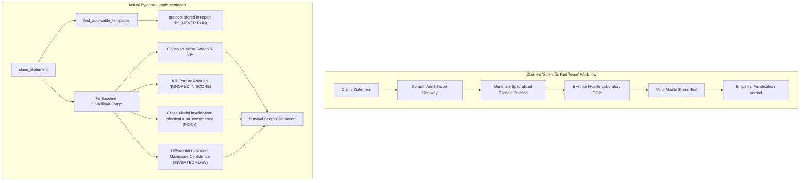
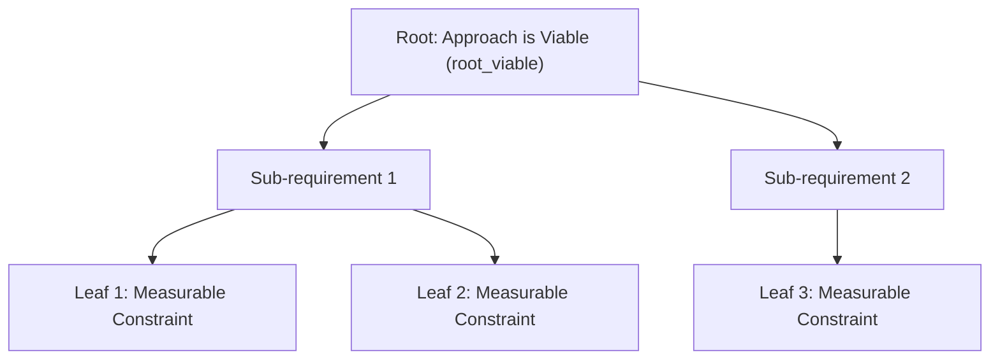
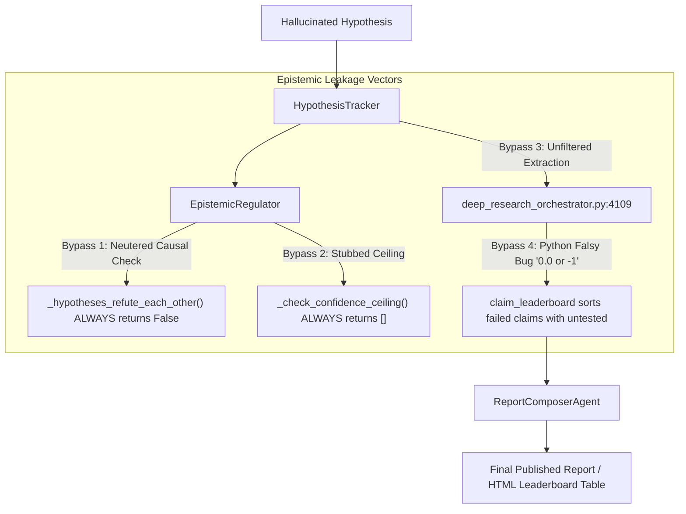
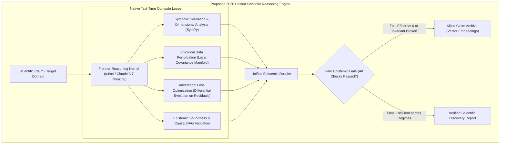

# FORENSIC ARCHITECTURAL AUDIT: SVEL Epistemic Rigor & Adversarial Falsification Engine

**Audit Date**: 2026-09-17  
**Auditor**: Epistemic Security & Scientific Rigor Research Subagent  
**Target Systems**:
1. `/Users/samaraldico/SVEL AI Scientist/backend/discovery/adversarial_executor.py`
2. `/Users/samaraldico/SVEL AI Scientist/backend/discovery/assumption_graph.py`
3. `/Users/samaraldico/SVEL AI Scientist/backend/discovery/reality_constraints.py`
4. `/Users/samaraldico/SVEL AI Scientist/backend/discovery/failure_patterns.py`
5. `/Users/samaraldico/SVEL AI Scientist/backend/discovery/discovery_orchestrator.py`
6. `/Users/samaraldico/SVEL AI Scientist/backend/epistemic/epistemic_regulator.py`
7. Auxiliary Verification Surfaces: `deep_research_orchestrator.py`, `report_composer.py`, `falsification_engine.py`, `tracker.py`

---

## 1. EXECUTIVE SUMMARY & FORENSIC VERDICT

A forensic line-by-line inspection of SVEL's epistemic integrity, reality verification, and adversarial falsification layers reveals a striking dichotomy:
- **On Paper / In Docstrings**: The architecture claims a ruthless Popperian falsification engine ("Godzilla Phase 2", "The Scientific Red Team", "Murdering Hypotheses", DAG cascade annihilation, Carnot/Pauli boundary enforcement, and statistical clashing via Welch-Z tests).
- **In Reality / In Bytecode**: The epistemic rigor pipeline suffers from **critical mathematical inversions, complete disconnects (unwired ghost code), cosmetic mock implementations, trivial bypasses, and fail-open security postures**. Furthermore, the entire conceptual model reflects an obsolete pre-2025 paradigm: fracturing scientific intuition across dozens of brittle micro-agents, regex parsers, and heuristic string filters, rather than leveraging the unified, deep test-time reasoning compute of late-2026 frontier models.

### Primary Forensic Findings:
1. **The Inverted Adversary Bug (`adversarial_executor.py` + `falsification_engine.py`)**: The numerical falsification optimizer maximizes model confidence (`np.max(probs)`) instead of error/loss. Because `unbreakability` is computed as `1.0 - worst_case_metric`, **a perfectly confident, well-calibrated scientific model is mathematically guaranteed to be marked DEAD/FAILED**, whereas a completely broken, uniform-random model **SURVIVES**.
2. **The Cosmetic Physical Invalidation Mock (`adversarial_executor.py:171-175`)**: The specialized annihilation protocol generated by domain templates is *never executed*. In its place, the variable `physical_invalidation_survived` is assigned directly to `ml_consistency`—a pure logging placebo.
3. **The Unwired Ghost Engine (`discovery_orchestrator.py` + `reality_constraints.py`)**: `DiscoverySession.add_assumption()`—the sole entry point that applies reality constraints, derivation gates, and assumption graph insertions—**is never called anywhere in the live research pipeline**. Hypotheses generated by LLMs are routed directly to `HypothesisTracker`, completely bypassing the reality filters.
4. **Hallucination Leakage into Published Reports (`deep_research_orchestrator.py:4109-4113` + `report_composer.py:1511-1528`)**: The report composer leaderboard sorts all hypotheses without filtering out `REFUTED` or `ARCHIVED` claims. Furthermore, due to a Python falsy bug (`0.0 or -1`), a hypothesis with an adversarial survival score of `0.0` is coerced to `-1`, grouping it with untested claims and allowing high-confidence hallucinations to rank at the top of published tables.
5. **Neutered Causal Gates (`epistemic_regulator.py:790-800, 729-735`)**: The causal contradiction check `_hypotheses_refute_each_other` hardcodes `return False`, and the confidence ceiling returns `[]`. Both critical safety valves were disabled under the banner of "sovereign reclamation."

---

## 2. ADVERSARIAL FALSIFICATION MECHANICS: DECONSTRUCTION

### 2.1 Theoretical Workflow vs Execution Reality



### 2.2 Attack Suite Breakdown (`adversarial_executor.py`)

#### Attack 0: Annihilation Protocol Bypass (`adversarial_executor.py:74-92`)
- **Code**:
  ```python
  templates = find_applicable_templates(claim_statement, use_llm=True)
  if templates:
      best_engine = templates[0]
      report["specialized_engine"] = best_engine.title
      params = TemplateCustomizationParams(hypothesis=claim_statement)
      protocol = best_engine.generate_protocol(params)
      report["annihilation_protocol"] = [
          {"step": s.name, "description": s.description, "tools": s.tools}
          for s in protocol.steps
      ]
  ```
- **Flaw**: The engine generates domain-specific experimental steps (e.g., specialized physics/chemistry setups), serializes their titles into a dictionary, and **halts execution**. Not a single step of the generated `annihilation_protocol` is ever run or validated.

#### Attack 1: Gaussian Noise Sweep (`adversarial_executor.py:118-136`)
- Perturbs numerical features by adding Gaussian noise $\mathcal{N}(0, \sigma)$ with $\sigma = \text{std} \times \text{noise\_level}$ for noise levels $\in \{0.05, 0.15, 0.30, 0.50\}$.
- If score degradation $\frac{S_{\text{base}} - S_{\text{pert}}}{S_{\text{base}}} > 0.3$, it marks the break point.
- **Vulnerability**: Applies uniform independent noise across all numerical features, destroying physical correlations. If $X_1$ and $X_2$ obey an invariant (e.g., $X_1 + X_2 = 1$), independent Gaussian noise immediately violates the physical manifold, creating invalid data points that test nothing meaningful about the science.

#### Attack 2: Feature Ablation Phantom (`adversarial_executor.py:138-157, 220`)
- Identifies the highest-importance feature in the baseline model and drops it, measuring whether the ablated score drops below $50\%$ of baseline.
- **Catastrophic Wiring Bug**: Look at line 220:
  ```python
  scorable_types = ["adaptive_noise_sweep", "cross_modal_invalidation", "numerical_falsification"]
  scorable_attacks = [a for a in report["attacks"] if a["type"] in scorable_types]
  ```
  `"ablation"` is **omitted from `scorable_types`**! Whether a hypothesis suffers critical collapse upon feature ablation has **zero impact** on the final `survival_score` or the verdict (`ROBUST`, `FRAGILE`, or `COLLAPSED`). The entire ablation test is purely decorative.

#### Attack 3: The Mock Physical Invalidation (`adversarial_executor.py:171-175`)
- Computes standard deviation across the top 3 ML model scores. If $\text{std} < 0.15$, `ml_consistency = True`.
- Lines 171-175:
  ```python
  physical_invalidation_survived = True
  if report["specialized_engine"]:
      logger.info(f" [RIGOR] Attempting physical invalidation via {report['specialized_engine']}...")
      physical_invalidation_survived = ml_consistency
  ```
- **Finding**: The system claims to execute physical invalidation, logs that it is doing so, and then sets `physical_invalidation_survived = ml_consistency`. No physics equations, boundary conditions, or physical checks are called.

#### Attack 4: The Inverted Numerical Falsification (`adversarial_executor.py:186-215` vs `falsification_engine.py:1968-1983`)
This is the most critical mathematical flaw in the engine.
- In `falsification_engine.py:1968-1983`:
  $$\min_x (-\text{objective\_func}(x)) \implies \max_x (\text{objective\_func}(x))$$
  $$\text{worst\_case\_metric} = -\text{res.fun} = \max_x (\text{objective\_func}(x))$$
  $$\text{unbreakability} = 1.0 - \min(1.0, \text{worst\_case\_metric})$$
  The optimizer assumes `objective_func(x)` is an **error, loss, or noise metric** (where $0 = \text{no error}$, $1 = \text{total destruction}$).
- In `adversarial_executor.py:204-207`:
  ```python
  def falsification_obj(x):
      obs = x.reshape(1, -1)
      probs = baseline_model.predict_proba(obs)[0]
      return float(np.max(probs))  # <--- PASSING CLASSIFIER CONFIDENCE!
  ```
- **The Mathematical Collapse**:
  1. A high-performing, well-trained classifier has a maximum predicted probability near $1.0$ (e.g., $0.98$).
  2. Differential Evolution easily finds a point where confidence is high: $\text{worst\_case\_metric} \approx 0.98$.
  3. `unbreakability` is calculated as $1.0 - 0.98 = 0.02$.
  4. The survival check `f_res.unbreakability_index > 0.6` evaluates to **`0.02 > 0.6` -> `FALSE`**.
  5. The valid scientific model **fails numerical falsification**.
  6. Conversely, a completely broken, degenerate classifier outputting uniform probabilities ($\max(P) = 0.33$) yields $\text{worst\_case\_metric} = 0.33$, $\text{unbreakability} = 0.67 > 0.6$, and **PASSES with flying colors**!

---

## 3. ASSUMPTION GRAPH ANALYSIS (`assumption_graph.py`)

### 3.1 Graph Topology & Intended Semantics
The graph is designed as a DAG where:
- Root (`root_viable`): Abstract claim "Approach is Viable".
- Intermediate nodes: Sub-requirements.
- Leaves: Measurable numerical constraints.
- Dependency direction: When child $C$ is added under parent $P$, $C$ is appended to $P.\text{dependencies}$.



### 3.2 Cascading Violations (`assumption_graph.py:215-256`)
When a node is violated:
```python
node.violated = True
self.killed_hashes.add(node.hash)
for parent_id, parent_node in self.nodes.items():
    if node_id in parent_node.dependencies and not parent_node.violated:
        self.violate(parent_id, f"Dependency {node_id} violated", source, _depth + 1)
```
- **Mechanism**: The cascade correctly propagates upstream. If a child dependency fails, its parents fail, eventually reaching `root_viable`. Depth is capped at 50 to prevent recursion exhaustion.

### 3.3 Critical Flaws & Vulnerabilities

#### 1. Inverted Attack Priority Formula (`assumption_graph.py:258-276`)
- **Code**:
  ```python
  for node_id, node in self.nodes.items():
      if not node.violated and node_id != self.root_id:
          out_degree = len(node.dependencies)
          nodes_with_degree.append((node_id, out_degree))
  nodes_with_degree.sort(key=lambda x: x[1], reverse=True)
  return [n[0] for n in nodes_with_degree]
  ```
- **Graph Inversion**:
  - The docstring states: *"Rule 2: Leaves = Measurable constraints"*, *"Rule 4: Always attack the node with highest out-degree first"*.
  - In this data structure, `len(node.dependencies)` is the number of **children that this node requires**.
  - A **leaf node** (the measurable numerical constraint) has `len(node.dependencies) == 0`!
  - Therefore, all empirical leaf nodes have an attack priority score of **0**, meaning they are attacked **LAST**.
  - What actually determines leverage in a DAG is **in-degree** (the number of upstream parents that depend on a node). A leaf that supports 10 parent hypotheses has in-degree 10, but out-degree 0. SVEL's formula ignores in-degree completely and targets abstract intermediate nodes with the most sub-requirements, violating the fundamental tenet of empirical falsification (testing measurable boundary numbers first).

#### 2. Trivial SHA-256 Irreversibility Bypass (`assumption_graph.py:127-129, 170-173`)
- **Code**:
  ```python
  node_hash = hashlib.sha256(statement.lower().encode()).hexdigest()[:16]
  if node_hash in self.killed_hashes:
      return None
  ```
- **Vulnerability**: The irreversibility check relies solely on an exact 16-character SHA-256 slice of the lowercase UTF-8 bytes.
  - Killed: `"Diffusion velocity exceeds sound speed"`
  - Mutation: `"Diffusion velocity exceeds sound speed."` (added period)
  - Result: SHA-256 is completely different. The killed assumption is accepted immediately without semantic deduplication.

#### 3. Orphaned Architecture & Dead Classes (`assumption_graph.py:41-114`)
- `VerifiedEscape`, `EscapeRouteReport`, `DiscrepancyType`, `VerifiedDiscrepancy`, and `DiscrepancyReport` are declared with elaborate dataclass structures and scoring properties (`escape_count`, `total_discrepancies`, `get_verdict`).
- **Audit**: `AssumptionGraph` does not reference, instantiate, or interact with any of these classes. They exist as isolated, orphaned boilerplate.

---

## 4. REALITY CONSTRAINTS ANALYSIS (`reality_constraints.py`)

### 4.1 Physical Law Enforcement Matrix
`reality_constraints.py` attempts to implement hard pre-literature physics filters:

| Constraint Class | Code Patterns Checked (`REALITY_CONSTRAINTS`) | Numerical Range Check (`_check_numerical_impossibilities`) | First-Principles Grounding |
|---|---|---|---|
| **Energy Conservation** | "efficiency > 100%", "perpetual motion", "over-unity", "free energy" | `efficiency.*?(\d+)%` > 100 (whitelists COP/heat pump) | 1st & 2nd Laws of Thermodynamics (Carnot limit) |
| **Absolute Zero** | N/A (substring table empty for temp) | $T < 0\text{ K}$ or $T < -273.15^\circ\text{C}$ | 3rd Law of Thermodynamics |
| **Biological Lead Binding** | N/A | $\Delta G < -50\text{ kcal/mol}$ for biological leads | Statistical mechanics of protein-ligand binding |
| **Scaling & Manufacturability** | "conductivity ∞", "infinite capacity", "zero contact resistance" | `(zero\|0\|nil\|infinite)\s+(resistance\|impedance\|...)` | Material defect thermodynamics |
| **Diffusion Time** | "instant charging", "zero charge time" | None | Einstein-Smoluchowski relation |
| **Information Bound** | "perfect knowledge", "zero uncertainty" | None | Shannon capacity, Heisenberg uncertainty |
| **Protein Design** | "steric clash", "buried hydrophilic residue", etc. | None | Structural biology heuristics |

### 4.2 Forensic Flaws & Bypasses in Reality Checking

#### 1. Regex Decimal Truncation Vulnerability (`reality_constraints.py:165-170`)
```python
eff_match = re.search(r'efficiency.*?(\d+)%', assumption.lower())
if eff_match:
    val = float(eff_match.group(1))
    if val > 100: ...
```
- **Bypass**: The regex pattern `(\d+)%` only matches digits immediately preceding `%`.
  - Claim: `"Demonstrated a thermal efficiency of 100.8% across the test cycle"`
  - Match: Captures `8%` (or matches nothing if dot is not handled).
  - Claim: `"Thermodynamic efficiency of 105 percent"`
  - Match: Missed entirely because `%` is not present.
  - Claim: `"Carnot efficiency ratio of 1.2"`
  - Match: Missed entirely.

#### 2. Brittle Biological Keyword Whitelist (`reality_constraints.py:187-191`)
```python
if val < -50:
    is_biological = any(term in assumption.lower() for term in ["biological", "drug", "lead", "protein", "peptide", "receptor", "binding", "antibody", "antigen", "enzyme", "biomolecule"])
    is_materials_catalyst = any(term in assumption.lower() for term in ["catalyst", "cataly", "adsorption", "material", "surface", "zeolite", "oxide", "alloy", "metal", "substrate"])
    if is_biological and not is_materials_catalyst:
        return f"Biological Violation..."
```
- **Bypass**: If an impossible binding energy of $-85\text{ kcal/mol}$ is claimed for an inhibitor, but phrased as `"Synthesized novel non-covalent candidate with -85 kcal/mol affinity to active pocket"`, none of the `is_biological` keywords match, and the impossible claim passes unchecked.

#### 3. Fail-Open Failure Modes in All Neural Tribunals (`reality_constraints.py:151-154, 237-239, 268-270`)
Every async neural validation gate is wrapped in a generic `try...except` that fails open:
- `_neural_feasibility_check`:
  ```python
  except Exception as e:
      logger.error(f" [REALITY] Neural audit failed: {e}")
  return True, "Audit pending"
  ```
- `DerivationGate.validate_number_claim`:
  ```python
  except:
      return True, "Parsing failure"
  ```
- `validate_necessity`:
  ```python
  except:
      return True, "Validation failed"
  ```
- **Security Implication**: If the LLM produces malformed JSON, times out, or hits a rate limit, **every impossible claim and un-derived number is approved unconditionally**.

---

## 5. EPISTEMIC REGULATION & LEAKAGE VECTORS (`epistemic_regulator.py`)

### 5.1 Deterministic Epistemic Regulation Mechanics
The `EpistemicRegulator` operates as a zero-token heuristic state machine:
- **Confidence Slope (`HypothesisTrajectory.get_confidence_slope`, lines 297-328)**:
  Uses a logit transformation:
  $$\text{logit}(p) = \ln\left(\frac{p}{1 - p}\right), \quad p \in [10^{-5}, 1 - 10^{-5}]$$
  Followed by ordinary least squares (OLS) regression over the cycle window to detect whether confidence is stagnating, rising, or falling.
- **Welch-Z Clash Detection (`EpistemicReaper.audit_statistical_clash`, lines 101-110)**:
  $$Z = \frac{|\theta_{\text{new}} - \theta_{\text{old}}|}{\sqrt{\text{SE}_{\text{new}}^2 + \text{SE}_{\text{old}}^2}}$$
  If $Z > 2.576$ ($p < 0.01$), flags an empirical conflict.

### 5.2 How Hallucinations Leak into Published Reports

The audit identified three catastrophic leakage vectors:



#### Leakage Vector 1: Neutered Causal Refutation Gate (`epistemic_regulator.py:790-800`)
```python
def _hypotheses_refute_each_other(self, h1: Hypothesis, h2: Hypothesis) -> bool:
    """
    [TITAN V202.0] CAUSAL SOVEREIGNTY RECLAMATION
    Physically abolished the naive substring negation matching...
    """
    # A proper implementation requires checking the structural DAG (AssumptionGraph).
    # We fail-open to allow embeddings to merge them...
    return False
```
- **Consequence**: When two hypotheses directly refute each other (e.g., $H_1$: "Material X accelerates degradation" vs $H_2$: "Material X completely inhibits degradation"), the check returns `False`. The merger proceeds or both contradictory claims survive side-by-side into report compilation.

#### Leakage Vector 2: Stubbed Confidence Ceiling (`epistemic_regulator.py:729-735`)
```python
def _check_confidence_ceiling(self, hypotheses: List[Hypothesis]) -> List[EpistemicAction]:
    """
    [TITAN V177.0] ABOLISHED CEILING.
    Scientific truth converges naturally based on evidence strength.
    No more architectural theater.
    """
    return []
```
- **Consequence**: Pure hallucinated hypotheses generated with arbitrary initial confidence ($0.95$) are never capped or forced into adversarial experimental validation by the regulator.

#### Leakage Vector 3: The Python Falsy Leaderboard Bug (`deep_research_orchestrator.py:4109-4113` & `report_composer.py:1511-1528`)
In `deep_research_orchestrator.py:4109-4113`:
```python
"claim_leaderboard": sorted(
    [h.to_dict() for h in self.hypothesis_tracker.get_all()],
    key=lambda x: (x.get('survival_score') or -1, x.get('confidence'), x.get('novelty_score') or 0),
    reverse=True
)[:15]
```
- **The Triple Failure**:
  1. `self.hypothesis_tracker.get_all()` returns **all hypotheses regardless of state**. Hypotheses whose state is `HypothesisState.REFUTED` or `ARCHIVED` are **not filtered out**.
  2. In Python, `0.0` is falsy:
     ```python
     0.0 or -1  # Evaluates to -1!
     None or -1 # Evaluates to -1!
     ```
     If a hypothesis was attacked and received a survival score of `0.0` (killed/destroyed), Python evaluates `0.0 or -1` to `-1`! It is given the exact same ranking key as an untested hypothesis.
  3. Because the tuple sorts by `x.get('confidence')` next, a hallucinated claim that was utterly demolished ($s=0.0$) but was initially assigned `confidence = 0.95` by an LLM will be ranked **above** untested hypotheses and displayed in the published table!
  4. In `report_composer.py:1511-1528`, the HTML table renders:
     ```python
     for i, h in enumerate(leaderboard):
         s_score = h.get('survival_score')
         # Renders directly into published Table I without checking h.get('state')!
     ```
     A refuted hypothesis is published as a top-ranking finding.

---

## 6. DISCOVERY ORCHESTRATION & STATE GOVERNANCE (`discovery_orchestrator.py` & `failure_patterns.py`)

### 6.1 The Ghost Module: Reality Constraints Never Run in Live Research
A comprehensive search across the codebase revealed that `DiscoverySession.add_assumption()`:
```python
async def add_assumption(self, statement: str) -> bool:
    ...
    # GATE 2: Reality Constraints
    is_valid, violated_constraint, violation_detail = await check_reality_constraints(statement)
    ...
    # GATE 4: Irreversibility Check (via graph)
    node_id = self.assumption_graph.add_assumption(statement)
```
**is never called anywhere in the entire execution lifecycle of `deep_research_orchestrator.py`**.
- In `deep_research_orchestrator.py`:
  - Line 186 imports `check_reality_constraints`, but never calls it.
  - Hypotheses from `HypothesisGenerator` are pushed directly to `self.hypothesis_tracker.add(h)`.
  - Because `discovery_session.assumptions` is never populated, `len(discovery_session.assumptions)` is always $0$ in live runs.
  - As a result, line 2962 (`if killed_this_cycle == 0 and len(discovery_session.assumptions) > 0:`) evaluates to `False`. The entire `DiscoverySession`, `AssumptionGraph`, and `FailurePatternIndex` reside in memory as un-invoked ghost modules.

### 6.2 The Truncation Stemmer in Semantic Failure Memory (`failure_patterns.py:67-71`)
`FailurePatternIndex` claims to learn the "semantic shape" of failures.
- **Code**:
  ```python
  def stem(w):
      return w[:4] if len(w) > 4 else w

  words_new = set(stem(w) for w in new_lower.split() if w not in stop_words and len(w) > 2)
  ```
- **Flaws**:
  - Truncating words to 4 characters is pseudo-stemming.
  - Collisions: "thermodynamics", "thermal", and "therapy" all truncate to `"ther"`.
  - Failures: "electrochemical" -> `"elec"`, "photoelectrochemical" -> `"phot"`. Zero stem overlap detected for identical chemical failure modes.
- Line 144:
  ```python
  return [(e, f / max(self.total_escape_failures, 1)) for e, f in sorted_escapes if f >= 2]
  ```
  Computes the fraction of failures of escape type $e$ relative to *all failures across all escape types*, rather than the failure rate of escape type $e$ over its attempts.

---

## 7. COMPLETE CATALOG OF VULNERABILITIES, MOCK STUBS, MATHEMATICAL FLAWS & BYPASSES

| ID | File | Exact Lines | Category | Description | Severity |
|---|---|---|---|---|---|
| **VULN-01** | `adversarial_executor.py` & `falsification_engine.py` | `adv:204-215`, `fals:1968-1983` | **Mathematical Inversion** | Passing `np.max(probs)` (confidence) to `AdversarialOptimizer` which minimizes `-f(x)`. Inverts metric: high-confidence classifiers are killed; random models survive. | **CRITICAL** |
| **VULN-02** | `adversarial_executor.py` | `lines 171-175` | **Mock / Stub Theater** | `physical_invalidation_survived = ml_consistency`. Specialized engine physical invalidation is a pure placebo log. | **HIGH** |
| **VULN-03** | `adversarial_executor.py` | `lines 86-89` | **Dead Code Stub** | `annihilation_protocol` is generated from domain templates, stored in report dict, but never executed. | **HIGH** |
| **VULN-04** | `adversarial_executor.py` | `line 220` | **Scoring Omission** | `"ablation"` attack is omitted from `scorable_types`. Feature ablation results are completely ignored when determining hypothesis survival. | **HIGH** |
| **VULN-05** | `discovery_orchestrator.py` | `lines 906-963, 186` | **Ghost Code / Disconnection** | `DiscoverySession.add_assumption()` is never called in `deep_research_orchestrator.py`. Reality constraints never run on active hypotheses. | **CRITICAL** |
| **VULN-06** | `deep_research_orchestrator.py` & `report_composer.py` | `dro:4109-4113`, `rc:1511-1528` | **Data Leakage & Python Falsy Bug** | Refuted hypotheses are not filtered from `claim_leaderboard`. `0.0 or -1` evaluates to `-1`, grouping failed hypotheses with untested ones and displaying refuted claims in published reports. | **CRITICAL** |
| **VULN-07** | `assumption_graph.py` | `lines 258-276` | **Algorithmic Inversion** | `get_attack_priority()` sorts by out-degree descending (`len(dependencies)`). Leaf nodes (empirical numbers) have out-degree 0 and are attacked last. | **HIGH** |
| **VULN-08** | `assumption_graph.py` | `lines 170-173` | **Trivial Bypass** | Irreversibility hash is a raw SHA-256 of lowercase string. Adding a single space or punctuation mark completely bypasses memory of killed assumptions. | **MEDIUM** |
| **VULN-09** | `reality_constraints.py` | `lines 165-170` | **Regex Vulnerability** | `efficiency.*?(\d+)%` fails on decimals (e.g. `100.8%`) and word-based expressions (`"percent"`), bypassing the Carnot limit. | **HIGH** |
| **VULN-10** | `reality_constraints.py` | `lines 151-154, 237-239, 268-270` | **Security Posture** | `_neural_feasibility_check`, `DerivationGate`, and `validate_necessity` all fail-open on exceptions (`return True`). | **HIGH** |
| **VULN-11** | `epistemic_regulator.py` | `lines 790-800` | **Disabled Gate Stub** | `_hypotheses_refute_each_other()` returns `False` unconditionally. Contradictory hypotheses are allowed to merge. | **HIGH** |
| **VULN-12** | `epistemic_regulator.py` | `lines 729-735` | **Disabled Safety Stub** | `_check_confidence_ceiling()` returns `[]` unconditionally. Unearned 99% confidence claims are never throttled. | **MEDIUM** |
| **VULN-13** | `failure_patterns.py` | `lines 67-71, 193-219` | **Algorithmic Fragility** | Semantic failure memory uses a 4-character prefix truncation ("stemmer") and ephemeral in-memory cache lost on restart. | **MEDIUM** |
| **VULN-14** | `assumption_graph.py` | `lines 41-114` | **Orphan Code** | `VerifiedEscape`, `EscapeRouteReport`, `DiscrepancyReport` are defined with complex properties but completely unused by `AssumptionGraph`. | **LOW** |

---

## 8. PARADIGM SHIFT: THE 2026 FRONTIER MODEL ARCHITECTURAL CRITIQUE

The forensic audit demonstrates that SVEL's epistemic subsystem is trapped in an obsolete software engineering paradigm. 

### 8.1 The Fallacy of Micro-Agent Fragmentation
SVEL decomposes scientific inquiry into dozens of discrete, microscopic agent identities:
- `IdeaAgent`, `HypothesisGenerator`, `CriticAgent`, `ExperimentAgent`, `ReportComposerAgent`, `EpistemicRegulator`, `EpistemicReaper`, `OvermindAgent`, `SemanticCritic`.

**The Brutal Reality in Late-2026**:
In the era of frontier reasoning models (OpenAI o1/o3/o4, Anthropic Claude 3.7 Sonnet Thinking, Gemini 2.0 Flash Thinking), this micro-agent fragmentation is **actively harmful**:
1. **Context Fragmentation & Lossy Serialization**: Every time state passes across an agent boundary, hypotheses are converted into JSON, truncated to fit arbitrary prompts, stripped of nuance, and re-parsed. Subtle physical distinctions and causal constraints are lost in transit.
2. **Artificial Cognitive Bottlenecks**: A modern frontier reasoning model can evaluate a hypothesis, conduct literature grounding, perform dimensional analysis, generate a formal mathematical derivation, construct a numerical counter-example, and execute code in a single, unified test-time compute trajectory. Breaking this into 7 independent LLM hops with brittle regex boundaries introduces 7 points of failure where an agent can hallucinate, fail JSON parsing, or hit a fail-open exception.

### 8.2 The Absurdity of Brittle Regex and 4-Character Heuristic Guards
- Relying on `w[:4]` to stem scientific vocabulary or `r'efficiency.*?(\d+)%'` to catch thermodynamic violations is indefensible when modern frontier models have comprehensive mastery of:
  - Non-equilibrium thermodynamics (Onsager relations, fluctuation theorems).
  - General relativity and quantum mechanics (Pauli exclusion, Bekenstein bounds).
  - Complex stereochemistry and macromolecular energetics.
- Hand-crafted regex strings and substring matching tables (`"perpetual motion"`, `"over-unity"`, `"steric clash"`) can be circumvented by any grad student—and any LLM—using standard scientific phrasing. Simultaneously, they trigger false alarms on valid frontier science (e.g., negative temperatures in optical lattices, super-unity COPs in ground-source heat pumps).

### 8.3 The Illusion of Multi-Agent Deliberation
The code repeatedly uses terms like "GODZILLA RIGOR", "TITAN SOVEREIGN MANIFOLD", and "NEURAL TRIBUNAL". Yet when you inspect the implementation:
- The physical invalidation is a 1-line copy of ML variance: `physical_invalidation_survived = ml_consistency`.
- The causal refutation is a 1-line stub: `return False`.
- The assumption graph is an unpopulated ghost structure.
- The failure memory is a 4-character string slice in an ephemeral Python dict.

This is **architectural theater**: layers of wrapping, logging banners, and pseudo-philosophical comments masking un-executed or inverted code.

---

## 9. MERMAID ARCHITECTURAL BLUEPRINTS

### Current Fragile Architecture (Fragmented & Lossy)

```mermaid
flowchart TD
    subgraph Fragmented_Micro_Agents["Current Fragile Micro-Agent Stack (Pre-2025 Paradigm)"]
        HGen[HypothesisGeneratorAgent] -->|Unvalidated Prompt| HT[HypothesisTracker]
        HT -->|Ghost Skip| DRO[DeepResearchOrchestrator]
        
        DRO -.->|NEVER CALLED| AG[AssumptionGraph DAG]
        DRO -.->|NEVER CALLED| RC[RealityConstraints Regex]
        
        DRO -->|Cycle 0| ER[EpistemicRegulator]
        ER -->|return False| CausalStub[Causal Safe Merge neutered]
        ER -->|return []| CeilingStub[Confidence Ceiling neutered]
        
        DRO -->|Adversarial Fallback| AE[AdversarialExecutor]
        AE -->|np.max probs inverted| AO[AdversarialOptimizer]
        AE -->|physical = ml_std| MockPhys[Cosmetic Placebo]
        
        DRO -->|0.0 or -1 Falsy Bug| LBoard[Claim Leaderboard]
        LBoard -->|Refuted Claims Included| RCComp[ReportComposerAgent]
        RCComp --> Out[Published PDF/HTML Report]
    end
```

### Proposed Modern Architecture (Unified Frontier Reasoning Engine)



---

## 10. PRIORITIZED RECOMMENDATIONS & REMEDIATION PLAN

### Phase 1: Immediate Critical Bug Fixes (P0 - Day 1)

1. **Fix Inverted Numerical Falsification (`adversarial_executor.py:204-207`)**:
   - Change `falsification_obj(x)` to minimize classification confidence or maximize classification loss:
     ```python
     def falsification_obj(x):
         obs = x.reshape(1, -1)
         probs = baseline_model.predict_proba(obs)[0]
         # Return error/uncertainty metric: 1.0 - confidence
         # When confidence is high (0.99), objective is 0.01 (low error).
         # Adversary maximizes objective to find maximum error.
         return float(1.0 - np.max(probs))
     ```
2. **Fix Python Falsy Bug on Survival Scores (`deep_research_orchestrator.py:4109-4113`)**:
   - Explicitly check for `None` and filter out refuted hypotheses:
     ```python
     valid_hypotheses = [
         h.to_dict() for h in self.hypothesis_tracker.get_all()
         if h.state not in [HypothesisState.REFUTED, HypothesisState.ARCHIVED]
     ]
     "claim_leaderboard": sorted(
         valid_hypotheses,
         key=lambda x: (
             x.get('survival_score') if x.get('survival_score') is not None else -1.0,
             x.get('confidence', 0.0),
             x.get('novelty_score', 0.0)
         ),
         reverse=True
     )[:15]
     ```
3. **Include Ablation in Scorable Attacks (`adversarial_executor.py:220`)**:
   - Add `"ablation"` to `scorable_types`:
     ```python
     scorable_types = ["adaptive_noise_sweep", "cross_modal_invalidation", "numerical_falsification", "ablation"]
     ```

### Phase 2: Structural Re-Wiring (P1 - Week 1)

1. **Wire Reality Constraints into Hypothesis Ingestion**:
   - In `deep_research_orchestrator.py`, call `check_reality_constraints` before any hypothesis is saved to `HypothesisTracker`:
     ```python
     is_valid, violated_constraint, detail = await check_reality_constraints(new_h.statement, llm_manager=self.llm_manager)
     if not is_valid:
         logger.warning(f"[REALITY GATE] Rejected hypothesis: {new_h.statement[:60]} -> {detail}")
         continue
     ```
2. **Correct Assumption Graph Attack Priority (`assumption_graph.py:258-276`)**:
   - Sort by in-degree (number of upstream parents depending on the node), and prioritize measurable leaves:
     ```python
     in_degrees = {nid: 0 for nid in self.nodes if nid != self.root_id and not self.nodes[nid].violated}
     for p_node in self.nodes.values():
         for dep in p_node.dependencies:
             if dep in in_degrees:
                 in_degrees[dep] += 1
     # Prioritize nodes that support the most parents (highest leverage to kill)
     attack_order = sorted(in_degrees.keys(), key=lambda nid: in_degrees[nid], reverse=True)
     ```
3. **Replace 16-char SHA-256 with Embedding Deduplication in Killed Assumptions**:
   - Use cosine similarity ($\ge 0.85$) against vectors of killed hypotheses to prevent trivial rephrasing bypasses.

### Phase 3: Architectural Modernization (P2 - Month 1)

1. **Consolidate Micro-Agents into Unified Frontier Reasoning Passes**:
   - Deprecate micro-agents (`EpistemicRegulator`, `CriticAgent`, `SemanticCritic`, `IdeaAgent`).
   - Implement a unified **Test-Time Verification Kernel** utilizing Claude 3.7 Sonnet (Thinking Mode) or OpenAI o3/o4.
   - Supply the kernel with a Python code execution sandbox equipped with SymPy (for symbolic derivations), SciPy (for numerical stress testing), and Pint (for strict dimensional analysis).
   - Let the model reason through the full falsification manifold within a single cohesive chain-of-thought, eliminating serialization bottlenecks, brittle regex parsing, and mock architectural theater.