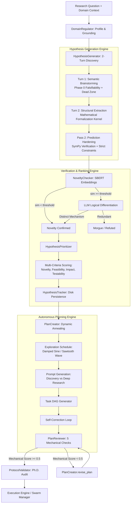
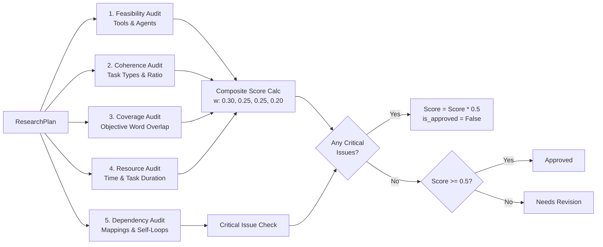

# Forensic Architectural Audit: SVEL Hypothesis Generation & Autonomous Planning Engine

**Target Subsystem:** SVEL Core Science & Strategy Kernel  
**Target Codebase Paths:**
- `/Users/samaraldico/SVEL AI Scientist/backend/core/hypothesis/generator.py`
- `/Users/samaraldico/SVEL AI Scientist/backend/core/hypothesis/prioritizer.py`
- `/Users/samaraldico/SVEL AI Scientist/backend/core/hypothesis/novelty_checker.py`
- `/Users/samaraldico/SVEL AI Scientist/backend/core/hypothesis/tracker.py`
- `/Users/samaraldico/SVEL AI Scientist/backend/core/hypothesis/models.py`
- `/Users/samaraldico/SVEL AI Scientist/backend/core/planning/plan_creator.py`
- `/Users/samaraldico/SVEL AI Scientist/backend/core/planning/plan_reviewer.py`

---

## 1. Executive Summary & Architectural Topology

SVEL’s **Hypothesis Generation & Autonomous Planning Engine** is designed to transform high-level research questions into mathematically grounded, falsifiable scientific hypotheses and convert those hypotheses into dependency-ordered, parallelizable execution DAGs (Directed Acyclic Graphs).

The architecture bifurcates into two tightly coupled pipelines:
1. **The Scientific Discovery Pipeline (`hypothesis/`):** Generates hypotheses with symbolic mathematical equations and concrete empirical predictions, checks semantic and mechanistic novelty against literature/history, computes a multi-criteria priority score, and tracks lifecycle states across sessions.
2. **The Strategic Planning & Verification Pipeline (`planning/`):** Converts prioritized hypotheses and domain objectives into executable tasks (`ResearchTask`), dynamically modulates an exploration-vs-exploitation ratio (using a damped sawtooth annealing schedule), and subjects candidate plans to a 5-dimensional feasibility and dependency review before handing off to the execution swarm.



---

## 2. Deconstruction of the Hypothesis Generation Lifecycle

The generation engine in `generator.py` enforces a **2-Turn, 2-Pass Generation Protocol** designed to avoid "cosplay science" (unfalsifiable prose) and compel the LLM to emit rigorous symbolic mathematics.

### 2.1 Procedural Rigor Gate
Before invoking LLM synthesis, `generator.py` inspects the research question to avoid wasting inference on purely administrative tasks:
- **File & Lines:** `generator.py:71-79`
- **Filter Stems:** `proc_stems = ["extract", "gather", "check", "run ", "using agent", "use ", "compile", "survey", "collect", "preprocess", "train", "validate", "optimize"]`
- **Bypass Rule:** If any procedural stem is present, hypothesis generation is aborted *unless* the question explicitly contains `"develop"` or `"novel"`.

### 2.2 Domain Knowledge Priors & Grounding
- **File & Lines:** `generator.py:88-102`
- **Scientific Profiling:** Calls `DomainRegulator.get_domain_profile(research_question, domain_hint)` to derive domain-specific tags.
- **Neural Grounding:** Calls `DomainRegulator.get_domain_examples_async(profile, research_question)` to synthesize the physical units, variables, and canonical relationships (e.g., FLOPs, nM, Top-1 Accuracy).
- **Fact Purification:** Uses `DomainRegulator.filter_by_domain_similarity` (SBERT embedding cosine similarity with threshold $0.18$) and regex pattern matching to purge out-of-domain arXiv preprints and OS/API logs (`/Users/`, `.py`, `traceback`, `npm`, `pip`).

### 2.3 Turn 1: Semantic Brainstorming Prompting Strategy
- **File & Lines:** `generator.py:134-282`
- **Persona & Meta-Prompting:** "You are a tenured professor of {domain} with 40 years of experimental design and theory."
- **Phase 0 (Falsifiability & Identifiability Gate):** Forces the model to internally verify if the claim connects to observable quantities, what observation would falsify it, and whether physical bounds (conservation laws, probabilities in $[0,1]$) hold. If not, it commands a hard refusal: `{"refusal": true, "reason": "..."}`.
- **Dead Zone Anti-Patterns:** An explicit blacklist of saturated literature directions:
  - NAS + attention entropy regularization (EViT 2022, NASViT 2022)
  - RL-based NAS for ViT pruning (MNasNet 2019, ProxylessNAS 2019)
  - KL-divergence attention preservation (DeiT 2021)
  - Zero-shot NAS proxies based on gradient norms or synflow (ZiCo ICLR 2023)
  - Vision-LSTM / xLSTM for vision (Beck et al., 2024)
- **Novelty Seeds (Attempt 0 Departure Points):**
  - *Seed A:* PAC-Bayes generalization bounds directly as NAS search objective.
  - *Seed B:* Random Matrix Theory (Marchenko-Pastur null distribution $\Delta_{\text{MP}}$) debiasing of attention entropy.
  - *Seed C:* Pearson correlation matrix of cross-layer attention entropy vectors.
  - *Seed D:* Causal mediation of CKA (Centered Kernel Alignment) collapse via do-calculus.

### 2.4 Turn 2: Structural Extraction (Mathematical Formalization Kernel)
- **File & Lines:** `generator.py:348-398`
- Model: `TASK_ROUTING_MODEL` (temperature 0.0).
- Strips rambling prose and isolates a strict single-item JSON structure:
```json
{
  "skeletons": [
    {
      "statement": "...",
      "rationale": "...",
      "variables": [
        { "symbol": "X", "name": "...", "unit": "...", "role": "independent|dependent|confounding|mediator", "empirical_range": "..." }
      ],
      "parameters": [
        { "symbol": "k", "value_guess": 0.0, "unit": "...", "justification": "..." }
      ],
      "functional_form": "dY/dt = k * X**2 / (K + X)",
      "falsification_experiment": {
        "condition": "...",
        "expected_outcome": "...",
        "null_outcome": "...",
        "falsification_threshold": "...",
        "metric": "..."
      }
    }
  ]
}
```
- **Mandatory Skeleton Checklist (`generator.py:436-447`):** Rejects any skeleton missing `statement`, `variables`, `parameters`, or `functional_form`.

### 2.5 Pass 2: Prediction Hardening & Constraints Expansion
- **File & Lines:** `generator.py:452-536`
- Model: `REPORT_FINAL_MODEL` (temperature 0.4).
- Transforms the skeleton into a fully specified scientific artifact by expanding:
  1. **Structured Predictions ($\ge 2, \le 4$):** Must define `condition`, `outcome`, numeric `baseline`, `baseline_unit`, numeric `threshold`, `threshold_unit`, and `direction` (`increase|decrease|any`).
  2. **Physical Constraints ($\ge 2$):** Mathematical inequalities/equalities (`equation`, `variables`, `type`, `description`).
  3. **Falsification Criteria:** A single formal statement: *"The hypothesis is falsified if [metric] measured under [condition] is [comparison] [value]."*

### 2.6 SymPy Mathematical Verification Pipeline
- **File & Lines:** `generator.py:625-768` (`_validate_formal_hypothesis` and `check_math_string`)
- To prevent hallucinatory pseudo-math, SVEL evaluates every `functional_form` and constraint equation through `sympy.sympify`:
  1. *Sanitization:* Strips trailing clauses (`where...`, `for...`), converts `^` to `**`, LaTeX delimiters, maps $|x| \to \text{Abs}(x)$.
  2. *Greek & Unicode Normalization:* Maps $\Delta \to \text{var\_delta}$, $\lambda \to \text{var\_lambda}$, $\sigma \to \text{var\_sigma}$, $\pi \to \text{var\_pi}$, etc.
  3. *Subscript Flattening:* Regex `([a-zA-Z0-9]+)_([a-zA-Z0-9]+) -> \1\2` (e.g., $C_{\text{eff}} \to C\text{eff}$).
  4. *Singularity & Domain Boundary Audit:* Checks `sympy.zoo`, `sympy.nan`, `sympy.I`. Audits arguments of `log`/`ln` ($\le 0 \implies \text{rejection}$) and `sqrt` ($< 0 \implies \text{rejection}$).
  5. *Inequality Consistency:* Splits on inequalities (`<, <=, >, >=, =`) and verifies constant inequalities (e.g., rejecting $5 < 2$).

---

## 3. Novelty Verification & Scoring Analysis (`novelty_checker.py` & `prioritizer.py`)

### 3.1 Semantic Novelty Architecture (`novelty_checker.py`)

#### Vector Embedding & Similarity Calculation
- **Model:** Local SentenceTransformer singleton via `get_shared_embedding_model()` (defaults to `all-MiniLM-L6-v2` or configured `EMBEDDING_MODEL` on CPU/MPS).
- **Text Manifold:** `text = f"{hypothesis.statement} {hypothesis.rationale}"`
- **Embedding Cache:** `_embedding_cache[h.id]` prevents $O(N^2)$ re-encoding.
- **Cosine Metric:** Given candidate embedding $\mathbf{u}$ and existing pool embedding $\mathbf{v}$:
$$\text{CosineSimilarity}(\mathbf{u}, \mathbf{v}) = \frac{\mathbf{u} \cdot \mathbf{v}}{\|\mathbf{u}\|_2 \|\mathbf{v}\|_2}$$
$$\text{MaxSimilarity}(\mathbf{u}) = \max_{\mathbf{v} \in \mathcal{H}_{\text{history}} \cup \mathcal{H}_{\text{active}}} \text{CosineSimilarity}(\mathbf{u}, \mathbf{v})$$
$$\text{NoveltyScore}_{\text{base}} = 1.0 - \text{MaxSimilarity}(\mathbf{u})$$

#### Adaptive Density Threshold
- **File & Lines:** `novelty_checker.py:85-90`
- Base threshold $\theta_{\text{base}} = 0.85$.
- If pool density $|\mathcal{H}_{\text{active}}| > 10$:
$$\theta_{\text{adaptive}} = \min(0.92, \theta_{\text{base}} + 0.05) = 0.90$$

#### Jaccard Word-Set Fallback
If SentenceTransformer fails to load (`novelty_checker.py:91-120`):
$$J(W_{\text{new}}, W_{\text{prev}}) = \frac{|W_{\text{new}} \cap W_{\text{prev}}|}{|W_{\text{new}} \cup W_{\text{prev}}|}$$
Threshold is adjusted: $\theta_{\text{Jaccard}} = \theta_{\text{adaptive}} - 0.20$ (default $0.65$).

#### LLM Logical Differentiation Protocol
- **File & Lines:** `novelty_checker.py:162-239`
- When $\text{MaxSimilarity} \ge \theta_{\text{adaptive}}$, candidate is not immediately discarded. Instead, `TASK_ROUTING_MODEL` executes a 5-point comparative audit:
  1. *Core Mechanism (Causal DAG isomorphism)*
  2. *Mathematical Formalism (Algebraic equivalence)*
  3. *Estimand and Falsification Criteria*
  4. *Physical Regime / Boundary Scales*
  5. *Novelty of Insight*
- If LLM confirms distinction (`is_distinct: true`, `divergence_score` $\delta \in [0.0, 1.0]$), `is_novel` is overridden to `True`, and the score is modulated:
$$\text{NoveltyScore}_{\text{adjusted}} = 1.0 - \left(\text{MaxSimilarity} \times (1.0 - \delta)\right)$$

---

### 3.2 Mathematical Prioritization & Multi-Criteria Ranking (`prioritizer.py`)

Hypotheses are ranked using a weighted linear combination of four normalized criteria:

$$\text{PriorityScore} = w_N \cdot N + w_F \cdot F + w_I \cdot I + w_T \cdot T$$

Default weights (`prioritizer.py:45-50`):
$$w_N = 0.25 \quad (\text{Novelty}), \quad w_F = 0.25 \quad (\text{Feasibility}), \quad w_I = 0.30 \quad (\text{Impact}), \quad w_T = 0.20 \quad (\text{Testability})$$

#### Feasibility Scoring Function ($F$)
- **File & Lines:** `prioritizer.py:181-205`
- Penalizes structural degrees of freedom (variables $V$ and parameters $P$) and mathematical operator density in `functional_form`:
$$F = \max\left(0.1, \min\left(1.0, 0.8 - \min(0.3, 0.04 \cdot |V|) - \min(0.3, 0.05 \cdot |P|) - \min(0.2, 0.02 \cdot N_{\text{ops}})\right)\right)$$
where $N_{\text{ops}} = \sum_{\text{op} \in \{+, -, *, /, **, \log, \exp\}} \text{count}(\text{op})$.

#### Testability Scoring Function ($T$)
- **File & Lines:** `prioritizer.py:309-351`
- Formed from three sub-metrics: Data Availability ($D$), Methodology Clarity ($M$), and Resource Requirements ($R$):
$$T = 0.3 \cdot D + 0.4 \cdot M + 0.3 \cdot R$$
where:
$$D = \text{clamp}_{[0.1, 1.0]}\left(0.5 + \min(0.4, 0.1 \cdot |V_{\text{with\_range}}|)\right) \quad (\text{or } 0.3 \text{ if } |V| = 0)$$
$$M = \text{clamp}_{[0.1, 1.0]}\left(0.5 + \min(0.4, 0.1 \cdot N_{\text{valid\_predictions}}) + 0.1 \cdot \mathbb{I}_{\{\text{falsification\_criteria} \ne \emptyset\}}\right)$$
$$R = \text{clamp}_{[0.1, 1.0]}(F) \quad (\text{tied directly to Feasibility})$$

#### Impact Scoring Function ($I$)
- **File & Lines:** `prioritizer.py:206-289`
- Evaluated via `PRIORITY_SCORING_MODEL`:
$$I_{\text{raw}} = S_{\text{novelty\_depth}} (0-0.4) + S_{\text{domain\_implications}} (0-0.3) + S_{\text{application\_potential}} (0-0.2) + S_{\text{rarity}} (0-0.1)$$
$$I = \text{clamp}_{[0.0, 1.0]}\left(I_{\text{raw}} \times M_{\text{falsifiability}}\right)$$
- Heuristic fallback (`prioritizer.py:291-307`):
$$I_{\text{fallback}} = \text{clamp}_{[0.0, 1.0]}\left(0.5 + 0.2 \cdot \mathbb{I}_{\{\text{novel, breakthrough}\}} + 0.15 \cdot \mathbb{I}_{\{\text{universal, fundamental}\}} - 0.1 \cdot \mathbb{I}_{\{\text{incremental, minor}\}}\right)$$

---

## 4. Autonomous Planning & Protocol Verification (`plan_creator.py` & `plan_reviewer.py`)

### 4.1 Plan Creation Pipeline (`plan_creator.py`)

#### Dynamic Exploration Annealing Schedule
- **File & Lines:** `plan_creator.py:187-211`
- Balances divergent exploration vs convergent exploitation via a **Damped Sawtooth Annealing Schedule**:
  - *Cycles 1 to 3 (Shock & Awe):*
$$\text{Ratio}(c) = \max(0.4, 0.9 - 0.15 \cdot c)$$
  - *Cycles $c \ge 4$ (Oscillating Bursts):* Period $P = 10$ if $C_{\text{total}} < 50$ else $25$.
$$\text{Phase}(c) = (c - 3) \pmod P$$
$$\text{Ratio}(c) = \begin{cases} 0.50 & \text{if } \text{Phase}(c) < 0.3 \cdot P \quad (\text{Discovery Burst}) \\ 0.20 & \text{otherwise} \quad (\text{Deep Exploitation / Validation}) \end{cases}$$

#### Operational Modes
1. **`discovery` Mode (Adversarial Falsification Attack Planner):**
   - Implements 5 phase directives across mission lifecycle: Phase 0 Seeding ($<5\%$), Phase 1 Genesis ($5-10\%$), Phase 2 Early Attack ($10-40\%$, reading **FORBIDDEN**), Phase 3 Siege ($40-90\%$), Phase 4 Verdict ($>90\%$).
   - Mandatory rule: Tasks must formulate mutually exclusive falsification outcomes.
2. **`research` Mode (Deep Research Orchestration):**
   - Enforces batch reading (`deep_paper_reader` for 50–100 papers).
   - Mandatory parallelism: At least 3 tasks with `dependencies: []`.
   - Mandatory execution: At least one task assigned to `experiment_agent`.

#### Self-Correction & Critique Loop
- **File & Lines:** `plan_creator.py:749-794` (`_critique_and_refine`)
- Generated plans are submitted to a critic prompt. If critique emits `VERDICT: REJECTED`, the plan is recursively refined up to `max_attempts = 2`.

---

### 4.2 Mechanical & Strategic Review Gate (`plan_reviewer.py`)

Before a plan can be approved, `PlanReviewer.review(plan)` executes 5 audits:



1. **Feasibility ($w = 0.30$, `plan_reviewer.py:221-304`):**
   - Matches tools against `REGISTRY.list_tools()`.
   - Tool string normalized (strips `_`, `-`, `tool`, `database`).
   - Hardware bypass: allows physical wet-lab words (`pipette`, `centrifuge`, `spectrometer`).
   - Explicit computational allowlist (`ml_model_builder`, `experiment_agent`, `code_executor`).
   - Missing tool = **Critical Issue** ($-0.15$); missing agent = **Warning** ($-0.10$).
2. **Coherence ($w = 0.25$, `plan_reviewer.py:306-329`):**
   - Base 0.8. $+0.1$ if $\ge 3$ distinct task types; $-0.1$ if only 1 type.
   - Penalizes exploration ratio imbalance: $-0.1$ if $|\text{actual\_ratio} - \text{expected\_ratio}| > 0.2$.
3. **Coverage ($w = 0.25$, `plan_reviewer.py:330-346`):**
   - Lexical overlap between `research_objective` and task descriptions:
$$\text{CoverageScore} = \min\left(1.0, 1.5 \times \frac{\sum_{t \in \text{tasks}} \mathbb{I}_{\{\text{words}(\text{objective}) \cap \text{words}(t.\text{description}) \ne \emptyset\}}}{|\text{tasks}|}\right)$$
4. **Resources ($w = 0.20$, `plan_reviewer.py:347-367`):**
   - Base 1.0. Warning if total minutes $> 480$ (8h).
   - Warning if any task $< 5$ min or $> 120$ min. Each warning subtracts $0.1$.
5. **Dependencies (`plan_reviewer.py:368-403`):**
   - Flags missing dependency IDs as **Critical Issues**.
   - Flags self-loops ($t.\text{id} \in t.\text{dependencies}$) as **Critical Issues**.
6. **Overall Score & Approval Decision:**
$$\text{OverallScore}_{\text{base}} = 0.30 \cdot S_{\text{feas}} + 0.25 \cdot S_{\text{coh}} + 0.25 \cdot S_{\text{cov}} + 0.20 \cdot S_{\text{res}}$$
$$\text{OverallScore} = \begin{cases} \text{OverallScore}_{\text{base}} \times 0.5 & \text{if } |\{\text{critical issues}\}| > 0 \\ \text{OverallScore}_{\text{base}} & \text{otherwise} \end{cases}$$
$$\text{is\_approved} \iff (\text{OverallScore} \ge 0.50) \land (|\{\text{critical issues}\}| == 0)$$

---

## 5. Forensic Defect Registry: Bugs, Shortcuts, Inaccuracies, & Failure Modes

| Bug ID | Component / File | Exact Line(s) | Severity | Category | Description & Impact |
| :--- | :--- | :--- | :--- | :--- | :--- |
| **BUG-01** | `generator.py` | Line 110 | **High** | Performance / Latency | **Hardcoded 65-Second Sleep on Retries**: Loop sleeps unconditionally for 65.0s on every retry up to 10 times, causing 10-minute deadlocks on transient errors. |
| **BUG-02** | `generator.py` | Lines 143–144 | **Medium** | Prompt Injection / Math Corruption | **Destructive Regex Braces Replacement**: `.replace('{', '(').replace('}', ')')` mutates mathematical set definitions, equations, and prompt formats. |
| **BUG-03** | `generator.py` | Lines 221–235, 156–178 | **Critical** | Domain Leaking / Cosplay Bias | **Hardcoded ML/ViT Dead Zones & Seeds**: Non-ML domains (genomics, superconductivity, chemistry) receive ViT NAS pruning dead zones and seeds. |
| **BUG-04** | `generator.py` | Lines 338–341 | **Medium** | Dead Code / Latency | **Commented-Out Short-Circuit Bypass**: Parser detects complete hypotheses in Turn 1, but short-circuit code is commented out, forcing redundant Turn 2 extraction. |
| **BUG-05** | `generator.py` | Lines 665–667 | **High** | Mathematical Validation | **Subscript Stripping Destroys SymPy Variables**: Regex `r"([a-zA-Z0-9]+)_([a-zA-Z0-9]+)" -> \1\2` corrupts Greek prefix substitutions (`var_alpha` $\to$ `varalpha`). |
| **BUG-06** | `generator.py` | Lines 668 | **Medium** | Mathematical Inaccuracy | **Indicator Function Hardcoded to 1**: `re.sub(r"I\((.*?)\)", r"1", clean_eq)` replaces indicator functions with constant $1$, invalidating piecewise logic. |
| **BUG-07** | `generator.py` | Lines 785–790 | **Low** | Telemetry / Security | **Hardcoded Stale Scratch Directory**: Writes debug telemetry to a specific absolute path (`/Users/samaraldico/.../3997777f-.../scratch`). |
| **BUG-08** | `novelty_checker.py` | Lines 71–76 | **Critical** | Scientific Over-Filtering | **Scientific Keyword Blacklist Rejection**: Blacklisting `query` causes immediate rejection of valid Transformer Attention hypotheses ($Q, K, V$). |
| **BUG-09** | `novelty_checker.py` | Lines 53, 123, 219 | **High** | Concurrency / Event Loop | **Synchronous Blocking Calls in Async Engine**: Heavy SBERT encoding and `llm_manager.run` executed synchronously without `asyncio.to_thread`. |
| **BUG-10** | `novelty_checker.py` | Lines 42, 287 | **Medium** | Memory Leak | **Unbounded Embedding Cache**: `_embedding_cache` has no max size or TTL, growing indefinitely in long-running processes. |
| **BUG-11** | `prioritizer.py` | Lines 117–128 | **Critical** | State Machine Violation | **Illegal State Side-Effects in `prioritize`**: Mutates hypothesis state from `PROPOSED` $\to$ `NOVEL_CHECK` $\to$ `NOVEL` $\to$ `PRIORITIZED`, bypassing `NoveltyChecker`. |
| **BUG-12** | `prioritizer.py` | Lines 279–285 | **High** | Mathematical Inaccuracy | **Fragile Regex Extraction of Impact Score**: Regex `r"0?\.\d+\|1\.0\|0\|1"` extracts numbered markdown list indices (e.g. "1." $\implies 1.0$) instead of the actual score. |
| **BUG-13** | `prioritizer.py` | Line 201 | **Low** | Mathematical Inaccuracy | **Double-Counting Asterisks in Operator Density**: Counting `*` inside equations containing `**` double-counts exponents, inflating operator penalties. |
| **BUG-14** | `tracker.py` | Line 198 | **Medium** | Thread Safety / Integrity | **Unprotected Memory Reference Leak**: `get_all()` returns direct object references without deep-copying, permitting unsynchronized thread mutations. |
| **BUG-15** | `plan_creator.py` | Lines 320–329 | **Critical** | Architectural Fallback Shortcut | **Hardcoded SARS-CoV-2 Rescue Injection**: If planning returns 0 tasks, the engine injects SARS-CoV-2 PubMed extraction and protein simulation regardless of domain. |
| **BUG-16** | `plan_reviewer.py` | Lines 231–232, 258–261 | **Critical** | Simulation / Failure Mode | **Physical Lab Hardware Bypass**: Bypasses missing tools for wet-lab equipment (`pipette`, `centrifuge`), producing impossible tasks that fail at execution. |
| **BUG-17** | `plan_reviewer.py` | Lines 394–402 | **High** | Algorithmic Incompleteness | **Incomplete Dependency Cycle Detection**: Only checks self-loops ($A \to A$). Fails on multi-node cycles ($A \to B \to A$), leading to execution deadlock. |
| **BUG-18** | `deep_research_orchestrator.py` | Line 2576 | **Critical** | Governance / Safety Gate | **`executing_anyway` Bypass**: If a plan is rejected by `ProtocolValidator`, line 2576 marks it `executing_anyway` and proceeds to run it. |
| **BUG-19** | Multiple Files | `plan_reviewer.py:24`, `protocol_validator.py:21` | **Medium** | Architectural Duplication | **Colliding `PlanReview` Data Classes**: Two completely different schemas named `PlanReview` exist in the codebase with divergent dictionaries. |

---

## 6. Targeted Remediation & Hardening Recommendations

### 6.1 Remove Domain Bleed & Generalize Generation Priors
1. **Decouple Dead Zones & Seeds (`generator.py`):** Move the ViT/NAS Dead Zone and Seeds out of `generator.py` and into dynamic domain templates under `backend/experiments/templates/{domain}/dead_zones.json`.
2. **Context-Aware Keyword Sanitization (`novelty_checker.py`):** Remove `"query"` from `system_leakage_words`. Replace naive word search with an AST or contextual classifier that differentiates between API query noise and scientific Attention queries ($Q \in \mathbb{R}^{d_k}$).

### 6.2 Enforce State Machine Integrity & Decouple Scoring
1. **Purity in `prioritizer.py`:** Abolish lines 117–128 in `prioritizer.py`. Prioritization must be a pure, read-only ranking function that returns ordered rankings without mutating `hyp.state`. State progression from `PROPOSED` $\to$ `NOVEL_CHECK` $\to$ `NOVEL` must remain the exclusive responsibility of `deep_research_orchestrator.py` after `novelty_checker.check_novelty()` returns `is_novel == True`.
2. **Robust JSON Impact Parsing:** Replace naive regex extraction in `prioritizer.py` with `repair_json` to parse the structured `{"impact_score": float, ...}` object.

### 6.3 Eliminate Execution Bypasses & Wet-Lab Illusions
1. **Abolish Wet-Lab Bypass (`plan_reviewer.py`):** Remove `PHYSICAL_HARDWARE` bypass. If a plan requires a centrifuge or pipette on a compute-only workstation, mark it as `missing_tool` critical failure.
2. **Full Cycle Detection (Tarjan's or Kahn's Algorithm):** Replace the single-element loop check in `_check_dependencies` with Kahn's topological sort or Tarjan's strongly connected components algorithm to catch cycles of length $\ge 2$.
3. **Enforce Hard Block on Unapproved Plans (`deep_research_orchestrator.py`):** Remove `"executing_anyway"` in line 2576. If a plan fails validation after revision, the orchestrator must halt execution or trigger replanning.
4. **Remove Domain-Specific Fallback Shortcuts (`plan_creator.py`):** Replace the SARS-CoV-2 hardcoded rescue roadmap with a domain-agnostic fallback derived from `DomainRegulator.get_fallback_skeleton(domain, research_question)`.

### 6.4 Async Manifold Unification
1. Wrap all SentenceTransformer `model.encode()` calls in `novelty_checker.py` and SymPy parsing in `generator.py` inside `asyncio.to_thread()` to prevent freezing SVEL's event loop during batch operations.
2. Unify the duplicate `PlanReview` dataclasses into a single canonical definition in `backend/core/planning/models.py`.