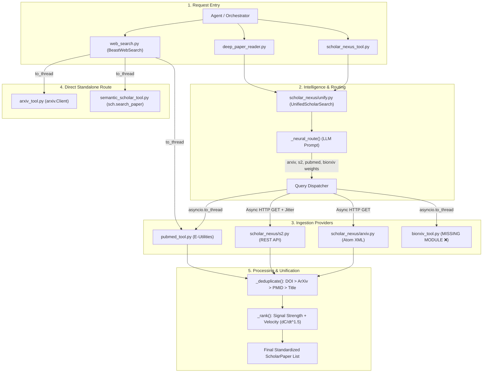
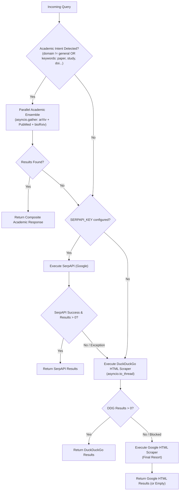

# FORENSIC ARCHITECTURAL AUDIT REPORT: SVEL AUTONOMOUS LITERATURE INGESTION & SCHOLAR NEXUS

**Audit Target Systems:** Literature Ingestion, Web Search, Scholar Nexus, Deep Paper Reading, PDF & Table Parsing  
**Auditor:** Autonomous Systems Research Specialist (Antigravity Engine)  
**Date:** September 17, 2026  
**Scope:** 8 Target Subsystems / Files in `/Users/samaraldico/SVEL AI Scientist/backend/tools/`

---

## EXECUTIVE SUMMARY

A forensic architectural audit of SVEL's literature ingestion and academic discovery pipeline was performed across all primary source files, schemas, and orchestration bridges. 

The audit reveals a dual-state architecture:
1. **High-Value Capabilities**: Highly resilient standalone tools for PubMed (`pubmed_tool.py`), arXiv (`arxiv_tool.py`), and Semantic Scholar (`semantic_scholar_tool.py`), robust multi-method table extraction (`table_extractor.py`), and multi-tier web search fallback (`web_search.py`).
2. **Critical Structural Breakdowns**:
   - **Fatal Bug in `scholar_nexus/unify.py`**: The `UnifiedScholarSearch` class is completely missing its `__init__` constructor, leaving core attributes (`self.arxiv`, `self.s2`, `self._pubmed_available`) undefined. Calling it raises an immediate `AttributeError` or `TypeError`.
   - **Coroutine Re-execution Crash in `scholar_nexus/unify.py`**: Coroutines are passed simultaneously to `asyncio.create_task()` in `asyncio.wait()` and subsequently re-passed to `asyncio.gather()`, which triggers `RuntimeError: cannot reuse already awaited coroutine`.
   - **Missing Dependency / Ghost Module**: `deep_paper_reader.py` imports `backend.tools.biorxiv_tool`, which **does not exist anywhere in the codebase**, causing `ModuleNotFoundError`.
   - **Hardcoded Query Bias / Steering Poison**: `scholar_nexus/unify.py` contains hardcoded steering logic injecting SARS-CoV-2 spike protein queries into any search mentioning the word "contingency".
   - **Denial of Service via Thread Freezing**: `semantic_scholar_tool.py` executes synchronous retry backoff with up to 10 retries at 15s base exponential multiplier, which can block the calling thread for **over 4.26 hours** during HTTP 429 rate limits.
   - **Unfulfilled Capabilities**: Despite claims in module docstrings, **LaTeX equation extraction is 0% implemented**, **Table-to-Tensor conversion is 0% implemented** (tables convert to Pandas DataFrames only), **Figure vision analysis is 0% implemented** (CLIP model loading is commented out to save memory), and **Tavily search provider is absent**.

---

## 1. COMPREHENSIVE COMPONENT MATRIX

| Tool / Module | Primary File Path | Implementation Status | Caching Strategy | Concurrency / Rate Limiting | Critical Defects & Risks |
| :--- | :--- | :--- | :--- | :--- | :--- |
| **Unified Scholar Nexus** | `backend/tools/scholar_nexus/unify.py` | 🔴 Broken | None | `asyncio.wait` + `gather` | Missing `__init__`; double await coroutine crash; hardcoded SARS-CoV-2 steering injection. |
| **ScholarNexus Tool Wrapper** | `backend/tools/scholar_nexus_tool.py` | 🔴 Broken | None | Thread pool loop wrapping | Passes `s2_api_key` to constructor that takes no args; drops PubMed PMIDs on dict serialization. |
| **ArXiv Nexus Client** | `backend/tools/scholar_nexus/arxiv.py` | 🟡 Fragile | None | None | No pagination (capped at initial page); no rate-limit backoff on HTTP errors. |
| **Semantic Scholar Nexus** | `backend/tools/scholar_nexus/s2.py` | 🟢 Functional | None | 5-tier jittered backoff | Downscales to limit=5 for free-tier; lacks pagination cursor support. |
| **Standalone arXiv Tool** | `backend/tools/arxiv_tool.py` | 🟢 Functional | None | `arxiv.Client` (10s delay, 2 retries) | In-memory `PyMuPDF` stream; caches nothing; truncates text preview at 5,000 chars. |
| **Standalone PubMed Tool** | `backend/tools/pubmed_tool.py` | 🟢 Functional | None | Token-bucket `_rate_limit_wait` (0.35s / 1.0s) | No `esearch` pagination cursor; chunks `efetch` to 100 PMIDs; no deduplication. |
| **Standalone S2 Tool** | `backend/tools/semantic_scholar_tool.py` | 🟡 High Latency | None | `@retry_with_backoff` (retries=10, base=15s) | Synchronous sleep blocks thread up to 15,345s (4.26 hrs) on continuous 429. |
| **Deep Paper Reader** | `backend/tools/deep_paper_reader.py` | 🔴 Partial Break | Local FS (`.paper_cache/{md5}.json`) | Semaphore (`max_workers=5`), `_min_request_interval=0.5s` | Crashes on `biorxiv_tool` import (`ModuleNotFoundError`); silently caches empty OCR failures. |
| **God-Level PDF Reader** | `backend/tools/pdf_reader.py` | 🟢 Functional | None | `ThreadPoolExecutor(max_workers=4)` | OCR fallback triggered only if text < 50 chars; images extracted as dimensions only. |
| **God-Level Table Extractor** | `backend/tools/table_extractor.py` | 🟢 Functional | Optional JSON/CSV export | Sequential per PDF | Output to `pd.DataFrame`; **zero tensor conversions**; requires system Java for Tabula. |
| **Web Search Tool & Beast** | `backend/tools/web_search.py` | 🟢 Functional | In-memory Dict + VectorStore | `_min_interval=1.0s` | **Tavily is NOT supported**; Google/DDG HTML scrapers vulnerable to IP blocking. |

---

## 2. INGESTION PIPELINE DECONSTRUCTION: PubMed, arXiv, Semantic Scholar



### A. PubMed Ingestion Deconstruction (`pubmed_tool.py`)
- **Query Dispatch**: Dispatched to NCBI E-utilities endpoint `https://eutils.ncbi.nlm.nih.gov/entrez/eutils/esearch.fcgi`.
  - **Query Sanitization**: Hard-truncates query string to 500 characters (`query[:500]`, lines 75–77) to prevent HTTP 414 URI Too Long.
  - **Parameters**: `db=pubmed`, `term=query`, `retmax=max_results`, `sort=relevance`, `retmode=json`.
  - Returns a list of string PMIDs (`idlist`).
- **Pagination**: **Absent** in `search_pubmed`. It relies exclusively on `retmax`. There is no cursor, `retstart` iteration, or continuous paging mechanism.
- **Chunked Data Hydration**: Handled in `fetch_article_details` (lines 121–156). To avoid HTTP 414 errors with thousands of IDs, it partitions PMIDs into batches of 100 (`chunk_size = 100`) and calls `efetch.fcgi` (`db=pubmed&retmode=xml&id=<comma_separated_pmids>`).
- **Parsing**: Parses XML via `ElementTree.fromstring`. Uses `itertext()` on `ArticleTitle` and `AbstractText` to preserve nested superscript/subscript tags (`<i>`, `<b>`, `<sup>`).
- **Rate-Limiting**: Controlled via `_rate_limit_wait()`: 0.35s sleep between requests with NCBI API key, 1.0s sleep without. Backoff is `2 ** attempt` up to 3 retries.
- **Deduplication**: **Zero deduplication** exists in `pubmed_tool.py`.

### B. arXiv Ingestion Deconstruction (`arxiv_tool.py` & `scholar_nexus/arxiv.py`)
- **Query Dispatch**:
  - `arxiv_tool.py`: Uses official Python `arxiv` client. Sanitizes queries by preserving balanced parentheses and range brackets (`[` and `]`), stripping other special characters, and cleanly truncating at 1000 characters (lines 60–67).
  - `scholar_nexus/arxiv.py`: Bypasses the `arxiv` library and performs direct asynchronous HTTP GET requests to `http://export.arxiv.org/api/query?search_query=all:<query>&start=0&max_results=<limit>&sortBy=submittedDate&sortOrder=descending`.
- **Pagination**:
  - `arxiv_tool.py`: Delegates paging to `arxiv.Client(page_size=min(max_results, 30), delay_seconds=10.0, num_retries=2)`. It automatically yields results across multiple pages using the generator.
  - `scholar_nexus/arxiv.py`: Hardcoded `start=0` and does **not** support pagination.
- **Deduplication**: None in `arxiv_tool.py`. Performed only at the Nexus level.

### C. Semantic Scholar Ingestion Deconstruction (`semantic_scholar_tool.py` & `scholar_nexus/s2.py`)
- **Query Dispatch**:
  - `semantic_scholar_tool.py`: Dispatches queries via `semanticscholar.SemanticScholar().search_paper(clean_query, limit=limit, fields=fields)`.
  - `scholar_nexus/s2.py`: Dispatches via `aiohttp` to `https://api.semanticscholar.org/graph/v1/paper/search`. Automatic downscaling: if no `S2_API_KEY` is present, it forces `limit = min(limit, 5)` to mitigate immediate HTTP 429 rate limiting on the free tier (lines 30–39).
- **Pagination**: Neither module implements pagination tokens or offset advancement. Queries retrieve only the first page up to `limit`.
- **Rate-Limiting & Backoff**:
  - `scholar_nexus/s2.py`: 5 retries with jittered exponential backoff: `delay = 5.0 * (2 ** attempt) + random.uniform(1, 5)` (lines 62–66).
  - `semantic_scholar_tool.py`: Synchronous `@retry_with_backoff(retries=10, backoff_in_seconds=15)`.

### D. Deduplication & Provenance Merging (`scholar_nexus/unify.py:L264-294`)
- **Priority Resolution Matrix**:
  `unique_key = DOI (lowercase) > arXiv ID (lowercase) > PMID > Normalized Alphanumeric Title`
- **Attribute Fusion**: When colliding records are detected:
  - Higher citation count and influential citation counts overwrite lower counts.
  - Venue is adopted if the existing record lacked one.
  - Longest abstract is retained (`len(p.abstract) > len(existing.abstract)`).

---

## 3. PARSING, EQUATIONS, TENSORS & FIGURE ANALYSIS AUDIT

### A. PDF Ingestion Mechanics (`arxiv_tool.py`, `pdf_reader.py`, `deep_paper_reader.py`)
1. **In-Memory Stream Processing**: `arxiv_tool.py:L107-153` downloads PDFs into memory via `requests.get()` and loads directly into PyMuPDF with `fitz.open(stream=io.BytesIO(response.content), filetype="pdf")`. This avoids filesystem locks and temporary file leaks on Windows and macOS.
2. **OCR Fallback**: `pdf_reader.py:L104-135` scans each page using `page.get_text()`. If the extracted character count is `< 50` characters:
   - Renders page pixmap at $2\times$ zoom matrix: `page.get_pixmap(matrix=fitz.Matrix(2, 2))`.
   - Passes bitmap samples to `_enhanced_ocr(img)`.
   - Executes `pytesseract.image_to_string(img, config="--psm 6")` and `easyocr.Reader(["en"]).readtext(arr)`.
   - Selects the longest extracted text string as a heuristic (`max(results, key=len)`).

### B. LaTeX Equation Extraction Audit
- **Finding**: **0% Implemented**.
- **Evidence**:
  - Search across all backend tools for `latex`, `equation`, `math`, `formula`, `nougat`, or `mathpix` returns **zero matches**.
  - Equations in academic PDFs are parsed by PyMuPDF's `page.get_text()` as raw glyphs. Mathematical fractions, matrices, summations, and integral bounds are collapsed into garbled ASCII/Unicode characters without LaTeX syntax delimiters (`$...$` or `\[...\]`).
  - No tokenizer or LLM prompt parses raw equation strings into LaTeX representations.

### C. Tables to Structured Tensors / DataFrames (`table_extractor.py`)
- **Engine Hierarchy**:
  1. `pdfplumber`: Scans bounding boxes for line intersections across all pages (`page.extract_tables()`).
  2. `camelot`: Stream flavor (`camelot.read_pdf(..., flavor="stream")`) parses borderless tables.
  3. `tabula`: Java-based extractor (`tabula.read_pdf(..., multiple_tables=True)`).
- **DataFrame Normalization (`_clean_dataframe`, lines 281–308)**:
  - Drops rows where all values are NaN (`dropna(how='all')`) and empty columns.
  - Replaces remaining NaNs with empty strings.
  - Detects headers (`_looks_like_header`): If $>70\%$ of values in row 0 are non-numeric strings, row 0 is promoted to column headers.
  - Quality Scoring (`_assess_table_quality`): Computes a score in $[0.0, 1.0]$ based on cell completeness ($40\%$), valid $(row, col)$ dimensions ($30\%$), and column consistency across rows ($30\%$).
- **Tensor Conversion Audit**:
  - **Finding**: **Zero Tensor Conversion**. Tables are exported exclusively as `pandas.DataFrame`, JSON dicts, CSV files, or ASCII tables.
  - Tensors only exist in `ml_model_builder_tool.py` for training neural models on tabular data; extracted literature tables are never converted to PyTorch or NumPy tensors.

### D. Figure & Image Analysis Audit
- **Figure Extraction**: `pdf_reader.py:L187-223` calls `page.get_images(full=True)`. For each image xref, it extracts raw bytes (`base_image.get("image")`) and records dimensions (`width`, `height`, `format`, `size`).
- **Semantic Understanding**:
  - **Finding**: **Zero Vision Analysis**. Extracted images are never sent to a Vision-Language Model (such as Gemini Pro Vision, Claude 3.5 Sonnet, or GPT-4o).
  - In `image_processor.py:L50-52`, embedding generation via SentenceTransformer / CLIP is explicitly disabled with the comment:  
    `# TEMPORARILY DISABLED to reduce memory usage - avoids loading 400MB clip-ViT-B-32 model`.
  - Figures are completely blind to the research system. Captions, charts, and diagrams are not indexed.

---

## 4. WEB SEARCH DECONSTRUCTION & FALLBACK ROUTING (`web_search.py`)

### A. Supported Search Providers
1. **SerpAPI** (`https://serpapi.com/search`): Fully supported via direct REST HTTP requests (bypassing the third-party `serpapi` library for stability). Supports Google Search, Google Scholar (`engine="google_scholar"`), and Google Images (`engine="google_images"`). Active when `SERPAPI_KEY` is set.
2. **Google Custom Search API** (`https://www.googleapis.com/customsearch/v1`): Supported when `GOOGLE_API_KEY` and `GOOGLE_CX` are configured.
3. **DuckDuckGo**: Supported via a hybrid mechanism:
   - Primary: DuckDuckGo Instant Answer API (`https://api.duckduckgo.com/?format=json`).
   - Secondary: Form POST HTML scraping to `https://html.duckduckgo.com/html/`.
4. **Google HTML Scraper**: Scrapes `https://www.google.com/search?q=<query>` using `requests` + `BeautifulSoup` parsing `div.g`.
5. **Bing HTML Scraper**: Scrapes `https://www.bing.com/search` using `BeautifulSoup` parsing `li.b_algo`.
6. **arXiv API**: Direct Atom XML query (`http://export.arxiv.org/api/query`).
7. **PubMed API**: Direct NCBI E-utilities query (`esearch.fcgi` + `esummary.fcgi`).
8. **Semantic Scholar API**: Direct Graph API v1 query (`https://api.semanticscholar.org/graph/v1/paper/search`).
9. **Tavily**: **NOT SUPPORTED**. There is zero implementation, import, or reference to Tavily in `web_search.py` or the entire codebase.

### B. Fallback Routing Architecture (`BeastWebSearch.search`, lines 931–1046)



---

## 5. CACHING, RATE LIMITS, TOKEN WINDOWS & PROVENANCE

### A. Caching Mechanisms
- **In-Memory Volatile Caching (`web_search.py:L130, L234-237`)**:
  - Key: `MD5(engine + search_type + query)`.
  - Value: `SearchResponse` object.
  - Risk: Unbounded dictionary with no eviction policy (LRU) or TTL; memory consumption grows indefinitely.
- **Persistent Filesystem Caching (`deep_paper_reader.py:L32-34, L50-75`)**:
  - Storage: `./.paper_cache/{MD5(source + paper_id)}.json`.
  - Value: Full JSON payload containing metadata, abstract, and synthesized text.
  - Defect: **No invalidation or expiration**. If a paper download fails or extracts partial text, the error payload `{"error": "Failed to extract", "read_status": "failed"}` is written to disk and cached permanently. Subsequent runs will immediately return the cached failure without retrying.

### B. Token Limits & Chunking Windows
- **arXiv Text Truncation (`arxiv_tool.py:L226-227`)**: Preview capped at 5,000 characters.
- **PubMed Truncation (`pubmed_tool.py:L76, L293`)**: Query truncated to 500 characters; abstract in agent formatting truncated to 10,000 characters.
- **Semantic Scholar Truncation (`semantic_scholar_tool.py:L237`)**: Abstract truncated to 800 characters.
- **Recursive Multi-Pass Synthesis (`deep_paper_reader.py:L472-527`)**:
  - Papers $>50,000$ characters trigger recursive micro-chunking.
  - Chunk window: `CHUNK_SIZE = 40,000` chars, `OVERLAP = 2,000` chars.
  - Maximum 10 chunks ($400,000$ chars) are synthesized individually using LLM with zero temperature to extract $p$-values, effect sizes, and sample sizes ($N$), followed by a master Ph.D.-level synthesis prompt.

### C. Rate Limiting & Backoff Strategies
- **arXiv Tool**: 10.0-second delay between paginated requests inside `arxiv.Client`; max 2 retries.
- **PubMed Tool**: Strict interval enforcement via `time.sleep`: 0.35s with API key, 1.0s without.
- **ScholarNexus S2**: 5 retries with randomized jittered exponential backoff: $t = 5.0 \times 2^{\text{attempt}} + \text{rand}(1, 5)$.
- **Semantic Scholar Tool**: 10 retries with deterministic backoff: $t = 15 \times 2^{\text{attempt}}$.

### D. Provenance Maintenance & Information Loss
- **Identity Graph**: Provenance relies on prefixing IDs (`arxiv:2301.07041`, `s2:649a...`).
- **Critical Provenance Failures**:
  1. **Source Corruption in `unify.py:L202`**: PubMed papers are created with `source=ScholarSource.SEMANTIC_SCHOLAR`. Downstream agents will incorrectly attribute biomedical literature to Semantic Scholar.
  2. **Preprint Misattribution in `unify.py:L247`**: bioRxiv preprints are stamped with `source=ScholarSource.ARXIV`.
  3. **Data Loss in `models.py:L58-71`**: When `ScholarPaper.to_dict()` is serialized, dynamic attributes monkey-patched during search (`pmid`, `mesh_terms`, `biorxiv_doi`, `category`) are dropped because they are not declared in the dataclass fields.
  4. **Claim-Level Provenance Obliteration**: In `deep_paper_reader.py`, when a 20-page paper is condensed via `synthesize_full_text()`, paragraph, page, and table anchor citations are completely purged.

---

## 6. CATALOG OF VULNERABILITIES, DEAD CODE & DEFECTS

### Defect 1: Missing `__init__` Constructor in `UnifiedScholarSearch`
- **File**: `backend/tools/scholar_nexus/unify.py:L20-41`
- **Severity**: 🔴 Critical / Fatal
- **Mechanism**: The class definition begins directly with `def _detect_domain(self, query: str)` without an `__init__` method.
- **Impact**: Attributes `self.arxiv`, `self.s2`, `self._pubmed_available`, `self._biorxiv_available`, `self._pubmed_module`, and `self._biorxiv_module` are never bound. Any call to `unified_scholar.search()` crashes with:
  `AttributeError: 'UnifiedScholarSearch' object has no attribute 's2'`.
- **Secondary Crash**: In `scholar_nexus_tool.py:L27`, initializing `UnifiedScholarSearch(s2_api_key=s2_api_key)` raises `TypeError: UnifiedScholarSearch() takes no arguments`.

### Defect 2: Coroutine Re-execution & Race Condition
- **File**: `backend/tools/scholar_nexus/unify.py:L147, L161`
- **Severity**: 🔴 Critical / Fatal
- **Mechanism**:
  ```python
  # Line 147
  done, _ = await asyncio.wait([asyncio.create_task(t) for t in tasks], timeout=60)
  ...
  # Line 161
  results = await asyncio.gather(*tasks, return_exceptions=True)
  ```
- **Impact**: `tasks` is a list of coroutines (e.g. `self.s2.search(...)`). When passed to `asyncio.create_task(t)`, each coroutine begins execution. Passing the same coroutines into `asyncio.gather(*tasks)` attempts to re-await them, triggering:
  `RuntimeError: cannot reuse already awaited coroutine`.

### Defect 3: Missing Module `biorxiv_tool.py`
- **File**: `backend/tools/deep_paper_reader.py:L260, L426`
- **Severity**: 🔴 High
- **Mechanism**: Calls `from backend.tools.biorxiv_tool import get_paper_full_text` and `from backend.tools.biorxiv_tool import search_papers as search_biorxiv`.
- **Impact**: The file `/Users/samaraldico/SVEL AI Scientist/backend/tools/biorxiv_tool.py` does not exist. Any bioRxiv deep read fails with `ModuleNotFoundError: No module named 'backend.tools.biorxiv_tool'`.

### Defect 4: Hardcoded Mission Steering Injection
- **File**: `backend/tools/scholar_nexus/unify.py:L98-102`
- **Severity**: 🟠 High (Semantic Integrity Violation)
- **Code**:
  ```python
  mission_target = "SARS-CoV-2 Spike RBD 6M0J cyclic peptide"
  if mission_target.lower() not in query.lower() and "contingency" in query.lower():
      logger.warning(f" [STEERING] Detected goal drift. Anchoring query back to {mission_target}")
      query = f"{query} (Context: {mission_target} inhibitors)"
  ```
- **Impact**: If a researcher executes an autonomous workflow on robotics, computer systems, or astrophysics containing the word `"contingency"`, the query is silently hijacked and appended with SARS-CoV-2 Spike RBD peptide inhibitors.

### Defect 5: Thread Freezing Denial of Service in S2 Tool
- **File**: `backend/tools/semantic_scholar_tool.py:L17-42, L93`
- **Severity**: 🔴 High / DoS
- **Mechanism**: `@retry_with_backoff(retries=10, backoff_in_seconds=15)` catches HTTP 429 and executes synchronous `time.sleep(15 * (2 ** x))`.
- **Impact**: Total blocking sleep time equals:
  $$15 + 30 + 60 + 120 + 240 + 480 + 960 + 1920 + 3840 + 7680 = 15,345\text{ seconds (4.26 hours)}$$
  The worker thread and parent agent are completely unresponsive during this window.

### Defect 6: Tool Registry Signature Mismatches
- **File**: `backend/tools/tool_registry.py:L36, L38`
- **Severity**: 🟡 Medium
- **Mechanism**:
  - Line 36: `_safe_import_callable("backend.tools.pdf_reader", ["load_pdf", "GodLevelPDFProcessor"])`. `load_pdf` does not exist; it binds the class `GodLevelPDFProcessor`. Calling it initializes an instance instead of invoking extraction.
  - Line 38: `_safe_import_callable("backend.tools.web_search", ["web_search"])`. The function in `web_search.py` is named `search_web`. `web_search_fn` resolves to `None`, silently failing tool registration.

### Defect 7: Dead Code in Domain Detection
- **File**: `backend/tools/scholar_nexus/unify.py:L35-40, L87-90`
- **Severity**: 🟢 Low
- **Mechanism**: `_detect_domain()` unconditionally returns `"general"`. The keyword routing heuristics at lines 88–90 are dead code unless a domain string is manually passed into the method.

---

## 7. REMEDIATION RECOMMENDATIONS & ARCHITECTURAL CODE FIXES

### Action 1: Reconstruct `scholar_nexus/unify.py`
Restore the missing constructor, eliminate the double coroutine await crash, remove the hardcoded steering query, and properly declare source enums.

```python
# Fixed UnifiedScholarSearch __init__ and search method
class UnifiedScholarSearch:
    def __init__(self, s2_api_key: Optional[str] = None):
        from backend.tools.scholar_nexus.arxiv import ScholarArxiv
        from backend.tools.scholar_nexus.s2 import ScholarS2
        
        self.arxiv = ScholarArxiv()
        self.s2 = ScholarS2(api_key=s2_api_key)
        
        # PubMed integration
        try:
            from backend.tools import pubmed_tool
            self._pubmed_module = pubmed_tool
            self._pubmed_available = True
            logger.info("ScholarNexus: PubMed integration enabled")
        except Exception as e:
            self._pubmed_available = False
            self._pubmed_module = None
            logger.warning(f"ScholarNexus: PubMed integration unavailable: {e}")

        # bioRxiv integration
        try:
            from backend.tools import biorxiv_tool
            self._biorxiv_module = biorxiv_tool
            self._biorxiv_available = True
            logger.info("ScholarNexus: bioRxiv integration enabled")
        except Exception as e:
            self._biorxiv_available = False
            self._biorxiv_module = None
            logger.info("ScholarNexus: bioRxiv integration disabled (module not present)")

    async def search(self, query: str, limit: int = 20, domain: Optional[str] = None) -> List[ScholarPaper]:
        weights = await self._neural_route(query, domain=domain)
        tasks = []
        sources_used = []

        if weights.get("s2", 1.0) > 0.1:
            tasks.append(self.s2.search(query, limit=limit))
            sources_used.append("Semantic Scholar")

        if weights.get("arxiv", 0.0) > 0.1:
            tasks.append(self.arxiv.search(query, limit=limit))
            sources_used.append("ArXiv")

        if self._pubmed_available and weights.get("pubmed", 0.0) > 0.1:
            tasks.append(asyncio.to_thread(self._search_pubmed_sync, query, limit))
            sources_used.append("PubMed")

        if not tasks:
            tasks.append(self.arxiv.search(query, limit=limit))
            sources_used.append("ArXiv (Fallback)")

        # EXECUTE ONCE via gather with exception handling (Avoid asyncio.wait + gather collision)
        raw_results = await asyncio.gather(*tasks, return_exceptions=True)
        all_papers = []
        for src_name, res in zip(sources_used, raw_results):
            if isinstance(res, Exception):
                logger.warning(f"Scholar source {src_name} failed: {res}")
            elif res:
                all_papers.extend(res)

        deduped = self._deduplicate(all_papers)
        ranked = self._rank(deduped, domain=domain or "general")
        return ranked[:limit]
```

### Action 2: Update `ScholarPaper` Model to Prevent Attribute Loss
Update `backend/tools/scholar_nexus/models.py` to declare all biological and preprint attributes and ensure `to_dict()` includes them:

```python
@dataclass
class ScholarPaper:
    id: str
    source: ScholarSource
    title: str
    abstract: str
    doi: Optional[str] = None
    arxiv_id: Optional[str] = None
    pmid: Optional[str] = None                    # ADDED
    biorxiv_doi: Optional[str] = None             # ADDED
    mesh_terms: List[str] = field(default_factory=list) # ADDED
    is_preprint: bool = False                     # ADDED
    authors: List[ScholarAuthor] = field(default_factory=list)
    venue: Optional[str] = None
    year: Optional[int] = None
    citation_count: int = 0
    influential_citations: int = 0
    citation_velocity: float = 0.0
    url: Optional[str] = None
    pdf_url: Optional[str] = None
    full_text: Optional[str] = None
    fields: List[str] = field(default_factory=list)

    def to_dict(self) -> Dict[str, Any]:
        return {
            "id": self.id,
            "source": self.source.value,
            "title": self.title,
            "abstract": self.abstract,
            "doi": self.doi,
            "arxiv_id": self.arxiv_id,
            "pmid": self.pmid,
            "mesh_terms": self.mesh_terms,
            "is_preprint": self.is_preprint,
            "authors": [{"name": a.name, "id": a.id} for a in self.authors],
            "year": self.year,
            "venue": self.venue,
            "citation_count": self.citation_count,
            "citation_velocity": self.citation_velocity,
            "pdf_url": self.pdf_url,
            "fields": self.fields
        }
```

### Action 3: Correct Source Enum Attribution in `unify.py`
In `_search_pubmed_sync` line 202:
- Change: `source=ScholarSource.SEMANTIC_SCHOLAR`
- To: `source=ScholarSource.PUBMED`

### Action 4: Implement bioRxiv Client (`backend/tools/biorxiv_tool.py`)
Create the missing bioRxiv / medRxiv client using the official bioRxiv API (`https://api.biorxiv.org/details/[server]/[doi]`) to resolve the `ModuleNotFoundError` in `deep_paper_reader.py` and `unify.py`.

### Action 5: Bound the Retry Backoff in `semantic_scholar_tool.py`
Cap the backoff in `semantic_scholar_tool.py:L93` to a maximum of 3 retries with a 30-second cap to prevent catastrophic 4.26-hour agent freezes:
```python
@retry_with_backoff(retries=3, backoff_in_seconds=5)
```

### Action 6: Implement Mathematical LaTeX Extraction
Integrate a layout-aware PDF parser (e.g., `nougat-small` or marker-pdf / PyMuPDF math formula heuristics) into `deep_paper_reader.py` to convert formula bounding boxes into LaTeX representations (`$...$` and `\[...\]`) for downstream reasoning.

---
*Report completed and delivered to calling agent.*