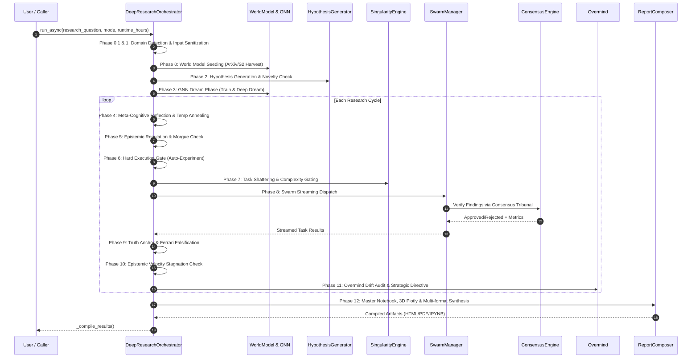

# FORENSIC ARCHITECTURAL AUDIT: SVEL MASTER ORCHESTRATION & SINGULARITY ENGINE

**Audit Date**: 2026-09-17  
**Scope**: 
- `backend/orchestration/deep_research_orchestrator.py` (262,806 bytes / 4,947 lines)
- `backend/orchestration/overmind.py` (14,233 bytes / 339 lines)
- `backend/orchestration/singularity.py` (24,447 bytes / 546 lines)
- `backend/orchestration/swarm_manager.py` (22,879 bytes / 482 lines)
- `backend/orchestration/beast_tracer.py` (19,981 bytes / 630 lines)

---

## 1. EXECUTIVE SUMMARY & ARCHITECTURAL TOPOLOGY

The SVEL Master Orchestration Engine represents a distributed, multi-agent scientific discovery architecture designed for autonomous hypothesis generation, empirical experiment dispatch, adversarial falsification, and multi-modal synthesis over 12 to 72-hour runtimes.

```mermaid
flowchart TD
    subgraph Core Orchestration ["DeepResearchOrchestrator (Master Loop)"]
        Init["0.1-1: Domain, Seeding & Battle Plan"] --> HypGen["2: Hypothesis Gen & Novelty Gate"]
        HypGen --> Dream["3: Subconscious GNN Dream"]
        Dream --> Meta["4: Meta-Reflection & Sigmoidal Annealing"]
        Meta --> Gate["5-6: Epistemic Law & Hard Execution Gate"]
        Gate --> Plan["7: PlanCreator & Singularity Shatter"]
        Plan --> SwarmExec["8: SwarmManager Parallel Dispatch"]
        SwarmExec --> Analysis["9: Truth Anchor & Ferrari Falsification"]
        Analysis --> Velocity["10: Epistemic Velocity Monitor"]
        Velocity --> Audit["11: Overmind Superego Audit"]
        Audit --> LoopCheck{"Time/Convergence Remaining?"}
        LoopCheck -- Yes --> Meta
        LoopCheck -- No --> Finalize["12: Consensus Tribunal, Notebook & Synthesis"]
    end

    subgraph Supervisory ["Meta-Supervision & Scaling"]
        Overmind["Overmind (overmind.py)<br/>Semantic Drift & Hard Stop"] -.-> Audit
        Singularity["Singularity Engine (singularity.py)<br/>Complexity Gating & Hydra Recovery"] -.-> Plan
        Swarm["SwarmManager (swarm_manager.py)<br/>Worker Pool & Consensus Tribunal"] -.-> SwarmExec
        Tracer["BeastTracer (beast_tracer.py)<br/>Telemetry & Step Audit"] -.-> Core Orchestration
    end
```

The system couples a strict state machine (`ResearchState`: `INITIALIZING`, `GENERATING_HYPOTHESES`, `PLANNING`, `EXECUTING`, `ANALYZING`, `REFINING`, `CONVERGING`, `COMPLETED`, `FAILED`, `PAUSED`, `REJECTED`) with an asynchronous worker pool, graph-neural-network subconscious intuition layer, and adversarial falsification tribunals.

---

## 2. DECONSTRUCTION OF THE 12-PHASE SCIENTIFIC DISCOVERY LIFECYCLE

The discovery lifecycle spans initialization, generation, testing, validation, and synthesis:



### Phase-by-Phase Technical Analysis

#### Phase 0.1: Domain Recognition & Input Sanitization
- **File & Lines**: `deep_research_orchestrator.py` L1248–L1271, L1335–L1342.
- **Mechanism**: Calls `DomainRegulator.detect_domain(self.research_question)`. Detects interdisciplinary technical keywords (`["topology", "manifold", "proof", "derivation", "convergence", "stability"]`). The input is then passed through `InputSanitizer.sanitize()` to intercept prompt injections before session initialization.

#### Phase 0: World Model Seeding & Literature Grounding
- **File & Lines**: `deep_research_orchestrator.py` L1308–L1321, L1533–L1860 (`_seed_world_model`).
- **Mechanism**: Connects to ArXiv and Semantic Scholar to ingest `min_abstracts=50` and `min_papers=10`. 
- **Epistemic Stop Guard**:
  ```python
  current_fact_count = self.world_model.get_facts_count() if self.world_model else 0
  if current_fact_count < 1:
      logger.critical(" [FATAL] Epistemic Grounding Failed. Zero facts stored in World Model after seeding.")
      return {"status": "error", "error": "Knowledge harvest yielded zero facts. Aborting to prevent hallucinations."}
  ```

#### Phase 0.5: Strategic Battle Planning
- **File & Lines**: `deep_research_orchestrator.py` L1322–L1331.
- **Mechanism**: `DynamicStrategyEngine.compose_battle_plan(objective, domain)` sets initial operational posture, selecting required toolsets and strategic protocols before hypothesis construction.

#### Phase 2: Sovereign Hypothesis Generation & Novelty Gating
- **File & Lines**: `deep_research_orchestrator.py` L1863–L1906 (`_phase_generate_hypotheses`).
- **Mechanism**: 
  1. Sovereign Tool Selection: Scans `expert_system.get_tool_catalog()`, prompts LLM to bind 5–8 domain-specific tools.
  2. Generation: `HypothesisGenerator.generate_hypotheses()` constructs structured `Hypothesis` objects containing variables, functional forms ($Y = f(X)$), physical boundary constraints, and testable predictions.
  3. Novelty Filter: `NoveltyChecker.check_novelty(h, existing)` computes embedding cosine distance against the hypothesis pool, dropping duplicates before committing to tracker and `WorldModel`.

#### Phase 3: Subconscious Discovery / GNN Dreaming
- **File & Lines**: `deep_research_orchestrator.py` L1919–L2059 (`_gnn_dream_phase`).
- **Mechanism**: 
  1. Minimum Graph Gate: Requires $N_{edges} \ge 200$. On smaller graphs, training is skipped to avoid high-variance pseudo-signals.
  2. Training: Calls `oracle.train_on_graph(snapshot)` using SentenceTransformer node representations.
  3. Dreaming: Calls `oracle.deep_dream(top_k, empirical_checker)`.
  4. Uncertainty Ranking: Hunches are ranked by uncertainty-discounted confidence:
     $$\text{Rank Score} = C \cdot (1.0 - \sigma)$$
     where $C \in [0, 1]$ is GNN confidence and $\sigma \in [0, 1]$ is model uncertainty. Hunches are converted to formal hypotheses and checked for novelty.

#### Phase 4: Meta-Cognitive Reflection & Annealing Scheduling
- **File & Lines**: `deep_research_orchestrator.py` L2140–L2195 (`_execute_cycle`).
- **Mechanism**: `MetaReasoningLayer.adapt_strategy_async()` inspects refusal rate, budget consumption, and graph retrieval nodes to adjust branch factors and concurrency limits.
- **Mathematical Formulation (Sigmoidal Temperature Decay)**:
  Progress $p$ is tied strictly to elapsed physical wall-clock time:
  $$p = \min\left(1.0, \frac{t_{\text{elapsed}}}{t_{\text{max\_runtime}}}\right)$$
  $$\text{exponent} = k \cdot (p - x_0) = 10.0 \cdot (p - 0.5)$$
  $$T(p) = 1.0 - \frac{1}{1 + e^{-\text{exponent}}} = \frac{1}{1 + e^{10.0 \cdot (p - 0.5)}}$$
  Clamped to $[0.01, 1.0]$. The system transitions sharply from hot exploratory divergence ($T > 0.7$) to cold, deterministic exploitation ($T < 0.3$) at the timeline midpoint.

#### Phase 5: Epistemic Regulation & Semantic Morgue Rejection
- **File & Lines**: `deep_research_orchestrator.py` L2202–L2286, L2332–L2356.
- **Mechanism**:
  1. `EpistemicRegulator.regulate()` issues discrete actions: `SPAWN_VARIANTS`, `DECAY_CONFIDENCE`, `MERGE_HYPOTHESES` (with evidence graph transference), or `REFUTE`.
  2. Semantic Morgue Filter: `red_team.query_morgue(h.statement, similarity_threshold=0.85)` compares active hypotheses against previously killed dead-ends, auto-refuting cyclical ideas.

#### Phase 6: Hard Execution Gate (Auto-Experimentation)
- **File & Lines**: `deep_research_orchestrator.py` L2357–L2486.
- **Mechanism**: All unverified hypotheses with confidence $\ge 0.5$ are dispatched directly to `ExperimentAgent` or `ml_model_builder_agent`. Verdicts (`CONFIRMED`, `REFUTED`, `INCONCLUSIVE`) trigger direct state updates:
  - `CONFIRMED`: $C \leftarrow \min(1.0, C + 0.2)$
  - `REFUTED`: $C \leftarrow \max(0.0, C - 0.3)$, state set to `HypothesisState.REFUTED`
  - `INCONCLUSIVE`: $C \leftarrow \min(0.75, C + 0.05)$

#### Phase 7: Continuous Dynamic Planning & Singularity Shattering
- **File & Lines**: `deep_research_orchestrator.py` L2488–L2718.
- **Mechanism**: Monitored by a queue starvation threshold (`MIN_QUEUE_SIZE = 5`). If starving, `PlanCreator` generates new tasks, vetted mechanically by `PlanReviewer` and adversarially by `ProtocolValidator`. Each task is then passed to `SingularityEngine.decompose_task` and the router's `neural_fractalizer.shatter()`.

#### Phase 8: Massive Swarm Streaming Execution
- **File & Lines**: `deep_research_orchestrator.py` L2719–L2874, `swarm_manager.py` L165–L240.
- **Mechanism**: `SwarmManager.execute_swarm_stream` dispatches batched subtasks over an `asyncio.Queue` worker pool guarded by a concurrency semaphore. Completed results are verified by the `ConsensusEngine` tribunal and streamed directly into `_process_completed_task`.

#### Phase 9: Truth Anchor & Ferrari Falsification
- **File & Lines**: `deep_research_orchestrator.py` L3288–L3793 (`_analyze_cycle_results`).
- **Mechanism**:
  1. `DiscoveryScorer.score_discovery()` evaluates findings against `StatisticalGroundingValidator`, `FailureDetector`, and `RedTeamAgent`.
  2. Nuclear Penalty: Any finding scoring $< 0.35$ is purged from `self.session.findings`.
  3. Ferrari Engine: Surviving hypotheses undergo post-hoc data attacks via `AdversarialExecutor`. Unrefuted hypotheses accumulate survival cycles and are promoted across tiers:
     $$\text{ESCAPED} \longrightarrow \text{RESILIENT} \longrightarrow \text{STRUCTURAL}$$

#### Phase 10: Epistemic Velocity & Stagnation Governance
- **File & Lines**: `deep_research_orchestrator.py` L1396–L1419, L2917–L2946.
- **Mechanism**: Tracks structural findings gained per cycle:
  $$\Delta_{\text{findings}} = |\text{Facts}_{t}| - |\text{Facts}_{t-1}|$$
  If $\Delta_{\text{findings}} == 0$:
  - Strike 3: Overrides temperature to $T = 0.9$ (forced exploration shake-up).
  - Strike 4: Triggers strategic reset, archiving unconfirmed hypotheses ($C < 0.7$) and generating a new orthogonal paradigm hypothesis.
  - Strike 5: Premature convergence shutdown.

#### Phase 11: Superego Strategic Auditing (The Overmind)
- **File & Lines**: `deep_research_orchestrator.py` L1420–L1485, L2287–L2324, `overmind.py` L124–L314.
- **Mechanism**: Evaluates semantic divergence against the mission objective. Returns directives: `continue`, `prune`, `pivot`, `intensify`, or `terminate`.

#### Phase 12: Master Notebook, Visualizations & Multi-Format Synthesis
- **File & Lines**: `deep_research_orchestrator.py` L3794–L4170 (`_phase_finalize`).
- **Mechanism**:
  1. Consensus Tribunal: Final adversarial sweep over the top 50 findings.
  2. Viz AI Coder: Generates publication-grade 3D Plotly and matplotlib figures from structured findings.
  3. Master Jupyter Notebook: `JupyterExporter` compiles every executed Python script, dataset, and visualization cell into `{safe_title}_master.ipynb`.
  4. Report Composer: Directly invokes `report_composer_agent` with full SQLite WorldModel rehydration to generate camera-ready PDF, HTML, and LaTeX papers.

---

## 3. DEEP ANALYSIS OF `overmind.py` AND `singularity.py`

### 3.1 Overmind: Trajectory Divergence & Superego Governance

The Overmind serves as the system's "Superego," preventing semantic drift and hallucination spirals.

#### Mathematical Drift Formulation
The `DriftMeter` projects the original research goal $G$ and the current session state $S_{\text{current}}$ into embedding space using SentenceTransformer:
$$\mathbf{e}_G = \mathcal{E}(G), \quad \mathbf{e}_S = \mathcal{E}(S_{\text{current}})$$
$$\text{Cosine Similarity: } \rho(G, S) = \frac{\mathbf{e}_G \cdot \mathbf{e}_S}{\|\mathbf{e}_G\|_2 \|\mathbf{e}_S\|_2}$$
$$\text{Semantic Drift: } \mathcal{D}(G, S) = \max\left(0.0, \min\left(1.0, 1.0 - \rho(G, S)\right)\right)$$

Where $S_{\text{current}}$ is formulated at line 142 as:
$$S_{\text{current}} = \text{"Hypotheses: "} \oplus \bigcup_{h \in H_{\text{testing}}} \text{stmt}(h) \oplus \text{". Findings: "} \oplus \bigcup_{f \in F_{\text{recent}}} \text{content}(f)$$

#### Gating & Decision Thresholds
- **Startup Protection**:
  - $\text{Cycle } \le 1 \implies \mathcal{D} \leftarrow \min(\mathcal{D}, 0.2)$, forces `action: "continue"`.
  - $\text{Cycle } \le 3 \implies \mathcal{D} \leftarrow \min(\mathcal{D}, 0.4)$.
- **Deterministic Gate**:
  - If $\mathcal{D} < 0.25$ and $\text{cycle} \pmod 5 \ne 0$, Overmind stands down immediately without calling the LLM.
- **Intervention Gate**:
  - If $\mathcal{D} \ge 0.25$ or $\text{cycle} \pmod 5 == 0$, Overmind prompts `META_REASONING_MODEL` (Claude 3.5 Sonnet / Opus class) with critical reasoning protocol overrides.
- **Hard Stop Authority (Epistemic Law)**:
  At lines 298–301, if the LLM issues `"action": "terminate"`, Overmind sets:
  ```python
  self.termination_requested = True
  self.termination_reason = directive.get("rationale", "Overmind strategic termination")
  ```
  This is wired directly into the orchestrator's `_can_proceed()` check at lines 1180–1182, instantly blocking the next cycle.

---

### 3.2 Singularity Engine: Fractal Task Decomposition & Dynamic Recovery

The `SingularityEngine` enables recursive self-prompting, task atomicization, and infinite loop continuation.

#### Heuristic Complexity Gate
To prevent token waste on simple tasks, Singularity computes a deterministic complexity metric:
$$\mathcal{C}(\tau) = \left\lfloor \frac{\text{len}(\text{desc})}{100} \right\rfloor + n_{\text{and}} + n_{\text{or}} + n_{\text{if}} + n_{\text{when}} + n_{\text{depends}} + \mathbb{I}_{\text{scope}}$$
Where $\mathbb{I}_{\text{scope}} = 1$ if any of `["comprehensive", "detailed", "full"]` occur in the description.
- If $\mathcal{C}(\tau) < 1$: Task is considered atomic; decomposition is bypassed.

#### Fractal Prompting & Task Atomization
For tasks with $\mathcal{C}(\tau) \ge 1$, Singularity calls `TASK_DECOMPOSITION_MODEL` with:
- `description`: Parent task specification
- `research_question`: Global objective anchor
- Schema enforcement: Returns JSON list typed by `task_type` and `decomposition_type` (`exploration`, `falsification`, `survey`).
- Deduplication: Computes a 200-character normalized key $\text{desc}[:200]\text{.lower()}$ and eliminates parent self-similarity.

#### The Hydra Protocol (Dynamic Failure Recovery)
When an agent task fails in the swarm, `on_child_failure` (L152) triggers `re_decompose` (L79):
1. Captures failed task description and `error_context`.
2. Recursion Guard: If `depth > 3`, aborts decomposition to prevent a "Hydra Death Spiral."
3. Prompts the decomposition model to generate 2–3 targeted bypass tasks:
   - Error is *Missing Data* $\implies$ Subtask: *"Search Alternative Sources"*
   - Error is *Code Execution Error* $\implies$ Subtask: *"Debug and Write Simpler Code"*
4. New subtasks inherit parent priority and metadata `recovery_parent: failed_task.id`.

#### Micro-Orchestration (Recursive Sub-Orchestrator Spawning)
At lines 427–524, when an exploration task has $\mathcal{C}(\tau) \ge 2$ or contains keywords like `"systematic review"`, `SingularityEngine` spawns a recursive `DeepResearchOrchestrator`:
```python
child_orchestrator = DeepResearchOrchestrator(
    research_question=task.description,
    domain="general",
    max_cycles=1,
    max_runtime_hours=0.1,
    router=self.router,
    llm_manager=self.llm_manager,
    recursion_depth=depth + 1
)
await child_orchestrator.run_async()
```
The child runs an isolated discovery cycle, and its findings are harvested and returned to the parent.

---

## 4. DEEP ANALYSIS OF `swarm_manager.py` AND `beast_tracer.py`

### 4.1 Swarm Manager: Worker Pools, Rate Limiting & Consensus Tribunal

#### Worker Pool Architecture
- Pattern: Asynchronous Worker Pool backed by `asyncio.Queue`.
- Tasks are enqueued into `local_queue`.
- Spawns $N = \min(\text{max\_parallel}, |\text{tasks}|)$ worker coroutines (`Agent-001` ... `Agent-050`).
- **Burst Rate Limiting**: Workers acquire `self.token_bucket = asyncio.Semaphore(max_parallel * 2)` before invoking router execution.
- **Neural Jitter**: Lines 294–295 enforce `await asyncio.sleep(random.uniform(0.1, 5.0))` on worker boot to stagger burst API requests.

#### Streaming Zero-Accumulation
Instead of storing all results in RAM, `execute_swarm_stream` yields results as they complete via `results_queue.get()`, preventing memory bloat during massive parallel executions.

#### Deadlock Prevention & Serial Rescue Fallback
To handle hung agent calls:
1. Queue Timeout: `asyncio.wait_for(results_queue.get(), timeout=900.0)` (15-minute per-task execution ceiling).
2. Worker Purge: On timeout, all active workers are cancelled via `w.cancel()` and awaited.
3. Serial Rescue: Pops the orphaned task from `local_queue` and runs it directly in-process via `_execute_task_direct` without multiprocessing or router queue overhead.
4. Pool Re-initialization: Spawns fresh `Agent-Rescue-XXX` workers for any remaining queue items.

#### Consensus Tribunal (Verification Engine)
Every completed finding must pass through `ConsensusEngine.verify_finding()` before acceptance:
- Prompts LLM with expert skills injected (`"adversarial review critical thinking"`).
- Extracts JSON containing `"verdict"` (`YES` or `NO`) and numeric `"metrics_found"`.
- **Quantitative Gate Checks**:
  - Accuracy Drop Check: If goal contains `"<0.5%"`, verifies `val <= 0.005`. Overrides verdict to `NO` if violated.
  - FLOPs Reduction Check: If goal contains `"60%"`, verifies `val >= 0.60`. Overrides verdict to `NO` if violated.

---

### 4.2 Beast Tracer: Telemetry, State Tracking & IDOR Security

#### Telemetry Schema
`BeastTracer` constructs a hierarchical directed trace:
- `ExecutionTrace`: Root object holding `trace_id`, `mission_id` (tenant ID), `query`, timestamps, `context`, and aggregated `statistics`.
- `TraceStep`: Individual operational units (`decomposition`, `subtask`, `llm_call`, `tool_call`, `fallback`, `merge`). Records start/end time, duration, provider, model, token usage, error payloads, and sanitized input/output previews.

#### Concurrency & Step Tracking
Maintains `self._active_steps: Dict[str, TraceStep]`.
- Start: `log_step_start()` allocates an `internal_id = f"{step_id}_{len(self._current_trace.steps)}"`.
- Completion: `log_step_complete()` moves the step from `_active_steps` into `_current_trace.steps` and calculates `duration_s = end_time - start_time`.

#### Tenant Security & IDOR Prevention
`export_trace()` enforces authorization verification (L566–L570):
```python
if mission_id and trace.get("mission_id") != mission_id:
    logger.warning(f"IDOR DETECTED: User {mission_id} tried to access trace {trace_id} belonging to {trace.get('mission_id')}")
    return None
```

---

## 5. FORENSIC CATALOG OF ARCHITECTURAL FLAWS, RACE CONDITIONS, AND STATE DESYNCS

### Flaw 1: Duplicate Overmind Trajectory Audits in the Same Cycle
- **Files & Lines**: 
  - `deep_research_orchestrator.py` L2289–L2296 (Inside `_execute_cycle`)
  - `deep_research_orchestrator.py` L1423–L1435 (Inside `run_async`)
- **Severity**: HIGH (Resource Exhaustion & State Desync)
- **Mechanism**:
  `audit_trajectory()` is called twice per audit interval:
  1. First at Step 0.5 of `_execute_cycle()` before planning and execution.
  2. Second at the end of the research cycle in `run_async()`.
- **Impact**: Doubles the expensive LLM calls to `META_REASONING_MODEL`, creates duplicate audit log entries in `self.audit_log` with identical cycle numbers, and creates strategic race conditions if the first audit orders `continue` and the second audit orders `pivot`.

### Flaw 2: Overmind Silent Exception Swallowing Suppresses Critical Failures
- **File & Lines**: `overmind.py` L311–L314
- **Severity**: HIGH (Epistemic Blindness)
- **Mechanism**:
  ```python
  except Exception as e:
      logger.error(f"Overmind audit failed: {e}")
      return {"action": "continue", "rationale": f"Audit exception: {e}"}
  ```
- **Impact**: If the LLM provider times out, returns HTTP 429, or fails JSON repair, Overmind catches the exception, logs it, and silently returns `action: "continue"`. A completely deranged or drifting research swarm will be allowed to run unchecked for 72 hours without oversight.

### Flaw 3: Semantic Drift Embedding Degeneracy on Startup / Empty Findings
- **File & Lines**: `overmind.py` L139–L144
- **Severity**: MEDIUM (Calculation Distortion)
- **Mechanism**:
  ```python
  active_hyps = [h.statement for h in hypotheses if h.state == HypothesisState.TESTING]
  recent_findings = [f.get("content", "") for f in findings[-5:]]
  current_state_text = f"Hypotheses: {' '.join(active_hyps)}. Findings: {' '.join(recent_findings)}"
  drift_score = self.drift_meter.compute_drift(research_question, current_state_text)
  ```
- **Impact**: In early cycles or if hypotheses are in `PENDING` rather than `TESTING`, both lists are empty. `current_state_text` evaluates to `"Hypotheses: . Findings: "`. The cosine similarity between the research question and this empty prefix is near zero, calculating a catastrophic drift score ($\approx 1.0$). This is masked by hardcoded clamps in cycles 1–3 (`min(drift, 0.2)` / `min(drift, 0.4)`), but in cycle 4+ any empty findings window triggers false emergency pivots.

### Flaw 4: Swarm Worker Timeout Purge Permanently Drops Non-Hung Tasks
- **File & Lines**: `swarm_manager.py` L200–L233, L436–L446
- **Severity**: CRITICAL (Data Loss & Race Condition)
- **Mechanism**:
  When `results_queue.get()` times out after 900s, the scavenger logic cancels ALL active workers:
  ```python
  for w in workers:
      if not w.done():
          w.cancel()
  await asyncio.gather(*workers, return_exceptions=True)
  ```
  Every worker catches `asyncio.CancelledError` and pushes `{"status": "cancelled"}` into `results_queue`. The rescue logic then runs ONE task serially from `local_queue`. Then the loop continues:
  `result = await asyncio.wait_for(results_queue.get(), timeout=900.0)`
  `yield result`
  `tasks_remaining -= 1`
- **Impact**: The loop retrieves the `"cancelled"` messages emitted by all the other $N-1$ non-hung workers that were aborted mid-execution. Those in-flight tasks are counted as finished (`tasks_remaining -= 1`), never re-enqueued, and permanently lost.

### Flaw 5: Sycophantic False Acceptance in ConsensusEngine
- **File & Lines**: `swarm_manager.py` L86–L93
- **Severity**: HIGH (False Consensus & Quality Gate Failure)
- **Mechanism**:
  ```python
  if not parsed or not isinstance(parsed, dict):
      verdict = "YES" if "YES" in text.upper() else "NO"
      metrics = {}
  ```
- **Impact**: If an LLM response fails JSON parsing and outputs:
  `"Verdict: NO. Does not meet requirements. Answer is neither YES nor MAYBE."`
  The substring `"YES"` is detected in `text.upper()`. `verdict` is set to `"YES"`, and `metrics` is `{}`. Because `metrics` is empty, quantitative gate checks pass without verification, and `return verdict == "YES"` evaluates to `True`. A rejected or malformed finding is approved as true scientific ground truth.

### Flaw 6: Micro-Orchestrator Recursion Deadlock on World Model Seeding
- **File & Lines**: `singularity.py` L476–L489, `deep_research_orchestrator.py` L1308–L1318
- **Severity**: HIGH (Architectural Deadlock)
- **Mechanism**:
  When `SingularityEngine.execute_micro_orchestration` spawns a child `DeepResearchOrchestrator` to solve an atomic task (e.g. "Write python script for matrix multiplication"), the child orchestrator starts `run_async()`, which immediately executes `_seed_world_model()` against ArXiv. Narrow technical tasks yield zero ArXiv abstracts, causing:
  ```python
  current_fact_count = self.world_model.get_facts_count()
  if current_fact_count < 1:
      return {"status": "error", "error": "Knowledge harvest yielded zero facts."}
  ```
- **Impact**: Micro-orchestration fails on every procedural, technical, or atomic subtask.

### Flaw 7: Fragile 4-Level Nested Dictionary Access in Micro-Orchestrator Harvest
- **File & Lines**: `singularity.py` L494–L499
- **Severity**: MEDIUM (Silent Result Dropping)
- **Mechanism**:
  ```python
  res = f.get("result", {}).get("result", {}).get("result", {}).get("results", {}).get("summary", {})
  ```
- **Impact**: Hardcoded 4-level nested structure. If the child orchestrator returns a standard result dictionary (`f["result"]["summary"]`), this expression returns `{}` and falls back to `str(f.get("result", {}).get("summary", ""))` which defaults to empty string `""`. Valid child findings are discarded.

### Flaw 8: Recursion Depth Check Placed After Expensive LLM Invocation
- **File & Lines**: `singularity.py` L278–L291
- **Severity**: MEDIUM (Latency & Token Waste)
- **Mechanism**:
  ```python
  result = await asyncio.to_thread(self.llm_manager.run, prompt=prompt, model=TASK_DECOMPOSITION_MODEL)
  depth = context.get("depth", 0)
  if depth >= int(os.environ.get("SINGULARITY_MAX_DEPTH", "5")):
      return [task]
  ```
- **Impact**: LLM decomposition call is executed *before* checking if max recursion depth has been reached. Wastes tokens and latency before terminating recursion.

### Flaw 9: Incomplete Decomposition Memory Cache
- **File & Lines**: `singularity.py` L248–L253, L414–L419
- **Severity**: MEDIUM (Performance & Token Waste)
- **Mechanism**:
  `_decomposition_memory[task_hash]` records `{"child_count": len(unique_tasks), "status": "decomposed"}`, but does NOT store the generated subtasks.
- **Impact**: When the same task hash is encountered again, `mem.get("child_count", 0) == 0` is false, so it does not return early. It re-invokes the LLM decomposition pipeline from scratch.

### Flaw 10: Step ID Collisions in BeastTracer Under High Swarm Concurrency
- **File & Lines**: `beast_tracer.py` L248–L260, L276–L296
- **Severity**: HIGH (Telemetry Corruption & Race Condition)
- **Mechanism**:
  ```python
  internal_id = f"{step_id}_{len(self._current_trace.steps)}"
  self._active_steps[internal_id] = step
  ```
- **Impact**: Under 50–200 concurrent swarm workers, multiple workers execute `len(self._current_trace.steps)` simultaneously. If `step_id` is identical (e.g. `"worker_task"`), they generate the exact same `internal_id`. The second worker overwrites the first worker's entry in `_active_steps`. When the first worker completes, it deletes `internal_id`, causing the second worker's completion call to fail with `"No active step found"`, silently corrupting trace telemetry.

### Flaw 11: Blocking Disk I/O in Async Loop
- **File & Lines**: `beast_tracer.py` L536–L538
- **Severity**: MEDIUM (Event Loop Latency Spikes)
- **Mechanism**:
  ```python
  with open(filepath, "w") as f:
      json.dump(trace_dict, f, indent=2)
  ```
- **Impact**: Synchronously serializes multi-megabyte trace logs to disk on the main thread, blocking the asyncio event loop for hundreds of milliseconds.

### Flaw 12: Cross-Task File Attribution Race Condition in Experiment Verification
- **File & Lines**: `deep_research_orchestrator.py` L4350–L4365
- **Severity**: HIGH (Validation Bypass & Race Condition)
- **Mechanism**:
  ```python
  new_files = [f for f in exp_dir.glob("**/*") if f.is_file() and (current_time - f.stat().st_mtime) < 600]
  if not new_files:
      # Fraud detected
  ```
- **Impact**: Scans the entire `experiments/` directory for any file touched in the last 10 minutes. If parallel experiment worker A generates a CSV file, parallel worker B (which may have failed or hallucinated without generating files) checks `exp_dir`, sees worker A's file, and is falsely credited with producing valid physical artifacts.

### Flaw 13: Permanently Disabled Physical Boundary Audits (`RealityConstraints`)
- **File & Lines**: `deep_research_orchestrator.py` L750, L2559–L2567
- **Severity**: MEDIUM (Safety & Scientific Rigor)
- **Mechanism**:
  `self.reality_constraints = None` accompanied by comment: `"RealityConstraints class was deleted in a refactor"`.
- **Impact**: Code at L2559 skips plan boundary validation entirely, allowing physically impossible research plans to proceed into execution.

---

## 6. SYSTEM EQUATIONS REFERENCE TABLE

| System Component | Equation / Metric | Source File & Lines |
| :--- | :--- | :--- |
| **DriftMeter Semantic Distance** | $\mathcal{D} = \max\left(0, \min\left(1, 1 - \frac{\mathbf{e}_G \cdot \mathbf{e}_S}{\|\mathbf{e}_G\|_2 \|\mathbf{e}_S\|_2}\right)\right)$ | `overmind.py` L91–L95 |
| **Sigmoidal Annealing Temp** | $T(p) = \frac{1}{1 + e^{10.0 \cdot (p - 0.5)}}, \quad p = \min\left(1.0, \frac{t_{\text{elapsed}}}{t_{\text{max}}}\right)$ | `deep_research_orchestrator.py` L1070–L1087 |
| **Singularity Complexity Gate** | $\mathcal{C}(\tau) = \lfloor \frac{\text{len}}{100} \rfloor + \sum \text{conjunctions} + \mathbb{I}_{\text{scope}}$ | `singularity.py` L169–L188 |
| **GNN Uncertainty Discount** | $\text{Score}_{\text{hunch}} = C \cdot (1.0 - \sigma)$ | `deep_research_orchestrator.py` L1980–L1986 |
| **Bayesian Confidence Penalty** | $C_{\text{final}} = C_{\text{raw}} \cdot (1.0 - \sigma)$ | `deep_research_orchestrator.py` L4448–L4450 |
| **Consensus Thresholds** | $\text{acc\_drop} \le 0.005 \quad (0.5\%), \quad \text{flops\_red} \ge 0.60 \quad (60\%)$ | `swarm_manager.py` L98–L116 |

---

## 7. REMEDIATION ROADMAP

### Recommendation 1: Deduplicate Overmind Audit Calls
- Remove the redundant audit invocation inside `_execute_cycle()` (L2289–L2324).
- Keep Overmind exclusively at the cycle boundary in `run_async()` (L1423), checking `_can_proceed()` immediately afterwards.

### Recommendation 2: Robust Fallback for Overmind Failures
- Replace silent exception swallowing with a degraded status alert:
  ```python
  except Exception as e:
      logger.critical(f"Overmind audit failed: {e}")
      return {"action": "continue", "rationale": f"SUPERVISORY_DEGRADED: {e}", "confidence": 0.0, "degraded": True}
  ```
- Track consecutive Overmind failures; halt the run if the supervisor fails for 2 consecutive audit windows.

### Recommendation 3: Atomic Task Isolation in Scavenger Rescue
- In `swarm_manager.py`: Do not wipe all workers unconditionally on a single task timeout.
- Track tasks individually with per-worker timeouts (`asyncio.wait_for(task, timeout)` inside the worker loop) rather than wrapping the global results queue.
- If a task times out, only cancel that specific worker, leaving other healthy in-flight tasks untouched.

### Recommendation 4: Fix ConsensusEngine Parse Fallback
- In `swarm_manager.py` L86–L93:
  ```python
  if not parsed or not isinstance(parsed, dict):
      # Safe fallback: require explicit uppercase delimiter, not substring
      verdict = "YES" if re.search(r'\b(YES|APPROVED|CONFIRMED)\b', text.upper()) and not re.search(r'\b(NO|REJECTED|REFUTED)\b', text.upper()) else "NO"
  ```

### Recommendation 5: Isolate Experiment Artifact Validation by Task ID
- In `deep_research_orchestrator.py` L4350:
  Require `ExperimentAgent` to write output files to a session-and-task-scoped directory:
  `experiments/{session_id}/{task_id}/`
  Verify artifacts exclusively within that specific subfolder to eliminate cross-task pollution.

### Recommendation 6: Thread-Safe UUIDs for BeastTracer
- In `beast_tracer.py` L248:
  Replace `internal_id = f"{step_id}_{len(self._current_trace.steps)}"` with:
  ```python
  internal_id = f"{step_id}_{uuid.uuid4().hex[:8]}"
  ```
  And replace synchronous `json.dump` with `await asyncio.to_thread(_save_trace_sync)`.

### Recommendation 7: Bypass Seeding in Recursive Micro-Orchestrators
- Pass `is_suborchestrator=True` (or check `recursion_depth > 0`) in `DeepResearchOrchestrator.__init__`.
- When `recursion_depth > 0`, inherit the parent's `WorldModel` directly and skip `_seed_world_model()`.

---

*Report compiled and transmitted by Research Subagent.*