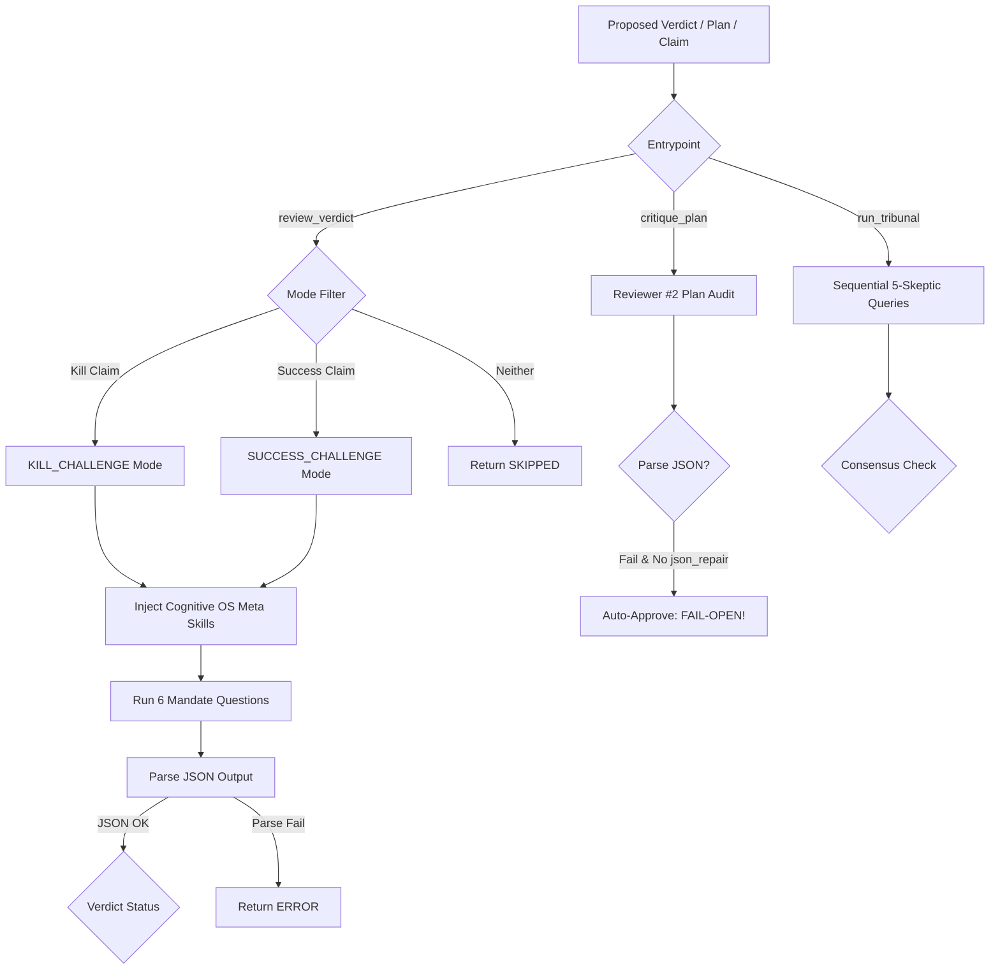
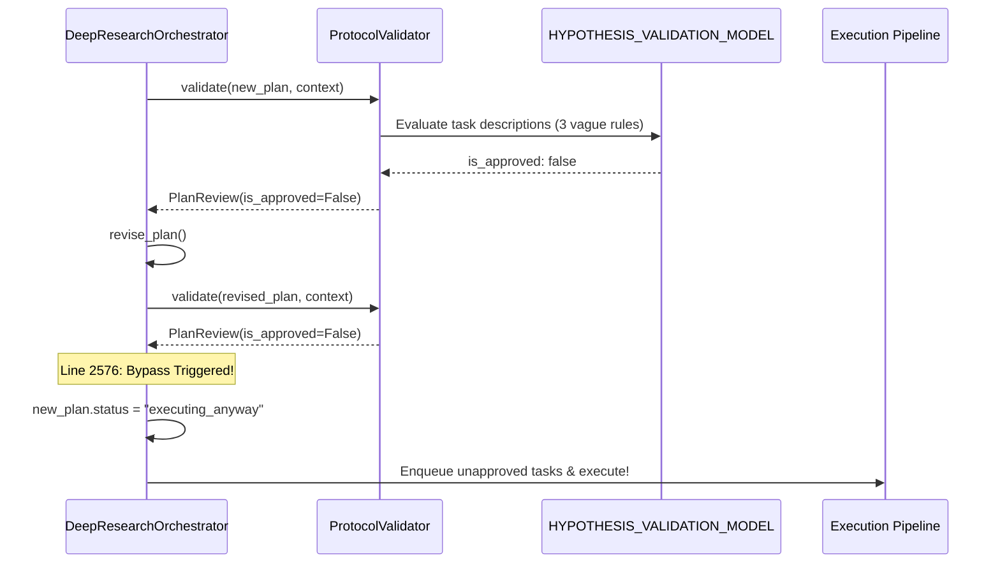
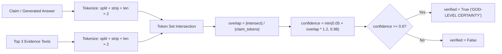
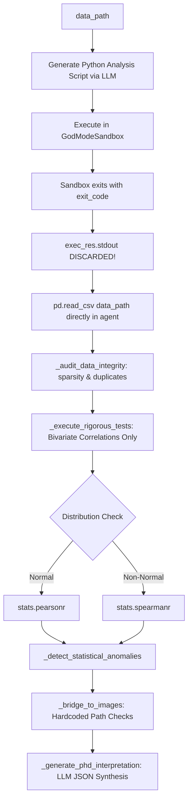

# FORENSIC ARCHITECTURAL AUDIT REPORT: SVEL RED TEAM, PROTOCOL VALIDATION & AGENT SWARM

**Audit Date:** 2026-09-17  
**Auditor:** Autonomous Systems Research Subagent  
**Target Repository:** `/Users/samaraldico/SVEL AI Scientist/backend`  
**Files Audited:**
1. `backend/agents/red_team_agent.py` (761 lines)
2. `backend/agents/protocol_validator.py` (128 lines)
3. `backend/agents/fact_checker_agent.py` (148 lines)
4. `backend/agents/qa_agent.py` (476 lines)
5. `backend/agents/writer_agent.py` (1182 lines)
6. `backend/agents/data_analyzer_agent.py` (465 lines)
*Supporting Orchestration & Validation Files Examined:*
- `backend/orchestration/deep_research_orchestrator.py`
- `backend/core/validation/discovery_scorer.py`
- `backend/agents/report_composer.py`
- `backend/agents/experiment_agent.py`

---

## 1. EXECUTIVE SUMMARY

The SVEL scientific validation and agent swarm architecture contains sophisticated design concepts—such as the 6 Mandate Questions for adversarial review, multi-agent tribunals, assumption ledgers, and cognitive skill injection. However, a forensic inspection of the implementation reveals **critical structural decouplings, fail-open vulnerabilities, pseudo-verification heuristics ("security theater"), and complete bypass gates**.

### Major High-Severity Vulnerabilities Discovered:
1. **The "Executing Anyway" Protocol Bypass (`deep_research_orchestrator.py:2576`):**
   When `ProtocolValidator` rejects a research plan as mathematically flawed, unfeasible, or lacking controls—even after a revision cycle—the orchestrator unconditionally sets `new_plan.status = "executing_anyway"` and enqueues all tasks into the execution pipeline regardless.
2. **The `final_verdict` Key Mismatch & Automatic Survivor Promotion (`deep_research_orchestrator.py:2956-2970, 3325-3328`):**
   The orchestrator extracts finding verdicts using `finding.get("result", {}).get("final_verdict", "UNKNOWN")`. However, almost all agents (`DataAnalyzerAgent`, `FactCheckerAgent`, `QAAgent`) return `"verdict"` or raw text. When `"UNKNOWN"` is passed to `RedTeamAgent.review_verdict()`, the Red Team skips evaluation (`status: SKIPPED`). In the orchestrator, because no finding contains `final_verdict: "DEAD"`, `killed_this_cycle` is constantly `0`, triggering automatic "Survivor Amplification" and promoting unverified hypotheses into `RESILIENT` and `STRUCTURAL` tiers.
3. **Red Team Status Disconnect in Discovery Scoring (`discovery_scorer.py:880-925`):**
   `RedTeamAgent.review_verdict()` outputs statuses: `APPROVED`, `REJECTED`, `DOWNGRADE`, `ESCAPED`, `INVALID_CLAIM`, `SKIPPED`. But `DiscoveryScorer._score_adversarial_survival()` only checks for `APPROVED`, `MODIFIED`, and `REJECTED`. For all other statuses (`DOWNGRADE`, `ESCAPED`, `INVALID_CLAIM`, `SKIPPED`), it defaults to `0.5` (a neutral pass), completely neutralizing the Red Team's veto.
4. **Fail-Open Plan Critique (`red_team_agent.py:254`):**
   If `json_repair` is not installed, any JSON parse error during `critique_plan()` causes an auto-approval: `{"status": "APPROVED", "critique": "Auto-approved (JSON parse error)"}`.
5. **QA Agent "Reality Stone" Token Overlap Pseudo-Verification (`qa_agent.py:114-132`):**
   Truth verification in `QAAgent` uses an unstemmed bag-of-words token intersection between claim and evidence. It cannot detect negation, inverted numbers, or opposite findings; a completely inverted scientific statement that shares vocabulary with the retrieved text receives up to `0.98` confidence and is labeled `"GOD-LEVEL CERTAINTY"`.
6. **Data Analyzer Sandbox Decoupling (`data_analyzer_agent.py:140-167`):**
   `DataAnalyzerAgent` prompts an LLM to generate analysis code and executes it in `GodModeSandbox`, but **discards `exec_res.stdout` completely** and instead reads the CSV directly into pandas, running basic Pearson/Spearman correlations with zero FDR/Bonferroni multiple testing corrections.
7. **Phantom LaTeX Architecture (`writer_agent.py:58`, `report_composer.py`):**
   `OutputFormat.LATEX` is an unhandled enum option. No LaTeX templates, escaping, macro packages, bibtex generation, or compiler invocations exist anywhere in the paper synthesis pipeline.

---

## 2. DECONSTRUCTION OF `red_team_agent.py`

### 2.1 Overview & Responsibilities
`RedTeamAgent` (761 lines) is designed as "Reviewer #2" / "Project Godzilla: Phase 2 - Adversarial Intelligence". It acts as the contrarian engine to attack hypotheses, challenge proposed "killer verdicts" and "success claims", audit citations, and manage the "Morgue" of dead hypotheses.



### 2.2 The 6 Mandate Questions (`red_team_agent.py:121-141`)
When auditing proposed verdicts in `review_verdict(verdict, claims, evidence)`:
1. **Necessity Check:** *"Is this assumption logically required, or historically convenient?"* (Failure $\rightarrow$ `Status: ESCAPED`)
2. **Parameter Smuggling Check:** *"Which variable was fixed without justification?"* (e.g. assuming 25°C)
3. **Constraint Tier Check:** *"Is the DEAD verdict relying on Tier 3 (Economic) constraints?"* (If yes $\rightarrow$ `Status: DOWNGRADE` to `CONDITIONALLY DEAD`)
4. **Symbolic Violation Check:** *"Do the constraints contradict symbolically (form), or only numerically?"* (Numeric only $\rightarrow$ `Status: DOWNGRADE`)
5. **Escape Enumeration Check:** *"Does ANY material / geometry / regime / control strategy escape this failure?"* (>0 routes $\rightarrow$ `Status: DOWNGRADE`)
6. **Physics Check:** *"Does this violate 2nd Law of Thermodynamics, Conservation of Energy, or imply FTL information? Are constants respected?"* (Failure $\rightarrow$ `Status: INVALID_CLAIM`)

### 2.3 Modes: `KILL_CHALLENGE` vs `SUCCESS_CHALLENGE` (`red_team_agent.py:81-91`)
- Scrutinizes both Kill claims (`"dead"`, `"fail"`, `"kill"`) and Success claims (`"success"`, `"confirm"`, `"discovered"`, `"verified"`).
- In `SUCCESS_CHALLENGE` mode, prompts the LLM to search for instrumental convergence, proxy gaming, and selection bias.
- **Flaw (`lines 86-87`):** If a verdict is phrased outside these keywords (e.g. `"SUPPORTED"`, `"INCONCLUSIVE"`, `"OPTIMAL"`, `"UNKNOWN"`), it returns `{"status": "SKIPPED"}`, bypassing the entire review!

### 2.4 Devil's Advocate / Counterfactuals (`red_team_agent.py:266-303`)
- `generate_counterfactual(claim)` prompts the LLM (`temperature=0.15`) to generate alternative mechanisms and a "distinguishing test" with a plausibility score.

### 2.5 Citation Verification (`red_team_agent.py:307-390`)
- `verify_citation(claim, cited_paper_title, cited_abstract)` implements dual-source retrieval:
  1. Calls Semantic Scholar API (`semantic_scholar_tool.search_papers`).
  2. Compares title match with `SequenceMatcher(None, paper['title'].lower(), cited_paper_title.lower()).ratio() > 0.8`.
  3. Falls back to ArXiv API (`search_arxiv`).
  4. Classifies claim vs abstract as `VALID`, `MISREPRESENTED`, `HALLUCINATED`, or `UNVERIFIABLE`.
- **Flaws:**
  - Hard-truncates abstract to 3000 chars (`cited_abstract[:3000]`).
  - If retrieval fails, sets `cited_abstract = "ABSTRACT UNAVAILABLE - VERIFICATION FAILED"` and asks the LLM to verify against that literal text, causing hallucinated `UNVERIFIABLE` errors.

### 2.6 The Morgue: Kill Chain Logging & VectorStore (`red_team_agent.py:426-559, 739-760`)
- `log_to_morgue()` merges a `DeadHypothesis` node into Neo4j with a SHA-256 hash.
- `log_to_morgue_semantic()` writes to ChromaDB/FAISS vector store.
- **Critical Flaw in `query_morgue()` (`line 505`):**
  ```python
  similarity = max(0, 1 - (score / 100))  # Rough normalization
  ```
  This normalization is mathematically invalid. Vector stores returning cosine distance yield values in $[0, 2]$. If cosine distance is $0.15$, `1 - (0.15 / 100) = 0.9985`, which causes **every single query** to falsely exceed the $0.85$ threshold. Conversely, if Euclidean ($L_2$) distance is used, unscaled distances $>100$ clamp to $0$.
- **Flaw in `_query_morgue_neo4j()` (`lines 545-546`):**
  Calculates Jaccard overlap on unstemmed, raw tokens including stopwords (`"the"`, `"is"`), skewing lexical similarity.

### 2.7 Multi-Agent Tribunal ("Council of Skeptics", `red_team_agent.py:619-738`)
- Spawns 5 specialized skeptic prompts: The Statistician, The Historian, The Physicist, The Domain/ML Scientist, The Economist.
- **Architectural Bottleneck (`lines 680-716`):** Executes 5 LLM queries sequentially in a blocking `for` loop instead of `asyncio.gather()`.
- **Consensus Vulnerability (`lines 723-725`):**
  ```python
  non_abstaining = approvals + rejections
  consensus = "APPROVED" if (approvals >= 4 or (non_abstaining > 0 and rejections == 0)) else "REJECTED"
  ```
  If 4 skeptics abstain due to lack of domain-specific data, and 1 approves, `non_abstaining = 1` and `rejections = 0`, resulting in **CONSENSUS: APPROVED**. A single approval with 4 abstentions bypasses the tribunal.

---

## 3. PROTOCOL VALIDATION & FACT CHECKING

### 3.1 `protocol_validator.py` Audit



#### Code Analysis:
- **Information Starvation (`protocol_validator.py:56`):**
  `task_descriptions = "\n".join([f"- {t.description}" for t in plan.tasks])`
  Only the string description of tasks is passed to the LLM. It receives **zero** information about:
  - Tool selections, code templates, or arguments
  - Control groups (negative controls, vehicle controls, positive controls)
  - Replicate structure (biological vs. technical replicates)
  - Power calculations or sample size bounds
  - Baseline algorithms or null models
- **Fragile Output Extraction (`line 93`):**
  `match = re.search(r"\{.*\}", text, re.S)` uses a greedy regex that captures from the first `{` to the last `}`, crashing JSON parsers if markdown code blocks or reasoning traces include braces.
- **Dead Code in `experiment_agent.py:195`:**
  `self.validator = ProtocolValidator()` is instantiated without `llm_manager` (which would trigger fail-closed line 52), but `self.validator` is never referenced anywhere in `experiment_agent.py`.
- **The Orchestrator "Executing Anyway" Backdoor (`deep_research_orchestrator.py:2569-2576`):**
  ```python
  review = await self.protocol_validator.validate(new_plan, context)
  is_approved = review.is_approved
  if not is_approved:
      new_plan = await self.plan_creator.revise_plan(new_plan, review.to_dict(), context)
      review = await self.protocol_validator.validate(new_plan, context)
      is_approved = review.is_approved

  new_plan.status = "approved" if is_approved else "executing_anyway"
  self.session.plans.append(new_plan)
  ```
  The validator has zero veto power; invalid plans are executed regardless.

---

### 3.2 `fact_checker_agent.py` Audit

#### Operational Directives (`lines 30-57`):
- Operates under a strict closed-world assumption:
  *"ZERO HALLUCINATION: You must evaluate the claim strictly based on the provided reference_context. Do not use outside training data."*
- Taxonomies: `VERIFIED`, `CONTRADICTED`, `UNSUPPORTED`, `PARTIAL`.

#### Vulnerabilities & Biases:
1. **Sycophancy / Circular Hallucination:**
   The agent does not perform retrieval. If an upstream agent generates an ungrounded context and passes it to `fact_checker_agent`, the agent faithfully verifies the claim against the hallucinated context.
2. **Epistemic Pollution of the World Model (`lines 115-135`):**
   ```python
   wm = context.get("world_model")
   if wm and data.get("verdict") in ["VERIFIED", "PARTIAL"]:
       wm.commit_verified_fact(...)
   ```
   Claims graded as `PARTIAL` (which contain unsupported extrapolations or minor errors) are committed directly to the World Model as authoritative verified facts.
3. **Orchestrator Non-Invocation:**
   `fact_checker_agent` is never invoked automatically in verification pipelines; it is merely mentioned as a suggestion in a planning prompt (`deep_research_orchestrator.py:2534`).

---

## 4. QA AGENT: THEATRICAL VERIFICATION & RETRIEVAL FLAWS

`QAAgent` (476 lines) implements the "Five Infinity Stones" architecture:
1. `mind_stone`: Simple string length split (`words > 40`) to classify complexity into "very_high", appending 3 static template sub-questions.
2. `space_stone`: Truncates retrieved documents to 550 characters.
3. `power_stone`: Wraps answers in banners like `GOD-LEVEL CERTAINTY`.
4. `time_stone`: Generates timestamps.
5. `reality_stone`: Claims to perform heuristic reality verification.



### 4.1 The Pseudo-Verification Vulnerability in `reality_stone` (`qa_agent.py:114-132`)
```python
def reality_stone(claim: str, evidence: List[Dict]) -> dict:
    if not evidence:
        return {"confidence": 0.05, "verified": False, ...}
    top_texts = " ".join([e.get("text", "") for e in evidence[:3]])
    def tokens(s: str):
        return set([t.strip(".,;:()[]\"'").lower() for t in s.split() if len(t) > 2])
    t_claim = tokens(claim)
    t_evi = tokens(top_texts)
    intersect = t_claim.intersection(t_evi)
    overlap = (len(intersect) / max(1, len(t_claim)))
    confidence = min(0.05 + overlap * 1.2, 0.98)
    verified = confidence >= 0.6
    return {"confidence": round(confidence, 3), "verified": verified, ...}
```
- **Catastrophic Semantic Blindness:** Bag-of-words token overlap ignores word order, negation, numbers, and logical relationships.
- *Proof of Failure:*
  - Context: `"Model A failed to converge on ImageNet, resulting in 12% accuracy."`
  - Generated Claim: `"Model A converged perfectly on ImageNet, resulting in 98% accuracy."`
  - Token overlap is $>70\%$, resulting in `confidence = 0.89` $\rightarrow$ **`verified: True`**, stamped with **`GOD-LEVEL CERTAINTY`**.

### 4.2 Dummy Vector Search (`qa_agent.py:284-299`)
In `MultiverseRetriever._search_vector()`:
```python
embedding = [0.1] * 1536  # DUMMY EMBEDDING!
results = await asyncio.to_thread(index.query, vector=embedding, top_k=max_results, include_metadata=True)
```
When querying Pinecone, the agent queries with an array of 1,536 constant floats (`0.1`), retrieving arbitrary vectors unrelated to the query.

---

## 5. PAPER SYNTHESIS & DATA AUDITING

### 5.1 `writer_agent.py` & LaTeX / Markdown Synthesis

```mermaid
flowchart TD
    A[Task Payload] --> B[GodzillaWriterAgent.run]
    B --> C{Cache Hit?}
    C -->|Yes| D[Return Cached]
    C -->|No| E[Data Augmentation / Web Search]
    E --> F[Prompt Engine: ULTRA_BEAST Mode]
    F --> G[LLM Call: REPORT_FINAL_MODEL]
    G --> H{is_simulation?}
    H -->|Yes| I[Bypass Epistemic Police!]
    H -->|No| J[EpistemicEnforcementAgency.enforce]
    J --> K[Check <claim_registry>]
    K --> L[Audit Banned Absolutes, Leakage, [C#] Citations]
    L --> M{Violations?}
    M -->|None| N[Sanitize Mermaid & Return]
    M -->|Violations Found| O[Remediation Loop: Max 2 Retries]
    O -->|Still Failing| P{WORLD_MODEL_STRICT?}
    P -->|true| Q[Raise EpistemicIntegrityError]
    P -->|false| R[Append Warning Header & Return Draft Anyway]
```

#### Key Architecture Components:
- **Modes & Prompt Engineering (`lines 48-74, 150-414`):**
  - Modes: `ULTRA_BEAST` (scientific review), `SCOUT` (discovery), `ACADEMIC`, `TECHNICAL`.
  - `ULTRA_BEAST` requires a `<claim_registry>` JSON block containing `id`, `claim`, `type`, and `source`.
  - Enforces in-text claim tags (`[C1]`, `[C2]`).
- **Epistemic Enforcement Agency ("The Police", `lines 548-788`):**
  - Scans for banned absolutes (`undeniably`, `perfectly`, `miraculously`), binary verdicts (`winner`, `loser`), and internal leakage (`WorldModel`, `SVEL`, `Agent-\d+`).
  - Scans for "Fake Experimental Authority": flags claims mentioning sample size or degrees of freedom if no experimental components exist in context.
- **Vulnerabilities:**
  1. **Phantom LaTeX Support (`line 58`):**
     `OutputFormat.LATEX = "latex"` is exposed as an enum. However, neither `writer_agent.py` nor `report_composer.py` contains any LaTeX handling. The prompt merely injects `OUTPUT FORMAT: latex`. It produces unescaped markdown or malformed LaTeX that is never compiled via `pdflatex` or `latexmk`. The PDF generator in `report_composer.py:403` exclusively compiles HTML to PDF via Playwright/WeasyPrint.
  2. **Simulation Mode Escape Hatch (`lines 865-871, 936-940`):**
     If `"[SIMULATION]"` is present in any component string, or the topic is `"Quantum Resonance Verification"`, `is_simulation` is set to `True`, completely bypassing `EpistemicEnforcementAgency`.
  3. **Soft Rejection Bypass (`lines 692-696, 943-948`):**
     When an LLM fails all 3 epistemic remediation attempts, if `WORLD_MODEL_STRICT` is `false` (or not set to `true`), the draft is emitted with an HTML comment warning rather than being rejected.

---

### 5.2 `data_analyzer_agent.py` Audit

`DataAnalyzerAgent` (465 lines) is billed as an "Autonomous Data Auditor integrating statistical validation with neural-symbolic reasoning".

#### Workflow Disconnect:


#### Deficiencies Identified:
1. **Sandbox Execution is Theater (`lines 140-167`):**
   The agent constructs an LLM prompt to write Python analysis code, executes it inside `GodModeSandbox`, logs the exit code, and **completely ignores the execution results**. It immediately executes `df = pd.read_csv(data_path)` locally.
2. **Statistical Oversimplification (`lines 228-272`):**
   - Only performs **bivariate correlations** between numeric columns and a single inferred target column.
   - Computes Pearson if $N \ge 8$ and `normaltest > 0.05`, else Spearman.
   - **No Multiple Testing Correction:** Tests dozens of columns simultaneously without Bonferroni, Holm-Bonferroni, or Benjamini-Hochberg (FDR) adjustments, guaranteeing Type I false-positive discoveries.
   - No multivariate regression, ANOVA, MANOVA, confounding variable stratification, or causal inference.
3. **Hardcoded Domain Paths (`lines 323-335`):**
   Multimodal imaging verification checks hardcoded directory names (`"cifar-100-python"`, `"COVID-19_Lung_CT_Scans"`, `"SARS-CoV-2_data"`) triggered by checking if the session ID contains `"cifar"` or `"sars"`.
4. **Mismatched LLM Model Assignment (`line 397`):**
   Invokes `self.llm_manager.run(prompt=prompt, model=CODE_GENERATION_MODEL)` to generate the final scientific textual verdict instead of using a reasoning or validation model (`HYPOTHESIS_VALIDATION_MODEL` or `REPORT_FINAL_MODEL`).

---

## 6. CROSS-SYSTEM ARCHITECTURAL FAULT MATRIX

| Vulnerability ID | Component(s) | File & Line Number | Severity | Description & Impact |
|---|---|---|---|---|
| **VULN-01** | Orchestrator / Protocol Validator | `deep_research_orchestrator.py:2576` | **CRITICAL** | **"Executing Anyway" Protocol Bypass:** When `ProtocolValidator` rejects a research protocol twice, orchestrator forces `status = "executing_anyway"`, completely neutralizing validation. |
| **VULN-02** | Orchestrator / Red Team / Discovery Scorer | `deep_research_orchestrator.py:2956-2970, 3325-3328` | **CRITICAL** | **The `final_verdict` Decoupling & Phantom Survival:** Orchestrator queries `final_verdict`, which agents do not set. Red Team skips (`SKIPPED`). `killed_this_cycle` remains 0, automatically triggering survivor amplification and promoting flawed hypotheses. |
| **VULN-03** | Discovery Scorer / Red Team | `discovery_scorer.py:880-925` | **HIGH** | **Status Enum Decoupling:** `_score_adversarial_survival` only matches `APPROVED`, `MODIFIED`, `REJECTED`. `DOWNGRADE`, `ESCAPED`, and `INVALID_CLAIM` default to `0.5`, allowing invalidated claims to pass quality gates. |
| **VULN-04** | Red Team Agent | `red_team_agent.py:254` | **HIGH** | **Fail-Open Plan Critique:** If `json_repair` is not installed, JSON parse exceptions during `critique_plan` return `{"status": "APPROVED", "critique": "Auto-approved (JSON parse error)"}`. |
| **VULN-05** | QA Agent | `qa_agent.py:114-132` | **HIGH** | **Pseudo-Verification Token Overlap:** `reality_stone` calculates word token overlap. Factual inversions, inverted numbers, and contradicted statements pass with `>0.85` confidence ("GOD-LEVEL CERTAINTY"). |
| **VULN-06** | QA Agent | `qa_agent.py:288-290` | **MEDIUM** | **Dummy Vector Search:** Queries Pinecone with static array `[0.1] * 1536` instead of embedding the query text. |
| **VULN-07** | Red Team Agent | `red_team_agent.py:505` | **MEDIUM** | **Morgue Vector Normalization Error:** Formula `similarity = max(0, 1 - (score / 100))` corrupts cosine distance metrics, causing false matches against the Morgue. |
| **VULN-08** | Red Team Agent | `red_team_agent.py:723-725` | **MEDIUM** | **Tribunal Consensus Abstention Exploit:** If 4 skeptics abstain and 1 approves, consensus evaluates to `APPROVED`. |
| **VULN-09** | Fact Checker Agent | `fact_checker_agent.py:115-135` | **HIGH** | **Epistemic Pollution:** Commits claims graded as `PARTIAL` to the World Model as verified truths. |
| **VULN-10** | Data Analyzer Agent | `data_analyzer_agent.py:140-167` | **MEDIUM** | **Decoupled Code Execution:** Generates and runs Python code in `GodModeSandbox` but discards outputs, falling back to naive local correlations. |
| **VULN-11** | Data Analyzer Agent | `data_analyzer_agent.py:228-272` | **MEDIUM** | **Lack of Multiple Testing Correction:** Runs dozens of bivariate correlations without Bonferroni or FDR corrections, inflating Type I errors. |
| **VULN-12** | Writer Agent | `writer_agent.py:58, 249` | **LOW** | **Phantom LaTeX Support:** Exposes `OutputFormat.LATEX` with zero LaTeX templating, escaping, or compiler support. |

---

## 7. RECOMMENDATIONS FOR IMMEDIATE HARDENING

### 7.1 Fix the Orchestrator Execution Gate (`deep_research_orchestrator.py:2576`)
**Change:** Delete `"executing_anyway"`. If a plan is rejected twice by `ProtocolValidator`, abort or mark it `"abandoned"`.
```python
# PROPOSED FIX:
if not is_approved:
    logger.critical(f" [PLAN-KILL] Plan {new_plan.id} failed protocol validation: {review.summary}")
    new_plan.status = "abandoned"
    self.session.plans.append(new_plan)
    return  # Do not execute unapproved tasks
```

### 7.2 Harmonize Verdict Vocabularies & Survivor Tracking
1. Update `deep_research_orchestrator.py:3325`:
   Extract verdict from all common agent formats:
   ```python
   res = finding.get("result", {})
   verdict = res.get("final_verdict") or res.get("verdict") or ("DEAD" if res.get("hypothesis_supported") is False else "SUPPORTED")
   ```
2. Update `discovery_scorer.py:880-925`:
   Add exhaustive matching for `RedTeamAgent` status enums:
   ```python
   if status == "APPROVED":
       score = 0.95
   elif status in ["DOWNGRADE", "MODIFIED", "CONDITIONALLY_DEAD"]:
       score = 0.50
   elif status in ["REJECTED", "INVALID_CLAIM", "ESCAPED"]:
       score = 0.10
       flags.append(f"red_team_{status.lower()}")
   ```
3. Fix survivor tracking (`deep_research_orchestrator.py:2956-2970`): Do not count "no kills" as survival unless there was at least one active adversarial challenge executed during that cycle.

### 7.3 Eliminate Fail-Open Parsing in Red Team (`red_team_agent.py:254`)
Never auto-approve on parse failure. Fail secure:
```python
except Exception as e:
    return {"status": "REJECTED", "critique": f"Audit parser failure: {e}", "fatal_flaw": "Unparseable response"}
```

### 7.4 Overhaul QA Reality Verification (`qa_agent.py:114-132`)
Replace the naive bag-of-words token overlap with an entailment check using an NLI model (Natural Language Inference) or a dedicated fact-checking pass with `FactCheckerAgent`.

### 7.5 Connect `DataAnalyzerAgent` Sandbox Execution
Capture `exec_res.stdout` from the sandbox, parse the emitted JSON results, and feed the true sandbox outputs into the downstream synthesis prompt. In `_execute_rigorous_tests`, apply `statsmodels.stats.multitest.multipletests(p_values, method='fdr_bh')` to eliminate false discovery inflation.

---

### Conclusion
SVEL's validation agents possess rich conceptual prompting, but the execution layer suffers from structural disconnections where validation outcomes are ignored, bypassed, or normalized into default passes. Implementing the fixes above will convert SVEL from theatrical validation to genuine epistemic enforcement.